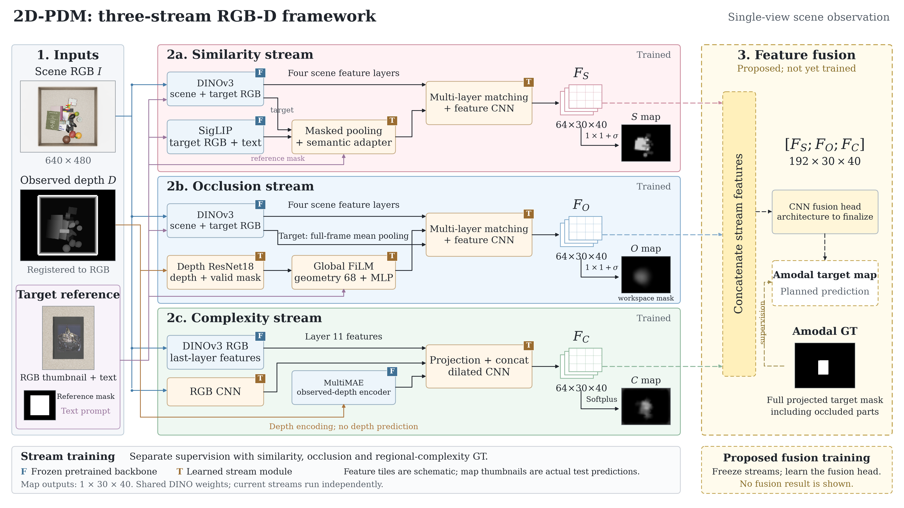
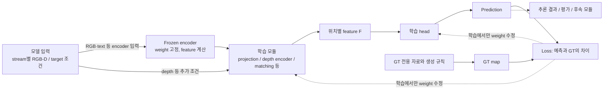
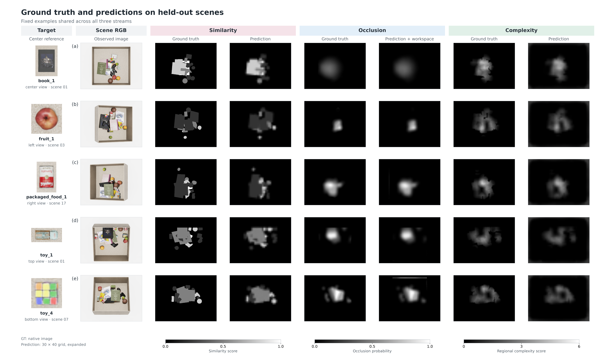

# 2D-PDM

### Zero-Shot Probability Distribution Mapping for Occluded Object Search in Cluttered Drawers

> **Research in progress**  
> RGB-D 관측으로 가려진 target object의 위치를 추론하고, 탐색 행동을 위한 pixel-wise probability map 생성

---

## 문서 안내

전체 연구 목표·입출력·stream 결합·현재 상태와 roadmap은 이 문서에 정리함. 각 stream의 구조·모듈·GT·결과·Q&A와 개발 이력은 아래 문서에서 확인함.

| 문서 | 내용 |
|---|---|
| [Similarity Stream](similarity_stream.md) | DINOv3·SigLIP, semantic adapter, MatchingBlock, GT·학습·zero-shot 결과 |
| [Occlusion Stream](occlusion_stream.md) | RGB-D·target geometry·FiLM, adaptive GT, full16·외부 target 평가 |
| [Complexity Stream](complexity_stream.md) | 현재 지역 GT·RGB-D 점수 모델·전체 데이터 학습·test 결과 |
| [Framework 작성 지침](framework_guide.md) | 웹 GPT용 읽기 순서·노드/화살표·배치 좌표·독립 GT/예측 이미지 |
| [Development Log](development_log.md) | Phase 1–42부터 새 데이터 수집·GT 보완·세 stream 전체 학습까지의 가정·사진·결과·판단 |
| [연구 문맥·근거 색인](agent.md) | 다른 agent와 외부 독자를 위한 문맥·상세 보고서·작업 지침 |

각 문서의 위·아래 이동 링크로 전체 개요와 다른 문서를 오갈 수 있음. 모든 문서는 저장소 최상위에 둠. Stream별 그림은 기존 `img/similarity/`, `img/occlusion/`, `img/complexity/` 경로를 유지하고, 공통 전체 구조도는 `img/overall_architecture.png`에 둠.

## Overview

서랍 속 더미에 가려진 target을 찾기 위해 **유사도·가림 가능성·장면 구조**를 위치가 보존된 세 feature stream으로 모델링함. 각 feature를 fusion과 decoder에서 결합하여 탐색 정책에 제공하는 것이 목표임.

| Stream | 목적 | 현재 확인한 범위 |
|---|---|---|
| Similarity | Target과 외형·의미가 관련된 가시 영역 찾기 | DINOv3+SigLIP 새 seed0 모델의 전체 학습·test 완료; 이전 모델의 zero-shot 결과와 구분 |
| Occlusion | 해당 target이 가려질 수 있는 위치 추론 | RGB-D·68-D geometry·global FiLM 새 모델의 전체 학습·coverage 내부 test 완료 |
| Complexity | 단일 RGB-D에서 여러 물체가 가까이 있는 영역의 점수 예측 | 지역 GT의 DINOv3+RGB CNN+MultiMAE 모델 구현·전체 학습·test 완료 |

**2026-10-26 최신 상태:** `261013_data` 240,000장과 S/O/C/fusion GT 각각 240,000장이 준비됐고, 보류했던 fusion 420장도 보완해 현재 보류 0장임. 공통 train192,000/validation24,000/test24,000으로 세 stream을 각각 새 학습했으며 **2026-10-24 04:18 KST 세 모델의 학습·test를 완료함**. Seed0·원래16개 target·clean 관측의 결과임. 최종 fusion GT는 보임 여부와 무관한 amodal target mask 한 종류로 준비됨. **통합 forward·fusion 학습·실제 탐색 평가는 미실행**임.

웹 GPT는 [Framework 작성 지침](framework_guide.md)의 순서대로 읽으면 현재 모델과 사용 가능한 이미지까지 연결할 수 있음. 기존 본문의 160장 GT·Phase42 count·미학습 상태는 날짜가 명시된 과거 이력임. 최신 정량 근거는 [전체 학습 요약 JSON](docs/stream_training_20261022_summary.json), 전체 흐름은 [연구 문맥](agent.md)을 따름.

### 전체 아키텍처



그림은 **학습·test가 완료된 세 stream과 계획 중인 feature fusion**을 나타냄. 분홍·파랑·초록 패널은 S/O/C를 구분하고, `F`는 frozen 사전학습 encoder, `T`는 학습 모듈임. 오른쪽 금색 점선은 아직 구현·학습하지 않은 fusion임. 작은 S/O/C map은 같은 실제 test 장면의 예측이고, amodal 썸네일은 **최종 감독용 GT 예시**임. Feature 타일은 tensor의 개념 표현임. Tensor는 `channel × 세로 × 가로`이며 batch `B`를 생략함. [PDF](img/overall_architecture.pdf)와 [SVG](img/overall_architecture.svg)도 제공함.

**① Scene 입력과 공통 backbone.** 현재 서랍의 RGB `3×480×640`을 DINOv3로 처리하면 각 위치가 768개 숫자로 표현된 `768×30×40` feature가 나옴. Similarity·Occlusion은 layer `2,5,8,11`의 feature를 사용하며, Complexity는 마지막 layer `11` 특징을 사용함. 그림의 각 DINO 블록은 같은 pretrained weight 규격이며 현재 모델은 stream별로 실행함. 동일 관측·가중치·전처리·정밀도를 맞춘 통합 구현에서 scene DINO 특징을 공유할 수 있음.

**② Similarity — 무엇을 찾을 것인가.** Target reference RGB와 mask에서 물체 영역을 잘라 DINO appearance `768-D`를 만들고, SigLIP은 reference 이미지와 이름·category를 `1152-D` 의미 조건으로 표현함. 학습 adapter가 이를 `768-D`로 변환하여 appearance에 더한 값이 검색 query임. 이 변환은 similarity-map GT를 통해 학습되며, DINO 자체의 weight는 고정됨. 각 scene 위치에서 **scene 768 + query 768 + cosine 1 = 1537채널**을 MatchingBlock이 64채널로 해석하고, 네 layer의 출력을 통합하여 `F_S`를 만듦.

**③ Occlusion — 그 target이 어디에 가려질 수 있는가.** Scene RGB feature와 함께 depth encoder가 만든 **현재 서랍의 depth feature**를 사용함. Target RGB는 물체의 appearance를 제공하고, reference mask는 크기·윤곽을 나타내는 `68-D` geometry를 제공함. 공유 MLP가 geometry에서 FiLM 계수를 계산하여 scene depth의 256채널 값을 조절함. 이렇게 조절한 depth 256채널과 scene 768·target 768·cosine 1을 합친 **1793채널**을 MatchingBlock에 전달하고, 네 layer를 통합하여 `F_O`를 만듦. Target이 달라지면 같은 모델에서 조절값이 달라지는 구조임.

**④ Complexity — 지역 점수 예측.** RGB CNN, DINOv3 layer11의 학습 projection, 관측 depth를 처리한 frozen MultiMAE의 학습 projection이 각각32채널을 제공함. 이96채널을 concat하고 dilation1/2/4의 CNN으로 `F_C:64×30×40`을 만듦. `1×1 Conv + softplus` head가 지역 점수 `1×30×40`을 예측하며, valid 내부의 양수·0 GT 그룹을 균형 있게 반영한 Smooth L1로 학습함. 감독값은 r48·가까운16픽셀의 물체별 거리 기여 합에서 가장 큰 기여를 뺀 값에16px 배경 감소 계수를 곱한 GT임. Native GT의16×16 평균인 정밀 `pooled30×40`을 사용함. Scene ID·mask는 GT 생성용이고 추론에는 제공하지 않음. MultiMAE는 **실제로 관측한 depth를 인코딩**함.

**⑤ Feature fusion과 최종 위치 map — 계획 단계.** 세 모델은 같은 `30×40` 위치에서 각각64채널의 학습 특징을 출력함. Head 이전 `F_S/F_O/F_C`를 같은 위치끼리 concat하면 `192×30×40`이 됨. 세1채널 예측 map은 stream별 감독·검사용 출력이며 이 계획의 fusion 입력과 구분함. 첫 통합안은 기존 stream을 고정하고 concat+CNN head만 amodal GT로 학습하는 방식임. Attention/Transformer의 필요성과 구체 head·loss·출력 해상도는 아직 비교·확정하지 않음. 같은 단일 관측에서 S는 RGB, O/C는 RGB-D를 사용하며 반복 crop/재분할 루프는 포함하지 않음.

세 stream의 개별 학습·test와 최종 GT 생성은 완료됐으나, 단일 통합 forward·공유 DINO cache·fusion/decoder/DRL의 학습·평가는 수행하지 않음. 현재 결과를 통합 모델의 성능이나 새 물체·실센서 성능으로 확대하지 않음. 이전 Phase42는 count GT 모델의 이력임.

각 stream 문서는 **목적·입출력 → 전체 구조 → 내부 모듈 → GT와 학습 → 핵심 설계 과정 → FAQ** 순서로 구성함. 단계별 가정·실패·비교 결과는 [Development Log](development_log.md), 실행 문맥과 상세 근거 색인은 [agent.md](agent.md)에 보존함.

### 입력과 감독 정보

**Complexity의 외부 입력은 단일 RGB와 depth임.** 관측으로 지역 점수와 중간 특징을 계산하도록 설계하며 GT 물체 ID·mask를 추론에 제공하지 않음. GT는 학습 감독과 출력 평가에만 사용함. 이 점수를 완전히 가려진 물체 수나 제거 난이도의 정답으로 해석하지 않음.

**Scene은 현재 서랍의 관측 영상**, **target reference는 찾을 물체를 별도로 촬영한 영상**임. Reference mask는 그 별도 영상에서 target이 차지하는 영역이며, scene 속 가려진 target의 위치를 알려 주는 mask가 아님.

| 자료 | 내용 | 용도 |
|---|---|---|
| Scene RGB | 현재 보이는 표면의 색·질감·외형 | 세 stream의 관측 입력 |
| Scene depth | 현재 보이는 표면의 깊이 | Occlusion·Complexity 관측 입력; 뒤에 가려진 표면은 직접 관측하지 못함 |
| Target RGB | 찾을 물체의 reference 영상 | Similarity·Occlusion의 target 조건 |
| Target mask | Reference 영상의 물체 윤곽 | Similarity crop/pooling, Occlusion geometry 계산 |
| Target text | Instance name·category 등의 설명 | Similarity의 SigLIP 의미 조건 |
| Empty depth / workspace | 빈 서랍 depth와 고정 camera의 관심 영역 | Occlusion의 GT·학습 영역·표시 후처리에 사용. 현재 Complexity에는 불필요 |
| Scene segmentation / target mesh | Pixel label / 시뮬레이션 형상 | Stream별 GT 생성에 사용. 지역 GT는 원본 가시 instance ID에서 계산하며 추론 입력과 구분 |
| GT map | 정의한 규칙에 따른 감독값 | Loss 계산·평가 |
| Prediction map | 관측 입력에서 계산한 예측값 | Stream별 GT 평가. 계획한 fusion에는 head 이전의 `F_S/F_O/F_C`를 전달 |

**GT(Ground Truth)는 이 연구에서 정의한 학습 목표**임. Simulation 정보로 GT를 생성하더라도 추론에는 각 stream이 요구하는 관측 입력만 사용함. GT 예측 오차와 GT 정의 자체의 타당성은 별도로 검증함.



| 구분 | Feature·prediction 계산 | Weight 갱신 |
|---|---|---|
| Frozen encoder | 입력마다 feature 계산; 반복 입력은 cache 재사용 가능 | 사전학습 weight 고정 |
| Trainable module — 학습 | Feature에서 prediction 계산 후 GT와 비교 | Loss의 gradient로 갱신 |
| Trainable module — 추론 | 저장된 weight로 새 입력의 prediction 계산 | 갱신하지 않음 |

### Feature와 Tensor 규격

DINOv3 ViT-B/16은 `480×640` scene을 **16×16px patch, 총 30×40개 위치**로 처리함. 각 위치의 출력은 768-D vector이며, transformer의 attention을 통해 다른 위치의 문맥도 반영됨. 따라서 patch 간격이 16px라는 사실과 feature가 참고하는 전체 영상 범위는 다름.

```text
Scene RGB                   DINOv3 dense feature
B × 3 × 480 × 640    →      B × 768 × 30 × 40
                                 │       │
                       위치별 표현 폭    공간 격자
```

`768-D`는 형상·색·질감·문맥을 분산해서 표현하는 vector의 길이임. 각 축에 특정 물체나 물리 속성이 하나씩 지정된 것은 아님. Scene feature는 위치를 유지하고, target feature는 pooling으로 대표 vector를 만들어 사용함.

| 표기 | 의미 | 현재 규격 |
|---|---|---|
| `B` | Batch size | 동시에 처리하는 sample 수 |
| `C` | Channel 수 | DINO feature 768, stream feature 64 |
| `H,W` | 입력 영상의 세로·가로 | `480×640` |
| `H_p,W_p` | Feature grid의 세로·가로 | `30×40` |
| `ℓ` 또는 `l` | Backbone block index, 0부터 시작 | Similarity·Occlusion은 `2,5,8,11`, Complexity는 `11` 사용 |
| `(u,v)` | 영상 또는 feature grid의 공간 위치 | 각 수식에서 좌표계 명시 |
| `D` in `768-D` | Dimension, vector 길이 | Depth와 구분 |
| `B` in `ViT-B` | Base 모델 크기 | Batch size와 구분 |

`B×768×30×40 → B×64×30×40`은 **공간 위치를 유지한 channel 변환**임. `30×40 → 480×640` 보간은 **공간 해상도 확대**이며, patch 내부의 새로운 세부 정보를 복원하는 연산은 아님.

### 주요 연산

| 연산·모듈 | 계산 | 프로젝트에서의 역할 |
|---|---|---|
| Encoder / backbone | 입력을 feature로 변환 | DINOv3의 외형·문맥, SigLIP의 image/text 의미, MultiMAE의 관측 depth 표현 |
| Head | Feature를 감독 목표의 출력으로 변환 | Stream feature에서 score map 생성 |
| Projection / Linear | `y=Wx+b` | SigLIP `1152→768`, geometry→FiLM 조건 등 학습 가능한 변환 |
| Pooling | 위치별 평균·가중 평균 | Target patch들을 대표 vector로 요약 |
| Broadcast | 같은 vector를 공간 위치마다 반복 | 모든 scene 위치에 동일한 target 조건 제공 |
| Concat | Channel 방향으로 이어 붙임 | 서로 다른 입력 단서를 별도 channel로 유지 |
| `1×1 Conv` | 같은 위치의 channel 혼합 | 공간 격자를 유지한 feature 변환 |
| `3×3 Conv` | 현재 위치와 주변 8개 위치의 channel 혼합 | 인접 patch의 공간 문맥 반영 |
| MLP | Linear와 비선형 함수의 연속 적용 | Geometry vector에서 FiLM 조절값 생성 |
| ReLU / GELU | 비선형 activation | 단순 선형 변환으로 표현하기 어려운 관계 학습 |
| GroupNorm | Sample별 channel group의 channel·공간 통계로 정규화 | 중간 feature의 수치 scale 조절 |
| Logit / sigmoid | `z → σ(z)=1/(1+exp(−z))` | 제한 없는 출력을 `0–1` 범위로 변환 |
| Complexity 출력 활성함수 | Softplus | 비음수 지역 점수 출력; 확률이나 정수 물체 수로 제한하지 않음 |
| Loss / gradient | GT와의 오차 / parameter별 미분 | Trainable module의 weight 갱신 |

**Projection.** Similarity의 `Linear(1152,768)`은 `W: 768×1152`, `b: 768`을 학습함. 출력의 각 성분은 1152개 입력 전체의 가중합으로 계산됨. 차원을 맞추는 동시에 similarity-map loss에 맞게 semantic 표현을 변환하는 역할임.

**Normalization.** 입력·vector·중간 feature의 정규화는 목적과 계산 대상이 다름.

| 종류 | 계산 대상 | 효과 |
|---|---|---|
| RGB normalization | Pixel 값에 `/255`, channel별 mean/std 적용 | 사전학습 encoder의 입력 scale에 맞춤 |
| L2 normalization | Vector를 자신의 길이로 나눔 | 방향을 유지하고 길이를 1로 맞춤. 예: `(3,4)→(0.6,0.8)` |
| GroupNorm | Sample 내부의 channel group과 공간 값 | 그룹 통계로 중간 feature를 정규화 |

**Cosine similarity.** L2-normalized vector의 내적으로 방향 유사도를 계산함. 예를 들어 `(1,0)`과 `(0.8,0.6)`의 cosine은 `0.8`임. 같은 좌표 표현에서 비교하는 연산이므로 서로 다른 encoder의 원본 vector에 바로 적용하지 않음. Similarity의 DINO–SigLIP 결합은 학습 가능한 projection을 먼저 거침.

**Broadcast / Concat / Addition.** Target 조건을 전달하는 서로 다른 연산임.

```text
Broadcast: q=[a,b]를 모든 scene 위치에 반복
Concat:    Concat([x,y,z], [a,b]) = [x,y,z,a,b]   → 길이 5
Addition:  [x,y] + [a,b]          = [x+a,y+b]     → 길이 2
```

Similarity는 appearance와 projected semantics를 **더해 query를 생성**하고, scene·query·cosine은 **concat하여 MatchingBlock에 전달**함. Concat 단계에서 서로 다른 공간 위치를 섞지는 않으며, 이후 `3×3 Conv`가 주변 patch를 함께 처리함.

### Stream 출력과 Fusion

각 stream의 **중간 feature `F`**와 **감독용 prediction map**을 구분함. 아래 S/O/C 모두 현재 학습된 모델의 출력 규격임. Fusion에는 head 이전의 64-channel 표현을 전달할 계획임.

| 출력 | Shape | 의미 |
|---|---|---|
| `F_S` | `B×64×30×40` | Similarity GT 예측을 위해 학습한 중간 표현 |
| `P_S` | `B×1×30×40` | Target과 scene의 정의된 관계 점수 |
| `F_O` | `B×64×30×40` | Occlusion GT 예측을 위해 학습한 중간 표현 |
| `P_O` | `B×1×30×40` | 해당 pixel을 덮는 후보 pose 중 가림 조건을 만족한 비율 GT의 예측 |
| `F_C` | `B×64×30×40` | 현재 지역 GT로 학습한 중간 표현 |
| `P_C` | `B×1×30×40` | r48 지역 점수의16×16 평균을 예측하는 softplus 한 채널 head |

**Stream마다 출력의 의미와 범위가 다름.** Similarity의 `0.8`은 관계 점수, Occlusion GT의 `0.8`은 후보 pose의 가림 조건 통과 비율임. Complexity 지역 GT의 `2.7`은 여러 물체의 거리 기여에서 계산한 연속 점수이며 개수나 확률이 아님. 어느 출력도 그대로 최종 target 존재 확률을 뜻하지 않으며 map 전체의 합도 1이 아님.

```text
# Implemented and trained independently
F_S, P_S = SimilarityStream(scene_RGB, target_reference, target_text)
F_O, P_O = OcclusionStream(scene_RGB, observed_depth, target_RGB, target_mask)
F_C, P_C = ComplexityStream(scene_RGB, observed_depth)
# Each F: B × 64 × 30 × 40; each P: B × 1 × 30 × 40

# Proposed; not implemented or trained
Z = Concat(F_S, F_O, F_C)                # B × 192 × 30 × 40
P_amodal = FusionCNN(Z)                 # final architecture/loss/resolution pending
```

**표시와 평가.** 공개 GT 이미지는 native640×480, 예측 원본은30×40임. 예측을 bilinear로 확대해 원본 RGB와 나란히 표시함. S/O는0–1, C는0–6 고정 grayscale이며 C의6은 표시 상한임. O 그림은 기존 고정 camera workspace mask를 확대 예측에 곱해 서랍 밖을0으로 표시함. Target 정답이나 GT coverage를 이용해 그림을 자르지 않음. Raw 예측·coverage 가중 평가 수치는 그대로 보존함.



5개 장면은 기존 driver가 지정한 target/view별 첫 test 행이며, 결과가 좋은 장면으로 다시 선정하지 않음. 각 GT·예측을 따로 사용할 수 있는 경로·그림 위치는 [Framework 작성 지침](framework_guide.md), 파일 목록·hash는 [이미지 manifest](img/framework_assets_20261026.json)에 정리함.

---

## From Shelf Search to Drawer Search

기존 선반 환경 연구를 비정형 drawer 환경으로 확장함.

> H. Jeon et al., *A study on deep reinforcement learning-based exploration intelligence for occluded object search*, Engineering Applications of Artificial Intelligence, 2026.

기존 연구는 similarity와 occlusion 기반 column-wise distribution을 사용함. 물체 유사도를 수동 정의한 category score에 의존했기 때문에, 학습에 없던 물체로 확장되는 zero-shot 탐색 성능을 확인하지 못했음.

주요 확장:

- 정규적인 shelf column에서 **비정형 cluttered drawer**로 확장
- Column-wise distribution에서 **pixel-wise 2D-PDM**으로 확장
- DINOv3의 dense appearance와 SigLIP의 language-aligned semantics 결합
- 학습하지 않은 target instance의 zero-shot 추론 확인: Similarity 정성 결과와 Occlusion 정량 평가
- Similarity와 Occlusion에 scene-level **Complexity stream** 추가

---

## Project Status

다음은 같은 새 데이터·새 seed0 모델의 test24,000장 결과임. Stream별 목표와 평가 영역이 달라 아래 숫자를 서로 비교하거나 accuracy로 바꾸지 않음.

| Stream | 완료 epoch / 선택 epoch | 현재 test 결과 | 평가 범위 |
|---|---|---|---|
| Similarity | 20 / 20 | MSE0.0000511075, MAE0.00135590; 양수GT 영역 MAE0.00764586 | pooled30×40 전체 및 양수영역 분리; center target 참조 |
| Occlusion | 12 / 12 | coverage 가중 MAE0.00438191, IoU@0.5 0.907542 | IoU는 valid patch 내 union이 있는21,612장 평균; 빈union2,388장은 제외 |
| Complexity | 20 / 19 | 전경지역 MAE0.103904, 상위20% 선택 손실0.0215941 | valid∩foreground_center에서 연속 지역 점수 비교 |

Complexity에서 GT 상위20% 위치의 평균 점수는2.653252, 모델이 선택한 위치의 실제GT 평균은2.631658임. 두 값의 차이가 선택 손실이며 낮을수록 좋음. 이는 선택한 픽셀이 몇% 정확하다는 뜻이 아님. 모든 수치는 같은 run의 [공개 수치 요약](docs/stream_training_20261022_summary.json)에 target별·camera별 결과와 함께 보존함.

| 구성 | 현재 완료 | 남은 범위 |
|---|---|---|
| 데이터·GT | 원래16target, 5뷰, 240,000관측 및 S/O/C/amodal GT 전량 준비; 보류0 | 새 물체·실센서 조건 |
| 개별 stream | Frozen pretrained encoder + 새 학습 모듈, 공통 split의 train/validation/test 완료 | 현재 checkpoint의 외부 target·조건 변화 검증 |
| 최종 감독값 | 보임 여부와 무관한 amodal target mask | Fusion head의 loss·해상도 설계 |
| Three-stream fusion | 특징 규격64×3=192와 concat+CNN 기준안 정리 | 통합 forward, 공유특징·지연, fusion 학습·비교 |
| 탐색 정책 | Target 검색을 위한 세 단서의 표현 | S+O 대비 S+O+C 효용, DRL·실환경 평가 |

이전 Similarity의 unseen-target 정성 동작과 Occlusion의 external target 정량 결과는 해당 이전 checkpoint의 완료 이력으로 유지함. 새 full-data 모델의 zero-shot 검증으로 옮겨 쓰지 않음. Phase38 미채택, GT 관계 회귀 공개 철회, SAM2 자동 영역 비교 미실행도 유지함.

### Core Files

공개 코드는 여러 연구 단계의 구현을 함께 보존함. **이번 게시의 최신 근거는 문서·그림·수치 JSON이며, 최신 full-data runner·regional head·checkpoint·원본 데이터는 LOCAL임.** 공개 clone만으로 10월24일 학습 전체를 바로 재현할 수 있다고 가정하지 않음. 공개/로컬 구분과 실제 역할은 [agent.md](agent.md)에 정리함.

| 기능 | 구현 또는 근거 | 공개 상태·역할 |
|---|---|---|
| 공통 RGB backbone | `backbone.py` | PUBLIC 기존 DINOv3 구현; 최신 run source hash와 구분 |
| Target 참조 | `target_utils.py`, `train_common.py` | PUBLIC 기존 crop/pooling/cache 도구 |
| Similarity 모델 | `similarity_model.py`, `train_similarity_v2.py` | PUBLIC 기존 구조; 최신 공통CSV runner는 별도 LOCAL |
| Occlusion 모델 | `occlusion_model.py`, `train_occlusion.py` | PUBLIC 기존 geometry/FiLM 구조; 최신 run과 source version 대조 필요 |
| 전체 GT 생성·보완 | `<DEV_ROOT>/experiments/full_stream_gt_20261016/`, `amodal_repair_20261016/` | LOCAL; 공통24만장과 보류420장 보완 |
| 현재 지역 Complexity | `<DEV_ROOT>/experiments/complexity_regional_validation_20261016/model.py` | LOCAL; DINO+RGB+MultiMAE,64feature,1채널softplus |
| Frozen depth 특징 | `<DEV_ROOT>/experiments/complexity_depth_pretrain_20261001/multimae_depth.py` | LOCAL; 현재 관측 depth 인코딩에 재사용 |
| 현재 세 stream 학습 | `<DEV_ROOT>/experiments/stream_training_20261022/` | LOCAL; 공통CSV adapter·fresh 모델·validation선택·GT없는 test추론 |
| 현재 수치 근거 | `docs/stream_training_20261022_summary.json` | PUBLIC; 원본 완료/평가 기록을 추출한 요약·hash |
| 그림 작성 입력 | `framework_guide.md`, `img/framework_assets_20261026.json` | PUBLIC; 독립 PNG·의미·배치 좌표·연결 규칙 |

공개 `complexity_cues.py`, `complexity_model.py`, `run_complexity_pilot.py`, `inference_complexity.py`의 density pilot 구조를 현재 지역 점수 모델로 대체 해석하지 않음. 최신 그림의 C는 지역 모델이며, 과거 count/density 수치와 분리함.

---

## Roadmap

- [x] 새 pose·instance 정보가 있는240,000관측 수집
- [x] S/O/C 및 단일 amodal fusion GT 전량 생성·보류420장 보완
- [x] 지역 Complexity의 새1채널 모델·loss 구현과 소규모RGB/RGB-D 비교
- [x] 공통 split의 세 stream 새 학습·validation 선택·test24,000장 평가
- [x] 웹 GPT용 독립GT/예측 이미지·상세 문맥·framework 배치 지침 공개
- [ ] 결과 검토·사용자 승인 후 동일 관측의 통합 forward와 concat+CNN fusion 구현
- [ ] DINO 특징 공유 시 수치 정합·전체 지연 확인
- [ ] 최종 amodal head의 loss·해상도 선정, S+O 대비 S+O+C 기여 확인
- [ ] 필요성이 확인될 때 attention/Transformer와 기준안 비교
- [ ] 현재 모델의 여러 새 target·실제 RGB-D 조건·탐색 효용 검증

Fusion 학습은 아직 승인·실행하지 않음. 다음 단계의 설계 항목과 완료된 개별 모델 결과는 구분해 기록함.

---

<!-- navigation:start -->
**전체 개요** · [Framework 작성 지침](framework_guide.md) · [Similarity](similarity_stream.md) · [Occlusion](occlusion_stream.md) · [Complexity](complexity_stream.md) · [Development Log](development_log.md) · [연구 문맥](agent.md)
<!-- navigation:end -->
