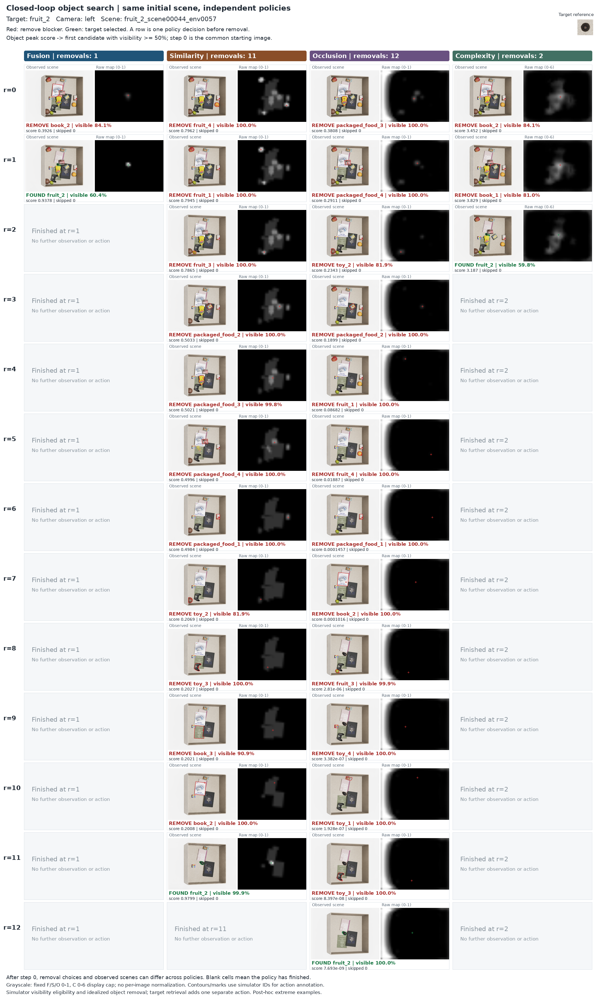
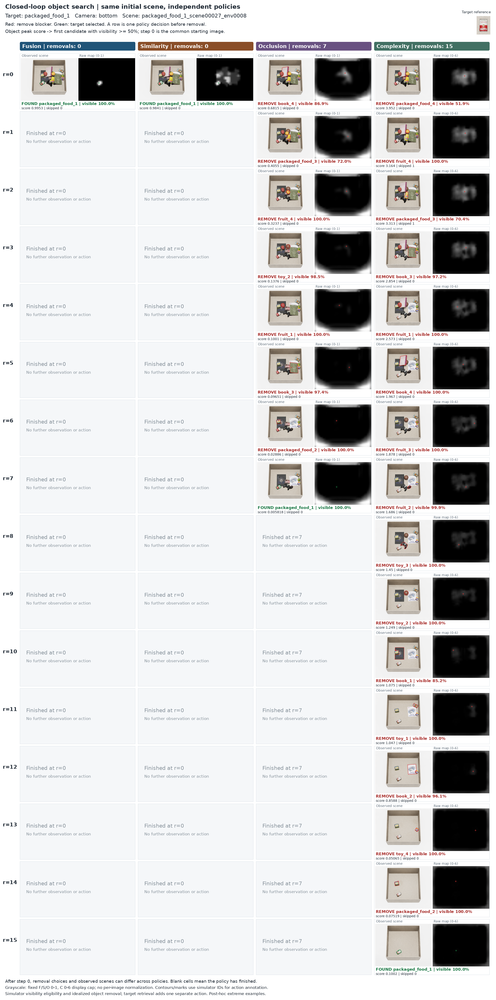
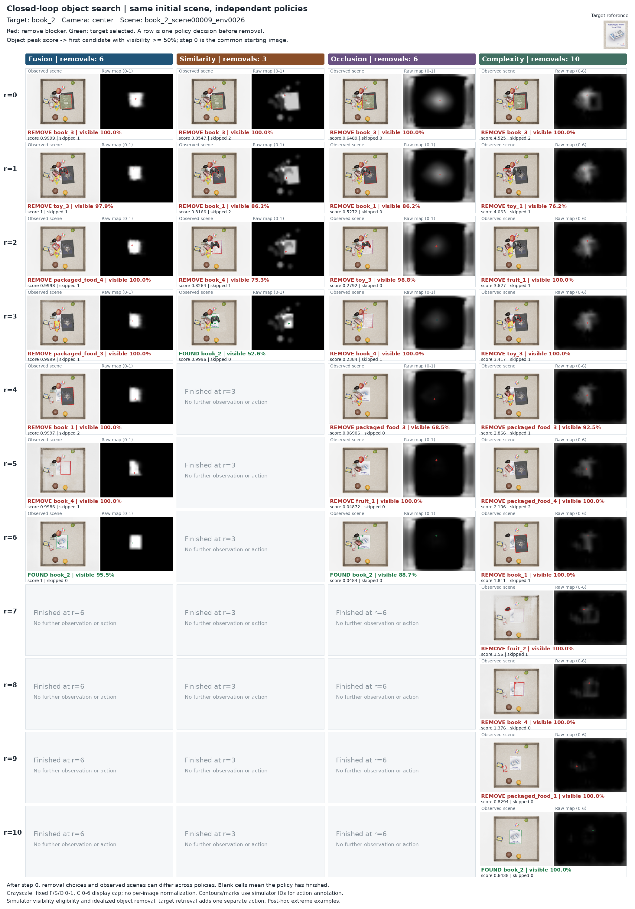

# 동일 장면·5개 camera의 물체 제거 탐색 — 2026-10-27

[전체 개요](README.md) · [Similarity](similarity_stream.md) · [Occlusion](occlusion_stream.md) · [Complexity](complexity_stream.md) · [Fusion](fusion_stream.md) · [Development Log](development_log.md) · [연구 문맥](agent.md#current-handoff-20261027)

## 결과와 비교 조건

기존 16개 물체의 별도 test 32장면을 5개 고정 camera에서 각각 독립적으로 평가하여 정책당 160회·총 640회 제거 탐색을 완료함. 한 episode의 입력은 해당 camera의 단일 RGB-D이며, 5뷰를 합친 입력이 아님. 네 정책 모두 155/160=96.875% 성공했고, 성공한 155조건의 집합도 정확히 동일함.

| 정책 | 성공/160 | 성공률 | 평균 제거 | 중앙값 | 초기 선택 성공 |
|---|---:|---:|---:|---:|---:|
| Fusion | 155 | 96.875% | **2.1290** | 2 | 36 |
| Similarity | 155 | 96.875% | **3.9355** | 3 | 36 |
| Occlusion | 155 | 96.875% | **7.7226** | 8 | 5 |
| Complexity | 155 | 96.875% | **6.0516** | 6 | 9 |

성공한 동일 155조건의 평균 제거 횟수는 Fusion 2.1290회로 Similarity 3.9355회보다 45.90% 적음. Fusion 평균은 5/5 camera에서 세 단독 stream보다 작음. S보다 적게/같게/많게 제거한 조건은 84/58/13임. 이 평균은 target 회수 동작을 제외하며 실패 회차를 성공으로 바꾸지 않음.

평균은 성공 회차에 한해 계산하며, 이번에는 성공 집합 155개가 네 정책에서 같아 동일 조건 비교임. 방해물 1개 제거=1step, 초기 target 선택=0step, target 회수는 별도 1행동임. 5뷰와 4정책은 같은 32개 물리 장면을 공유하므로 640개의 독립 scene로 해석하지 않음. 정적 test의 amodal 최고점 적중 85.06%·mIoU 50.92%와 이번 탐색 성공 96.875%는 정답·절차가 다른 지표임.

## 고정 행동 규칙

1. 기존 test에서 seed20261027로 각 target의 서로 다른 scene 2개와 env 1개를 선정함. 초기 target 가시율·예측·성공 여부로 scene을 골라 바꾸지 않음.
2. S20/O12/C19·SOC best10을 고정하고 동일 saved world pose·zero velocity를 복원함. RTX 렌더 잡음은 같은 camera의 사전에 정한 Fusion 환경 RGB를 네 정책의 초기 입력에 공유해 통제했고 원래 개별 렌더도 보존함. 초기 depth·physical labels는 exact 일치를 확인함.
3. 30×40 원시 지도를 bilinear 640×480로 확대한 뒤, 현재 보이는 물체마다 그 영역의 최대 점수를 계산함. 배경은 건너뛰고 동점은 행 우선임. C는 target과 무관한 연속 점수 baseline이며 모든 지도를 확률이라고 부르지 않음.
4. 높은 점수 순서로 현재 pose·camera의 가시 픽셀 / 물체만 단독 렌더링한 전체 투영 픽셀 ≥50%인지 확인함. 미달이면 다음 다른 물체를 검토함. 첫 적격 물체가 target이면 성공, 아니면 제거함. Target이 GT에서 보인다는 이유만으로 종료하지 않음.
5. 제거 후 진행 중인 각 환경에 600회의 실제 물리(120Hz, 5초 분량)를 적용하고, 물리를 멈춘 상태로 다시 관측·추론함. 최대 15개 방해물 제거 후 최종 target 선택까지 검사하고 적격 가시 물체가 없으면 실패임.

Worker에는 관측 RGB-D·target 참조만 전달함. 물체 ID·단독 mask는 시뮬레이터가 행동 위치를 물체에 연결하고 가시율·성공을 판정하는 정보임. 완전 정착·실제 파지 안정성을 확인한 것은 아님.

## Camera별 평균 제거

| Camera | Fusion | Similarity | Occlusion | Complexity |
|---|---:|---:|---:|---:|
| center | 2.1613 | 3.9032 | 8.1935 | 5.5161 |
| left | 2.1290 | 3.8387 | 7.7097 | 6.0323 |
| right | 2.0000 | 3.8387 | 7.6129 | 5.8710 |
| top | 2.2903 | 4.1290 | 7.2903 | 5.9032 |
| bottom | 2.0645 | 3.9677 | 7.8065 | 6.9355 |

각 camera·각 정책은 31/32 성공이며 실패 scene은 동일함.

## 단계별 비교 그림

| 비교 사례 | Target / camera | Fusion | Similarity | Occlusion | Complexity |
|---|---|---:|---:|---:|---:|
| Similarity 대비 차이가 가장 큰 사례 | fruit_2 / left | 1 | 11 | 12 | 2 |
| Complexity 대비 차이가 가장 큰 사례 | packaged_food_1 / bottom | 0 | 0 | 7 | 15 |
| Fusion이 Similarity보다 늦었던 사례 | book_2 / center | 6 | 3 | 6 | 10 |

사례는 결과를 본 뒤 차이가 큰 조건을 선택한 정성 예시임. 공통 성공 155조건에서 `S−F`, `C−F`, `F−S` 제거 차이를 각각 최대화하고 동점은 layout ID·camera의 사전순으로 선정함. 평균 성능이나 대표 표본으로 해석하지 않음. Fusion이 불리한 세 번째 사례도 같이 공개함.

각 그림의 열은 Fusion/S/O/C, 행 `r=0,1,...`은 방해물을 r개 제거한 뒤 다음 행동을 선택하는 관측임. 셀 왼쪽은 실제 RGB, 오른쪽은 실제 예측 지도임. 빨강은 제거할 방해물, 초록은 선택한 target이며 선택 물체명·가시율·점수·50% 미달로 건너뛴 후보 수도 표시함. 초기 RGB는 동일하고 각 정책의 선택 윤곽만 다름. 첫 제거 후에는 정책마다 남은 물체와 물리 상태가 달라지므로 같은 행의 scene이 서로 다를 수 있음. 종료 후 회색 셀은 추가 관측이 없다는 뜻임.

F/S/O 지도는 0–1, C는 0–6의 고정 grayscale로 표시하며 영상별 밝기 정규화는 없음. C의 6은 표시 상한으로 GT/점수의 최댓값이 아님. O도 실제 행동에 사용한 raw 출력을 표시하므로 이전 정적 그림의 workspace 표시 마스크를 곱하지 않았음. O 지도 바깥의 흰 반응도 보존하며 행동 선택에서는 배경을 건너뜀. 윤곽은 시뮬레이터 ID에 따른 행동 주석이며 모델 segmentation 출력이 아님. 지도 자체를 GT로 자르거나 정답을 예측으로 바꾸지 않음.

### 사례 1 — Similarity 대비 차이가 가장 큰 사례

Target은`fruit_2`, 원본 scene은`fruit_2_scene00044_env0057`, camera는`left`임. F/S/O/C 제거 횟수는1/11/12/2회임.

[확대 PDF](img/search_20261027_similarity_gap_fruit_2_left.pdf)

- **Fusion:** book_2 → fruit_2 발견
- **Similarity:** fruit_4 → fruit_1 → fruit_3 → packaged_food_2 → packaged_food_3 → packaged_food_4 → packaged_food_1 → toy_2 → toy_3 → book_3 → book_2 → fruit_2 발견
- **Occlusion:** packaged_food_3 → packaged_food_4 → toy_2 → packaged_food_2 → fruit_1 → fruit_4 → packaged_food_1 → book_2 → fruit_3 → toy_4 → toy_1 → toy_3 → fruit_2 발견
- **Complexity:** book_2 → book_1 → fruit_2 발견

### 사례 2 — Complexity 대비 차이가 가장 큰 사례

Target은`packaged_food_1`, 원본 scene은`packaged_food_1_scene00027_env0008`, camera는`bottom`임. F/S/O/C 제거 횟수는0/0/7/15회임.

[확대 PDF](img/search_20261027_complexity_gap_packaged_food_1_bottom.pdf)

- **Fusion:** packaged_food_1 발견
- **Similarity:** packaged_food_1 발견
- **Occlusion:** book_4 → packaged_food_3 → fruit_4 → toy_2 → fruit_1 → book_3 → packaged_food_2 → packaged_food_1 발견
- **Complexity:** packaged_food_4 → fruit_4 → packaged_food_3 → book_3 → fruit_1 → book_4 → fruit_3 → fruit_2 → toy_3 → toy_2 → book_1 → toy_1 → book_2 → toy_4 → packaged_food_2 → packaged_food_1 발견

### 사례 3 — Fusion이 Similarity보다 늦었던 사례

Target은`book_2`, 원본 scene은`book_2_scene00009_env0026`, camera는`center`임. F/S/O/C 제거 횟수는6/3/6/10회임.

[확대 PDF](img/search_20261027_fusion_slower_book_2_center.pdf)

- **Fusion:** book_3 → toy_3 → packaged_food_4 → packaged_food_3 → book_1 → book_4 → book_2 발견
- **Similarity:** book_3 → book_1 → book_4 → book_2 발견
- **Occlusion:** book_3 → book_1 → toy_3 → book_4 → packaged_food_3 → fruit_1 → book_2 발견
- **Complexity:** book_3 → toy_1 → fruit_1 → toy_3 → packaged_food_3 → packaged_food_4 → book_1 → fruit_2 → book_4 → packaged_food_1 → book_2 발견

## 실패·해석 범위

정책별 실패 5회는 모두 같은 원본 장면 `book_3_scene00005_env0031`의 5뷰임. 원본 pose·실제 mesh에서 책의 최고 높이 6.271mm가 서랍 바닥 윗면 10mm보다 낮고, 원본 5뷰의 target 가시 픽셀이 모두 0임. 원본 32장면을 교체하거나 제외하지 않았으며 이를 모델 실패로만 귀속하지 않음. 매몰 조건이 없는 31장면의 155/155 성공은 별도 설명용이며 전체 32장면 분모를 대체하지 않음.

32개 초기 target 실제 mesh의 완전 매몰 조건을 CPU로 검사한 결과 해당 조건은 1장면뿐임. 다른 31장면의 모든 물리적 정상성을 인증한 것은 아님. 원본 품질 근거는`docs/closed_loop_source_scene_quality_20261027.json`임.

기존 16종·고정 5camera·한 seed·clean 합성 조건의 비교이며 zero-shot/실제 robot 파지 성공률이 아님. Simulator 물체 ID·가시율을 행동 연결과 가능 조건에 사용하므로 배포 segmentation 오류를 포함한 검증이 아님. SOC와 각 단독 stream의 비교만으로 Complexity의 추가 효과를 분리할 수 없으며, SOC–SO 비교 해석이 별도로 필요함.

## 실행과 검산

최종실행5083.97초(84.73분)는초기화·모델추론·시뮬레이션·그림/집계를포함하고기존학습과GPU를공유했으므로독립배포속도가아님. 20환경의물리는병렬이며카메라촬영은순차임. 4011관측·5461단독가시율검사·3371제거를수행했음.

개발중발견한정적서랍바닥의위치복원순서와GPU접촉후보버퍼부족은수정후다시실행했으며이전오류실행은history에보존하고성능에포함하지않음. 최종본은정지→USD origin설정→reset→물체pose복원, 실제PhysX바닥20개조회, pair버퍼1,048,576 readback과PhysX오류즉시중단을적용함. 선정32장면·모델·가시율50%·제거후5초조건은유지함.

640episode·4011step원시지도순위·5461native가시율·1470skip·3371제거전이·160paired조건·카메라별분모를독립CPU감사했음. PhysX오류0, 모델/버퍼·원래40source·이번7Python source보존PASS임. 저장자료재계산감사이며새학습/재추론이아님.

## 공개 자료·웹 GPT 사용

- [반올림 전 결과·정의·출처JSON](docs/closed_loop_search_20261027.json), [640회결과CSV](docs/closed_loop_search_20261027_episodes.csv), [160동일조건비교CSV](docs/closed_loop_search_20261027_pairs.csv)
- [단계별선택·원본hash·그림좌표manifest](img/closed_loop_search_assets_20261027.json), [최종독립감사](docs/closed_loop_search_20261027_audit.json)

전체4011RGB-D/원시지도·640trajectory와코드/weights는LOCAL에보존함. 공개그림3개는총85관측을포함하며전체통계의대체자료가아님. LOCAL근거는`<DEV_ROOT>/outputs/closed_loop_search_20261027/full/`의`completion.json`, `physics_log_audit.json`, `report/`, `audit/`, `episodes/`임. 실행코드는`<DEV_ROOT>/experiments/closed_loop_search_20261027/`, 공개그림생성은`experiments/closed_loop_publication_20261027/`임.

웹GPT는이문서→`agent.md`최신절→`framework_guide.md`와그림manifest순서로읽음. Framework에서학습된amodal출력뒤에**시뮬레이터평가용고정행동규칙**을별도블록으로붙이고, 제거→물리진행→새RGB-D→모델의화살표를표시함. 가시율/ID를neural stream입력으로연결하지않음. 네정책비교그림은네가지독립episode이며네출력지도를추가fusion한구조가아님. 그림좌표는manifest의`rgb_panel_xywh`/`map_panel_xywh`를사용할수있음.

[전체 개요](README.md) · [Similarity](similarity_stream.md) · [Occlusion](occlusion_stream.md) · [Complexity](complexity_stream.md) · [Fusion](fusion_stream.md) · [Development Log](development_log.md) · [연구 문맥](agent.md#current-handoff-20261027)
