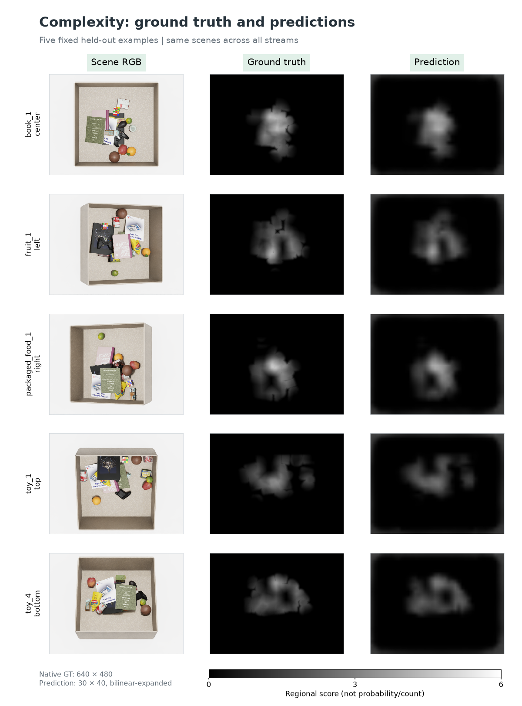
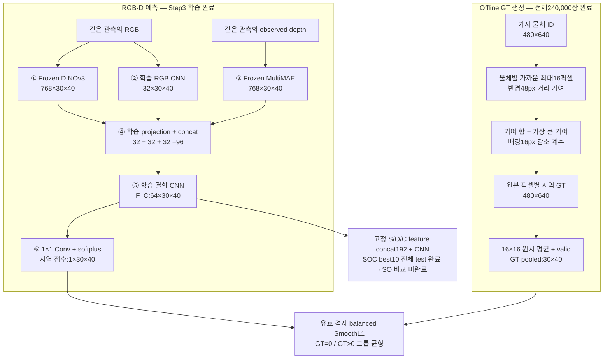
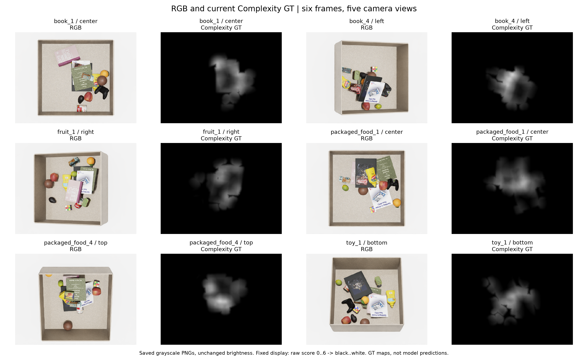

# Complexity Stream

<!-- navigation:start -->
[전체 개요](README.md) · [Similarity](similarity_stream.md) · [Occlusion](occlusion_stream.md) · **Complexity** · [Fusion](fusion_stream.md) · [Development Log](development_log.md) · [연구 문맥](agent.md) · [Framework guide](framework_guide.md)
<!-- navigation:end -->

> **현재 방법 — 2026-10-27 정리:** 반경48px·물체별 가까운16픽셀·배경 감소16px의 지역 GT와 단일 RGB-D 1채널 C19 모델을 사용함. 전체240,000장 GT·기존16종 test24,000장 평가와 외부 asset1종이 포함된80장 평가를 완료함. 외부 공통 상위20% 영역 일치율은90.84907%임. 고정 `F_C`는 실제 SOC Fusion에 연결했으며 SOC의 전체 test 24,000장 평가를 완료함. SO 비교는 미완료임. 이전 Phase42 count 모델과 구분함.

## 현재 모델의 외부 물체 평가와 Fusion 연결 — 2026-10-27

현재 checkpoint를 추가 학습하지 않고 `packaged_food_5/World1`이 포함된 기존 외부80장에 적용함. 구성은 **학습에서 제외한 asset1종 + 기존 asset15종, 16개 배치 × 5 camera**임. 외부 물체는80장 모두 일부 이상 보이며 완전 가림은0장임. Packaged-food category 자체는 학습에 포함됐으며 새로운 category·다수 외부 asset·실센서 일반화로 확대하지 않음. 같은 배치의5뷰는 상관된 관측임. 여기서 미학습은 각 stream의 학습 asset 목록 기준이며 사전학습 backbone의 모든 원자료에도 없었다는 뜻은 아님.

공통 지표는30×40 격자의 **C valid ∩ 전경 중심 ∩ O coverage≥0.5** 안에서, 각 stream의 GT 상위20%와 예측 상위20%가 얼마나 일치하는지 계산한 값임. 후보 격자 수의20%를 올림해 선택하며 GT 경계 동점은 동등한 정답으로, 예측 경계 동점은 균등한 분할 가중치로 처리함. 이미지별 비율을 같은 비중으로 평균하며 이번80장은 빈 평가영역·상수GT 제외가 모두0장임. GT로 정한 평가영역은 점수 계산에만 사용하고 추론 예측을 마스킹하지 않음. **픽셀 accuracy·target 발견률·서로 다른 과제의 동일 난이도를 뜻하지 않음.**

상위 20%는 높은 영역을 고르는 능력의 보조 진단 범위이며, 20%가 최적이라는 비교 실험 근거는 없음. 아래 전체 지도 오차는 이 선택 비율을 사용하지 않음.

| 현재 C19의 외부80장 지표 | 결과 |
|---|---:|
| 공통 평가영역의 상위20% 영역 일치율 | **90.84907%** |
| 같은 camera별 평가 이미지 | 16장씩, 총80장 |

C19는 target reference를 받지 않고 같은 관측의 RGB-D에서 지역 점수를 예측함. 이전 외부 장면의 가시 physical ID로 **현재 r48·가까운16픽셀·배경16px 감소 정의**의 GT를 새로 계산해 비교했으며, Phase41/42의3scale count GT나 checkpoint를 현재 지역 모델 결과로 사용하지 않음. 추가 학습·새 scene 수집 없이 저장된 현재 C19 예측으로 평가함.

앞서 수행한 C 단독 외부 검사의 평가영역과 이번 세 stream 공통 평가영역은 다름. 표시를 두 자리로 반올림하면 모두90.85%에 가깝더라도 같은 수치의 재사용으로 해석하지 않음. 이번 값은 공통 영역에서 다시 계산한 결과임. 수치와 출처는 [현재 외부 평가 JSON](docs/stream_external_evaluation_20261027.json)을 따름. 새 물체1종이 포함된 합성 더미에서의 확인이며 실센서·완전 가림 수·최종 탐색 효용을 검증한 것은 아님.

### 외부 80장의 전체 유효영역 오차

저장된 동일 예측을 재사용하여 높은 일부 영역만 고르지 않고, 각 stream의 전체 유효영역에서 GT 총량 대비 절대오차를 계산함. 현재 Complexity의 결과는 **9.33956%**임.

```text
상대 절대오차(%) = 100 × Σ(w × |예측 − GT|) / Σ(w × GT)
```

합계는 외부 80장의 유효 격자를 모두 합친 값이며 이미지별 오차 %의 평균이 아님. Complexity는 배경을 포함한 전체 valid 격자에서 `w=1`로 계산함. 48px 이웃이 영상 밖으로 나가는 경계는 제외하고, 기존 전경 중심 조건은 적용하지 않음. 유효영역에서 GT가 0인 곳의 잘못된 예측도 분자에 포함함. S는 전체 격자, O는 coverage 가중 영역, C는 전체 valid 영역을 사용하므로 세 stream의 평가영역은 같지 않음.

**낮을수록 좋은 오차 비율이며 accuracy·적중률이 아님.** 100%를 넘을 수 있고 `100 − 오차 %`를 정확도로 쓰지 않음. 서로 다른 GT·영역의 숫자 크기만으로 stream의 우열을 정하지 않음. 새 추론·학습 없이 계산한 지표이며 식·분모·반올림 전 값은 [전체 지도 오차 JSON](docs/stream_full_map_error_20261027.json)을 따름.

### 실제 Fusion 예측과 같은 장면의 비교

[공통 5장 전체 비교](img/stream_fusion_gt_prediction_comparison_20261027.png)와 [전체·장면별 확대 PDF](img/stream_fusion_gt_prediction_comparison_20261027.pdf)에 S/O/C GT·실제 예측 및 amodal GT·실제 SOC 예측을 함께 제시함. [Fusion 문서](fusion_stream.md)에서 개별 장면과 연결 구조를 확인할 수 있음. 이 그림은 **기존16종의 고정 test5장**이며 위 외부80장의 정량 결과와 다른 자료임. 예측 품질을 보고 고른 사례가 아니며 기존10월26일 비교의 같은5장을 유지함.

SOC는 13 epochs에서 조기종료하고 validation best 10을 선택함. 기존 그림은 이 best 10의 실제 예측이며, 예시를 생성한 당시 전체 test 평가가 미완료였다는 표기는 시점 기록임. 이후 같은 선택 모델의 전체 test 24,000장 평가를 완료함. GT는 native 640×480, 예측은 실제 30×40 float32 출력을 bilinear 확대한 표시임. S/O/Fusion 0–1·C 0–6 고정 회색조를 유지하며 영상별 min–max를 적용하지 않음. O 표시만 기존 고정 camera workspace를 곱하고 S/C/Fusion 예측에는 GT·visible·workspace mask를 곱하지 않음.

### SOC 전체 test와 외부 target 진단

원래 16종의 새 scene test 24,000장에서 SOC best 10의 **최고점 amodal 적중률은 85.058333%, amodal mIoU는 50.920985%**임. Amodal은 가려진 부분까지 포함한 target 전체 투영 mask임. 최고점 한 점이 이 mask 안에 있는지와, 예측 mask 전체가 GT와 얼마나 겹치는지는 서로 다른 지표임. 예측은 GT·workspace 마스킹 없이 native 해상도로 bilinear 확대하며, IoU는 확률 0.5 이상 영역과 GT를 비교함.

일부라도 보이는 15,235장에서는 **실제 보이는 부분의 최고점 적중률이 41.450607%**임. 완전 가림 8,755장의 amodal 최고점 적중률은 **70.359794%**임. Amodal 영역이 없는 10장도 전체 분모에 포함하며 두 지표가 0임. 이는 학습 영상의 정확도·실제 탐색/파지 성공률이 아니며, 같은 scene의 5뷰도 독립 시행으로 해석하지 않음. 선택된 모델의 평가이고 test로 checkpoint를 재선택하거나 튜닝하지 않음. 상세 분모·집계는 [SOC test 평가 JSON](docs/fusion_test_evaluation_20261027.json)을 따름.

별도 `packaged_food_5` 외부 80장에서는 SOC 원시 최고점의 **가시 target 적중이 0/80=0%**임. 외부 amodal GT 평가는 수행하지 않았으므로 이 결과를 amodal 위치 실패율 100%나 IoU 0으로 해석하지 않음. 단일 새 물체의 가시 부분을 선택하는 약점이며 원인·해결은 미확정임. [외부 Fusion 진단 JSON](docs/fusion_external_diagnostic_20261027.json)에 근거를 보존함. SO 학습·평가 및 SOC–SO 비교는 아직 미완료이므로 Complexity 추가 효과는 확정하지 않음.

## 최신 전체 학습·평가 — 2026-10-24 완료

2026-10-24 04:18 KST에 세 stream의 개별 학습과 각 test 24,000장 평가가 모두 완료됨. 이 문서의 현재 모델은 `261013_data`에서 새로 학습한 Step 3 모델임. 과거 실험의 checkpoint·외부 물체 결과는 이력으로 구분함. 전체 연결과 그림 작성 규칙은 [Framework guide](framework_guide.md), 재개 상태와 공개 범위는 [연구 문맥](agent.md)을 따름. **개별 stream 및 SOC best 10의 전체 test 평가는 완료됨. SO 비교 학습·평가와 외부 amodal 평가는 위 2026-10-27 상태를 따름.**

### 현재 데이터와 공통 학습 절차

- 원래 book·fruit·packaged_food·toy 각 4개, 총 16개 target을 유지함. `packaged_food_5`·`World1`은 이 전체 수집·학습·공통 test에 포함하지 않음. 위10월27일 외부 평가는 별도80장임.
- Scene은 16 targets × 50 scene IDs × 60 environments × 5 cameras = 240,000장임. 공통 CSV의 train 192,000 / validation 24,000 / test 24,000장을 전부 사용함.
- `(target, scene)` 단위로 40/5/5 scene IDs를 나누고 같은 scene의 모든 환경·5뷰를 같은 split에 둠. 각 추론 입력은 한 시점의 관측이며 5뷰를 동시에 넣지 않음. 같은 배치의 camera view를 독립 실험 반복으로 해석하지 않음.
- 사전학습 backbone은 frozen `eval/no_grad`, 뒤쪽 학습 층은 seed 0에서 새 초기화함. 기존 stream checkpoint를 이어 학습한 결과가 아님. Clean 관측, batch 16, float32, AdamW, gradient clipping 5를 사용함.
- 매 epoch 전체 train·validation을 처리하고 validation loss의 실제 최솟값을 best로 저장함. 최소 3 epochs 이후 3회 연속 미개선이면 종료하도록 고정했으며, 이번 세 모델은 각각 최대 epoch까지 실행함.
- Test GT는 학습·checkpoint 선택에 사용하지 않음. 선택된 best로 **RGB-D/reference만 읽어 모든 test 예측을 먼저 저장**한 뒤 별도 evaluator가 GT를 읽어 점수를 계산함. Target/reference 조건의 차이는 각 stream 설명을 따름.

### 실제 모델과 학습 대상

```text
Scene RGB → ImageNet 정규화 → frozen DINOv3 마지막 layer11 → 768×30×40
          → RGB 세부 CNN(PixelUnshuffle4 + stride2 Conv 두 번) → 32×30×40
Scene observed depth → 영상별 정규화 → frozen MultiMAE depth adapter·encoder → 768×30×40
DINO768 → channel L2 + 학습 1×1 projection32 ─┐
RGB 세부32 ──────────────────────────────────┼→ concat96
MultiMAE768 → channel L2 + 학습 1×1 projection32 ─┘
concat96 → 3×3 Conv96→64→64→64, dilation1/2/4 → F_C:64×30×40
F_C → 1×1 Conv64→1 + softplus → C_hat:1×30×40
```

DINO·MultiMAE의 사전학습 weight는 고정하고 RGB CNN·두 projection·결합 CNN·1채널 head를 새 학습함. DINO에는 RGB만, MultiMAE에는 **실제로 관측한 depth**만 넣음. RGB에서 depth를 추정하는 모델이 아님. Target RGB·text·geometry를 조건으로 넣지 않으며 scene ID·segmentation·pose·GT도 forward 입력이 아님. Softplus 출력은 음수가 아닌 **연속 지역 점수**이며 물체 수나 0–1 확률이 아님.

현재 Fusion은 고정한 S20/O12/C19의 head 이전 `64×30×40` feature를 concat한 `192×30×40`을 별도 CNN에 입력함. **최종 1채널 예측 map의 concat이 아님.** 같은 scene RGB의 DINO layer2/5/8/11을 한 번 계산해 S/O에 공유하고 C에는 layer11을 제공하는 통합 forward를 구현함. 세 stream 전체와 backbone은 `eval/no_grad`로 고정하고 Fusion CNN만 학습함. SOC는 13 epochs 후 종료하여 best 10을 선택했고, 실제 5장 예시와 전체 test 24,000장 평가를 완료함. SO 비교 학습·평가는 미완료이며 상세는 [Fusion](fusion_stream.md)을 따름.

### 전체 test 결과와 해석

| 항목 | 결과 |
|---|---:|
| 학습 완료 / 선택 epoch | 20 / 19 |
| Validation balanced SmoothL1 loss | 0.00423854444 |
| Test foreground-center 유효 격자 MAE | 0.1039041092 |
| Test 상위 20% 선택 regret | 0.02159411734 |
| Test 전체 유효 격자 MAE | 0.02600665093 |
| Test 정답 0 격자의 평균 예측 | 0.00156513094 |

MAE는 이미지별로 계산한 뒤 24,000장을 같은 비중으로 평균함. 주 MAE는 `valid=True`이고 해당 16×16 patch의 중심이 가시 물체인 위치만 사용함. 상위20% regret은 같은 후보 위치에서 GT가 가장 높은 20%의 평균 점수와, **예측으로 고른 20% 위치의 실제 GT 평균** 차이임. 두 평균은 각각 `2.6532519778`, `2.6316578604`이며 regret은 낮을수록 좋음. 정확도 백분율이나 target 발견률이 아님.

전체 유효 격자에는 0인 배경이 많이 포함되므로 전체 MAE만으로 물체 주변 예측 품질을 설명하지 않음. Softplus 예측은 GT가 0인 곳에도 작은 양수를 남길 수 있어 그 평균을 별도로 제시함. 이 점수는 이전 Phase 42의 지역 count와 정의·단위가 다르며 당시 count MAE와 개선율을 계산하지 않음. 이번 전체 데이터 학습에는 RGB-only 대조 실험이 없으므로 MultiMAE의 독립적인 기여나 실제 탐색 효용을 새로 입증한 결과는 아님.

### 동일한 test 5장: 원본 GT와 실제 예측



세 stream 모두 동일한 아래 5장을 사용함. 지정한 target/camera 조합의 공통 test CSV 첫 행을 선택했으며 예측이 잘 맞는 순서로 고른 사례가 아님. 그림은 전체 24,000장 평가의 예시이고 별도 성능 지표를 만들지 않음.

**GT는 native 640×480 PNG, 예측은 저장된 float32 `30×40` 출력을 640×480으로 bilinear 확대한 표시임.** 큰 그림이 원본 픽셀 해상도로 직접 추론했다는 뜻은 아님. 밝기는 모든 장면에서 `0–6 지역 점수`로 고정하고 영상별 min–max 정규화를 하지 않음. 예측에 target GT·scene segmentation·workspace mask를 곱하지 않음.

| Target / frame | GT 원본 PNG | 예측 표시 PNG |
|---|---|---|
| `book_1/scene00001_env0000_center` | [GT](img/complexity/complexity_20261026_book_1_scene00001_env0000_center_gt.png) | [Prediction](img/complexity/complexity_20261026_book_1_scene00001_env0000_center_prediction.png) |
| `fruit_1/scene00003_env0000_left` | [GT](img/complexity/complexity_20261026_fruit_1_scene00003_env0000_left_gt.png) | [Prediction](img/complexity/complexity_20261026_fruit_1_scene00003_env0000_left_prediction.png) |
| `packaged_food_1/scene00017_env0000_right` | [GT](img/complexity/complexity_20261026_packaged_food_1_scene00017_env0000_right_gt.png) | [Prediction](img/complexity/complexity_20261026_packaged_food_1_scene00017_env0000_right_prediction.png) |
| `toy_1/scene00001_env0000_top` | [GT](img/complexity/complexity_20261026_toy_1_scene00001_env0000_top_gt.png) | [Prediction](img/complexity/complexity_20261026_toy_1_scene00001_env0000_top_prediction.png) |
| `toy_4/scene00007_env0000_bottom` | [GT](img/complexity/complexity_20261026_toy_4_scene00007_env0000_bottom_gt.png) | [Prediction](img/complexity/complexity_20261026_toy_4_scene00007_env0000_bottom_prediction.png) |

Target thumbnail은 별도 center reference의 표시용 crop임. 실제 모델 전처리는 아래 설명을 따르며, thumbnail의 크기를 모델 입력 크기로 해석하지 않음.

### 현재 산출물과 재현 경로

공개된 [전체 학습·평가 JSON](docs/stream_training_20261022_summary.json)에서 반올림 전 수치·target별·camera별 집계와 checkpoint hash를 확인할 수 있음.

`<DEV_ROOT>`는 실제 개발 폴더 `2D-PDM_DINOv3`를 뜻함. 아래는 개발 폴더 기준 LOCAL 경로이며 공개 Git clone의 옛 실행 코드와 구분함.

| 자료 | 실제 경로 |
|---|---|
| 고정 학습 설정·source hash | `outputs/stream_training_20261022/step3/protocol.json` |
| 학습·추론 adapter | `experiments/stream_training_20261022/training_complexity.py` |
| 공통 runner·test 관측 loader·평가 | `experiments/stream_training_20261022/{train,training_observations,training_metrics}.py` |
| 현재 선택 모델·명세 | `outputs/stream_training_20261022/step3/runs/complexity/{best.pt,model_spec.json}` |
| 학습·완료 기록 | 같은 run의 `history.json`, `completion.json` |
| GT 없이 저장한 test 예측 | 같은 run의 `test_predictions.npy`, `prediction_complete.json` |
| 전체·target별·camera별 평가 | 같은 run의 `evaluation/{evaluation.json,per_image.csv}` |
| 현재 외부80장 공통 평가 | `outputs/streams_external_check_20261027/evaluation/{evaluation.json,per_image.csv}` |
| 외부80장 전체 유효영역 오차 | `outputs/streams_full_map_error_20261027/evaluation.json` |
| SOC 전체 test·외부 가시 부분 평가 | `outputs/fusion_soc_test_20261027/evaluation/evaluation.json`, `outputs/fusion_external_check_20261027/evaluation/evaluation.json` |
| 실제 Fusion5장 예측·그림 출처 | `outputs/fusion_examples_20261027/{prediction_complete.json,comparison_provenance.json}` |
| 공통 분할 | dataset `261013_data/_gt/full_stream_gt_20261016/common_{train,val,test}.csv` |

현재 best checkpoint SHA256은 `fb32dad4bfe2948477257a06105c56f2b1f0963467329aab2d09b70e3e643385`임. 공개 문서는 구조·설정·결과·선택 예시를 제공하며 전체 데이터·weight를 공개 clone에 복사한 것은 아님. 이번 게시는 개별 stream의 외부 평가·전체 지도 오차, SOC 전체 test와 외부 가시 부분 진단 및 저장된 실제 예시를 정리한 것임. 게시 과정에서 모델을 재학습하거나 원본 GT를 수정하지 않음.


## 1. 목적과 입출력

Complexity는 **현재 영상에서 여러 물체가 가까이 모인 위치**에 높은 점수를 주려는 stream임. Similarity가 target과 관련된 외형을, Occlusion이 target의 가림 가능성을 다루는 데 더해, scene 자체의 지역적인 혼잡 정도를 제공함. Target 사진·이름을 조건으로 넣지 않음.

한 물체만 가까운 곳은 0이며, 여러 물체의 가시 부분이 함께 가까워지면 점수가 커지도록 정의함. 물체 윤곽에서 값이 갑자기 끊기지 않도록 물체 밖의 좁은 영역에도 부드럽게 감소하는 값을 허용함. 예를 들어 책 한 권의 넓은 표면보다 책·과일·상자의 가시 부분이 가까이 모인 위치를 높게 표현하려는 목적임. 어떤 장면에서도 사람의 판단과 일치한다고 확인한 것은 아님.

이 점수는 영상상의 밀집 정도임. 완전히 가려진 물체 수·실제 3D 접촉·제거 난이도·target 존재 확률까지 나타내지는 않음. 최종 탐색에 도움이 되는지는 다른 stream과 결합한 뒤 별도로 검증해야 함.

### 현재 저장한 GT

| 항목 | 규격 | 의미 |
|---|---|---|
| 원본 물체 ID | `480×640` | 시뮬레이터의 가시 physical instance ID. GT 생성에만 사용함 |
| 생성 중 원시 지역 점수 `C` | float32 `[480,640]` | 모든 원본 픽셀에서 계산하며 PNG와 pooled를 만드는 기준임 |
| 학습 GT `C_pool` | NPZ `pooled: float32 [30,40]` | 원시 C의 각16×16 영역 평균. PNG에서 복원한 값이 아님 |
| 유효 영역 | NPZ `valid: bool [30,40]` | 반경이 영상 밖으로 나가는 격자를 loss·평가에서 제외함 |
| 평가 전경 위치 | NPZ `foreground_center: bool [30,40]` | patch 중심이 가시 물체인지 표시함. 모델 입력이 아님 |
| 회색조 PNG | uint8 `[480,640]` | 원시 C를 공통0–6 범위로 표시함 |

현재 전체 데이터의 compact NPZ에는 `pooled/valid/foreground_center`와 계산 설정을 저장함. `full [480,640]` 배열을240,000개 NPZ에 중복 저장하지 않음. 이전 소규모 검토에 저장한 full 배열은 이력으로 보존함. Native PNG는 원본 픽셀별 계산 결과의 표시이며30×40 지도를 확대해 만든 GT가 아님.

### 현재 RGB-D 예측 입출력

| 항목 | 실제 규격 | 역할 |
|---|---|---|
| Scene RGB | `B×3×480×640` | 한 camera 관측의 색·무늬·윤곽 |
| Scene depth | `B×1×480×640` | 같은 관측에 대응하는 표면 깊이 |
| 중간 표현 `F_C` | `B×64×30×40` | 현재 지역 점수 회귀에서 학습한 위치별 특징 |
| 예측 지도 `C_hat` | `B×1×30×40` | 같은 위치의 평균 지역 GT 하나를 회귀함 |

`B`는 한 번에 처리하는 관측 수임. 각 관측의 외부 입력은 **단일 RGB-D**이며 여러 camera의 영상을 동시에 넣지 않음. 원본 ID·GT mask·pose·물체 수는 입력하지 않음. 1채널 head와 loss를 구현하여 전체 데이터 학습을 완료했으며, 이전3채널 count checkpoint를 새 GT 예측 모델로 이름만 바꾼 것이 아님.

## 2. 전체 구조

GT는 시뮬레이터 ID로 미리 계산하고 모델은 RGB-D에서 그 점수를 예측하도록 학습함. **GT 생성과 모델 추론은 별도 경로임.** GT·예측·loss 경로의 개별 학습을 완료했으며, 현재는 고정한 중간 feature를 실제 Fusion CNN에 연결함. 아래 GT·loss는 Complexity 사전학습 경로이고 Fusion 학습은 별도 amodal GT를 사용함.



크기는 `채널×세로×가로`이며 batch 축을 생략함. `64×30×40`은 위치마다 숫자64개가 남는 특징으로 물체64개라는 뜻이 아님. `1×30×40`은 위치마다 연속 지역 점수 하나를 출력함.

모델이 먼저 segmentation을 만들고 물체별 거리 계산을 반복하는 흐름은 아님. 거리 집계는 offline GT 생성에만 사용하며 추론은 RGB-D 특징과 head를 정해진 순서로 한 번 처리함. 세 stream의 연산시간이 같다는 뜻은 아님. 현재 통합 forward는 같은 scene DINO를 공유하며, 장치별 배포 지연과 최종 탐색 행동 비용은 별도로 확인해야 함.

## 3. 내부 모듈과 역할 — 현재 학습 구조

기존 특징 추출 경로를 사용하되 새 지역 GT에 맞는1채널 head를 포함하여 trainable layer를 새 초기화함. 아래는 실제 구조와 의도이며 각 모듈의 독립적인 기여를 이번 학습에서 분리 측정했다는 뜻은 아님.

### ① DINOv3: RGB의 외형과 문맥

Frozen DINOv3 ViT-B/16의 마지막 block인0-based layer11에서 `768×30×40`을 받음. Scene RGB는 ImageNet mean/std로 정규화함. 원본480×640의 patch 간격은16px이며 attention으로 주변 문맥도 포함함. Channel 하나를 물체 하나로 해석하지 않음. DINO에는 depth·ID를 넣지 않고, RGB 외형을 지역 점수에 연결하는 뒤쪽 layer만 학습함.

### ② RGB 세부 CNN: 원본 영상의 작은 변화

같은 RGB를 `[-1,1]`로 정규화하여4×4 PixelUnshuffle로 처리함. RGB3채널의 공간 값을48채널로 재배열한 뒤 다음 구조를 적용함.

```text
3×480×640 → PixelUnshuffle4 → 48×120×160
 → 1×1 Conv48→32 → 3×3 stride2 Conv32→32:60×80
 → 3×3 stride2 Conv32→32:30×40
```

정규화·GELU를 포함한 작은 CNN으로 색·무늬·윤곽을 제공함. 물체별 mask를 출력하거나 명시적으로 물체 수를 세지 않음.

### ③ MultiMAE: 관측 depth의 공간 패턴

MultiMAE에는 RGB에서 생성한 깊이가 아닌 **scene 센서의 실제 metric depth**를 넣음. 유효한 양수·유한 depth의 하위·상위10%를 제외해 영상별 평균·분산을 계산하고 정규화하며, 무효 위치는 평균 깊이로 채움. 분산 안정화 값은 `1e-6`임.

Frozen depth input adapter와 encoder에 native480×640을 넣어1200개 patch를 모두 사용함. 학습 때의 random masking을 적용하지 않으며 positional embedding을14×14에서30×40으로 보간함. Global token을 제외한 `768×30×40` 공간 feature를 사용함. 이 경로의 pretrained 표현이 표면 높낮이·경계 해석에 도움을 줄 수 있지만, GT가2D 거리라는 사실만으로 depth의 추가 효과가 보장되지는 않음.

### ④ 특징 변환과 concat

DINO·MultiMAE feature에 위치별 channel L2 정규화를 적용한 뒤 각각 학습1×1 convolution·GroupNorm·GELU로768→32채널을 만듦. RGB CNN32채널과 같은 공간 위치에서 concat함.

```text
위치 A의 DINO 특징      768 → 32
위치 A의 RGB 세부 특징         32
위치 A의 depth 특징     768 → 32
                           ↓ concat
                    [32 | 32 | 32] =96
```

단순 덧셈이 아니라 각 특징을 유지한 채 이어 붙임. 뒤쪽 convolution이 결합 방법을 학습하며, 차원을 맞췄다는 이유만으로 외형과 깊이의 의미가 이미 정렬됐다고 가정하지 않음.

### ⑤ 결합 CNN과 중간 표현

96채널을3×3 convolution으로 `96→64→64→64` 처리하며 dilation은 차례로1/2/4임. GroupNorm·GELU를 적용하고 공간 격자를 유지하여 `F_C:64×30×40`을 만듦. 주변 물체가 중심 지역 점수에 영향을 주므로 주변 위치를 함께 조합함. 64개 channel에 개수·높이·접촉 같은 이름을 직접 지정하지 않음.

### ⑥ 한 종류의 지역 점수를 출력하는 head

`F_C`에1×1 Conv64→1과 softplus를 적용함. 출력은 음수가 아닌 원시 지역 점수이며1.4는 물체1.4개나 확률140%가 아님. 표시 상한6을 모델 출력의 최대값으로 제한하지 않음. Softplus는0인 GT를 근사할 때 작은 양수를 남길 수 있음.

실제 Fusion 입력은 최종 회색조 그림이 아닌 head 이전의 `F_C`임. 고정한 S/O의64채널 feature와 concat하여192채널 CNN을 학습함. SOC best 10의 실제 예측·전체 test 평가를 완료함. SO 비교와 최종 탐색 성능은 아직 확인하지 않음.

## 4. GT 생성과 학습

### 구현한 지역 GT 계산

시뮬레이터가 제공하는 것은 물체 구분 정보이며, Complexity 자체는 아래 규칙으로 정의한 학습용 점수임. 입력은 원본 instance ID를 물체별로 정리한 `480×640` 지도임. 한 물체의 여러 mesh나 떨어진 가시 조각은 같은 ID로 묶고 서랍·바닥은 0으로 둠. 색상 PNG의 색 수를 세지 않으며, **이 GT 계산에는 RGB·depth·pose·DINO·MultiMAE 특징을 사용하지 않음.** 완전히 가려져 가시 픽셀이 없는 물체도 계산에 들어가지 않음.

```text
원본 물체 ID 지도
 → 각 위치에서 물체별 가까운 최대 16픽셀 선택
 → 거리로 가중한 물체별 기여도
 → 기여도 전체 합 − 가장 큰 기여도 하나
 → 배경에서 물체와 떨어진 거리에 따라 감소
 → 원시 GT 저장 / 고정 회색조 표시
```

이 절의 반복 집계는 시뮬레이터 자료로 정답을 미리 만드는 과정임. 추론 시 GT segmentation을 받거나 여러 crop을 재처리하는 네트워크 구조를 추가한 것이 아님. 추론 입력은 단일 scene RGB-D 조건을 유지함.

#### 1. 같은 물체의 픽셀 중 가까운 16개를 선택함

점수를 계산할 위치를 `P`라고 함. 물체 A의 가시 픽셀 중 P와 가까운 최대 16개를 고르고, 물체 B·C에도 같은 선택을 각각 적용함. **모든 물체에서 총 16개를 뽑거나 16×16 사각형을 자르는 연산이 아님.** 거리는 영상의 가로·세로 좌표 차이로 구한 직선거리이며 실제 미터 단위 거리가 아님. 48px 반경 밖의 픽셀은 기여도를 0으로 처리함.

다음은 선택 규칙을 설명하는 작은 가상 예임. `P=(100,100)`이고 물체 B는 `x=103..107, y=98..102`의 25픽셀이라고 가정함. `●`는 선택한 16개, `○`는 같은 물체지만 선택하지 않은 9개, `·`는 B가 아닌 위치임.

```text
                 x 좌표
          100 101 102 103 104 105 106 107
y =  98    ·   ·   ·   ●   ●   ●   ○   ○
y =  99    ·   ·   ·   ●   ●   ●   ○   ○
y = 100    P   ·   ·   ●   ●   ●   ●   ○
y = 101    ·   ·   ·   ●   ●   ●   ○   ○
y = 102    ·   ·   ·   ●   ●   ●   ○   ○
```

`(103,100)`은 P에서 3px, `(103,99)`는 `sqrt(3²+1²)≈3.16px` 떨어져 있음. 가까운 순서로 16번째인 `(106,100)`의 거리는 6px이고, 그다음 `(106,99)`의 약 6.08px부터 제외됨. P가 바뀌면 선택되는 픽셀도 바뀜. 같은 물체의 여러 가시 조각은 한 ID의 픽셀 집합에서 함께 검색함.

#### 2. 선택한 거리들을 물체 하나의 기여도로 바꿈

물체 `i`의 k번째 선택 픽셀까지 거리를 `d_ik(p)`라고 하면 다음과 같이 계산함. 16개보다 적으면 부족한 항은 0이며, 분모는 항상 16임.

$$
a_i(p)=\frac{1}{16}\sum_{k=1}^{16}\max\left(0,1-\frac{d_{ik}(p)}{48}\right)
$$

| 선택 픽셀까지 거리 | 픽셀 하나의 기여 |
|---|---:|
| 3px | 0.9375 |
| 6px | 0.875 |
| 24px | 0.5 |
| 48px 이상 | 0 |

앞의 25픽셀 예에서 선택된 16개 기여의 합은 약 14.548이고, B의 점수는 `14.548/16≈0.909`임. B의 전체 면적이 크더라도 한 물체의 기여는 최대 1임. 반경 안에 4픽셀만 있고 각 기여가 0.75라면 `4×0.75/16=0.1875`로 계산함. 작은 가시 조각의 영향을 줄이는 가정이며 작은 물체를 과소평가할 가능성도 남음. 16개라는 설정의 최적성은 검증하지 않았음.

#### 3. 여러 물체의 기여를 결합함

$$
C_0(p)=\sum_i a_i(p)-\max_i a_i(p)
$$

물체별 기여를 더하고 가장 큰 값 하나를 뺌. 한 물체만 가까운 곳은 0이고, 여러 물체가 함께 가까워야 양수가 되게 하는 규칙임. 물체가 없으면 0으로 둠. 예를 들어 A/B/C의 기여가 `0.950/0.909/0.500`이면 `C_0=1.409`임. 설명용 수치이며 물체가 1.409개 있다는 뜻은 아님.

**빼는 값은 항상 가장 큰 기여도이며 자기 물체의 기여도와 같다고 보장하지 않음.** 자기 물체가 얇게 보이고 이웃이 크게 보이는 경우 이웃의 값이 빠질 수 있음. 물체 픽셀인지 배경인지에 따라 ID 제외 규칙을 바꾸지 않으므로 물체 사이의 작은 틈에서도 같은 식으로 계산할 수 있음.

#### 4. 물체 밖에서는 16px에 걸쳐 값을 줄임

P에서 가장 가까운 가시 물체까지의 거리를 `b(p)`라고 함. 물체 위에서는 0임. 다음 계수 `g(p)`를 기본 점수에 곱함.

$$
t(p)=\min\left(1,\max\left(0,1-\frac{b(p)}{16}\right)\right),\quad
g(p)=t(p)^2(3-2t(p)),\quad C(p)=C_0(p)g(p)
$$

| 물체까지 거리 | 기본 점수를 남기는 비율 |
|---|---:|
| 물체 위 | 100% |
| 배경 4px | 84.375% |
| 배경 8px | 50% |
| 배경 12px | 15.625% |
| 배경 16px 이상 | 0% |

기본 점수가 1.409인 배경 위치가 물체에서 8px 떨어졌으면 최종 점수는 `1.409×0.5=0.7045`임. 경계에서 바로 0으로 끊지 않고 감소시키는 방식이며 작은 빈틈뿐 아니라 더미 바깥 16px 이내의 띠도 허용함. 한 물체만 가까워 `C_0=0`이면 이 주변 띠도 0임. **참고 픽셀 16개와 배경 감소 거리 16px는 별개의 설정**임.

#### 5. 원시 수치와 회색조 표시를 구분함

원시 `C`를 float32로 계산하여 pooled를 저장하고, PNG에는 `round(255×clip(C/6,0,1))`을 적용함. 점수 1/3/6은 밝기 약 43/128/255에 대응함. 모든 영상에서 같은 기준을 쓰며 영상마다 최대값에 맞춰 밝기를 늘리지 않음. 6은 표시용 상한으로 물체 수·확률·학습 목표의 최대값을 뜻하지 않음.

| 현재 전체 데이터 저장 항목 | 규격과 의미 |
|---|---|
| `pooled` | float32 `[30,40]`, 원시 C의16×16 평균. 양자화 전 값임 |
| `valid` | bool `[30,40]`, 셀 전체에서 계산 반경이 유효함 |
| `foreground_center` | bool `[30,40]`, patch 중심의 가시 물체 여부. 주 평가 지표에 사용함 |
| 계산 설정 | `radius_px=48`, `support_pixels=16`, `background_feather_px=16` |
| 대표 PNG | uint8 `[480,640]`, full C를 고정0–6 범위로 표시함 |

생성 중의 full C와 full valid를 사용해 위 배열을 만들지만 전체240,000개 NPZ에 full을 중복 저장하지 않음. 이전 소규모 원시 full 저장 이력과 현재 compact 저장 계약을 구분함.


반경 48px가 영상 안에 온전히 들어오는 위치만 유효함. `valid`는 16×16 셀 전체가 유효할 때만 참이며 영상 가장자리의 무효 0을 정답 0으로 학습하지 않도록 구분함. DINO의 16×16 patch 간격, 물체별 참고 픽셀 16개, 배경 감소 거리 16px는 서로 다른 설정임.



**이전 GT 정의 검토용 그림 — 2026-10-15:** 각 쌍은 RGB와 당시 재생성한 지역 GT이며 모델 예측이 아님. 현재 모델의 GT/예측 비교는 문서 앞의 test5장 그림을 따름. 서로 다른 6개 target 폴더의 지정 camera에서 목록상 첫 프레임을 골랐고, center/left/right/top/bottom의 다섯 camera를 포함함. 원본 PNG의 밝기를 그대로 사용한 예시이며 독립 test나 성능에 따른 사례 선택이 아님. Target 이름은 자료 폴더를 구분하며 Complexity 계산에 target ID를 조건으로 넣지 않음.

### 현재 학습값·loss·checkpoint 선택

현재 학습은 PNG 밝기 대신 NPZ의 원시 `pooled`를 그대로 사용함. 추가 `/255`·표시 상한6으로 나누기·두 번째 pooling을 하지 않음. 예측·GT는 모두 `B×1×30×40`이며 `valid=False`인 격자는 loss와 평가에서 제외함. 무효 위치에 저장된0을 낮은 복잡도의 정답으로 해석하지 않음. 유효한 먼 배경의0은 실제 감독값임.

Loss는 beta1의 SmoothL1임. 각 이미지의 유효 격자를 **GT=0인 그룹과 GT>0인 그룹**으로 나누어 각 그룹의 평균 loss를 구하고, 존재하는 그룹들의 평균을 취함. 이후 이미지들을 같은 비중으로 평균함. 배경 격자가 많다는 이유만으로 loss가 배경에 지배되지 않도록 한 설정이며 `foreground_center`로 학습 영역을 자르는 방식은 아님.

```text
한 이미지의 loss = mean( mean(SmoothL1[valid & GT=0]),
                         mean(SmoothL1[valid & GT>0]) )
빈 그룹은 제외함 → batch 이미지별 loss를 평균함
```

AdamW `lr=1e-3`, weight decay0.01, 고정 learning rate, seed0, batch16/FP32, 최대20epochs를 사용함. 공통 train192,000/validation24,000/test24,000 split을 사용했고 같은 `(target,scene)`의 모든 환경·5뷰를 분리하지 않음. 전체 validation loss가 가장 낮은 epoch19를 선택했으며20epochs 학습을 완료함. Test 점수로 모델을 고르지 않음.

원본 GT가640×480이어도 head 예측은30×40임. 그림의 bilinear 확대는640×480의 세부 점수를 직접 추론한 결과와 다름. 더 높은 해상도의 decoder나 반복 crop을 현재 모델에 추가하지 않음.

## 5. 설계 이유와 확인 결과

### 주요 설계 선택

| 선택 | 목적 | 남은 한계 |
|---|---|---|
| 가시 물체 ID와 2D 거리 | 영상에서 보이는 여러 물체의 밀집 정도를 정의함 | 숨은 형상·실제 3D 간격은 반영하지 않음 |
| 물체별 가까운 최대 16픽셀 | 큰 물체의 전체 면적이 그대로 점수를 지배하는 것을 줄임 | 작거나 조금만 보이는 물체의 기여도 줄어듦 |
| 거리 기여 합에서 최대값 하나 제외 | 물체 하나만 있는 영역을 0으로 만듦 | 가장 큰 값이 항상 자기 물체의 기여는 아님 |
| 배경 16px에서 부드럽게 감소 | 물체 경계의 급격한 단절을 줄임 | 작은 틈뿐 아니라 더미 바깥의 좁은 띠도 양수일 수 있음 |
| 공통 선형 0–6 회색조 | 장면마다 같은 점수를 같은 밝기로 보여 줌 | 표시 설정이며 GT 최적성이나 확률을 뜻하지 않음 |

반경 48px·참고 16픽셀·배경 감소 16px는 현재 적용한 설정임. 서로 역할이 다르며 최적값으로 검증하지 않았음. 영상의 해상도·카메라 거리·화각이 달라지면 같은 픽셀 거리가 의미하는 실제 범위도 달라짐.

### 이전 GT 정의 검토 — 2026-10-15의160장 재생성

`261013_data`의 **16개 target 폴더 × 2배치 × 5뷰 =160장**에 같은 식을 적용해 처음 검토한 이력임. 당시 PNG160장·NPZ160개를 갱신했고 fusion 재투영 검사로5뷰가 보류되어 공통155장이었음. **이 수는 현재 데이터 수가 아님.** 이후 전체240,000장 GT 생성과 amodal 보류 자료 보완을 완료하여 현재 공통 목록은240,000장, 보류0장임.

| 확인 항목 | 결과와 범위 |
|---|---|
| 생성·교체 시간 | 약 39.80초. 모델 학습·추론 시간은 아님 |
| 배경 범위 | 160장 모두 물체에서 16px 이상 떨어진 배경 값이 0임 |
| 표시 범위 | 원시 최댓값 5.298194, 표시 상한 6에서 잘린 픽셀 0개 |
| 원시 점수 직접 검산 | 영상당 3좌표, 총 480점의 거리 재계산 최대 차이 약 1.51×10⁻⁷ |
| 평균 지도 검산 | 저장 full에서 pooled 192,000값을 재계산한 최대 차이 약 7.35×10⁻⁷ |
| 저장·이력 확인 | 전체 PNG·valid와 기존 4장 지역 후보의 배열·PNG 일치. 교체 전 PNG·NPZ 보존 |

이 결과는 계산과 저장이 정의대로 수행됐는지 확인한 것임. 전 픽셀의 거리 점수를 독립 재계산하거나, 사람이 판단한 혼잡도·모델 예측 정확도·최종 탐색 성능을 평가한 결과가 아님. 당시에는 예측 모델을 학습하지 않았음. 이후 완료한 Step3 학습·test 결과는 문서 앞에 별도로 제시함.

### 현재 저장 경로와 다음 단계

| 자료 | 현재 경로 |
|---|---|
| Native GT 표시 | `261013_data/complexity/<target>/<frame>.png` |
| 학습 원시 수치·valid·전경 중심 | `261013_data/_gt/full_stream_gt_20261016/arrays/complexity/<target>/<frame>.npz` |
| GT 생성 코드 | 개발 폴더 `experiments/full_stream_gt_20261016/sc.py` |
| 학습·예측·평가 | 문서 앞 Step3 runner·run·evaluation 경로 |
| 이전 feasibility 자료 이력 | dataset `_gt/history/pre_full_20261016/` |

현재 지역 정의의 GT 생성·개별 학습·held-out scene 및 외부 asset1종80장 평가를 완료함. 같은 관측의 고정 S/O/C 중간 feature를 연결한 Fusion도 구현하여 SOC best 10의 전체 test 평가와 외부 가시 부분 최고점 진단을 완료함. 다음에는 SO 학습·전체 test 평가를 마치고 동일 test의 SOC–SO 비교로 Complexity 추가 효과를 확인해야 함. RGB-only 비교나 실제 탐색 검증을 수행하지 않은 상태에서 각 모듈의 기여나 탐색 성공을 단정하지 않음.

이전 count 방식의 구조·GT·학습 설정·실패와 성능 그림은 [Development Log](development_log.md)의 Phase39–42 및 「이전 count 모델 구현 상세 보존」에 둠. 이전 count 수치와 새 연속 지역 점수를 섞어 개선율을 계산하지 않음. 이번 공개 문서 갱신은 저장된 학습·평가 결과를 정리하는 작업이며 새 학습이 아님.

## 6. 질문과 답변

### Q1. 정답 segmentation이 없는 실제 환경에서는 어떻게 계산하는가?

Segmentation의 거리 집계는 학습용 GT 제작 단계임. 현재 학습한 모델은 RGB-D만 받아 그 점수를 근사함. 새 사진마다 segmentation의 정확도를 판정하거나 GT ID를 받아 계산하지 않음. 기존16종의 학습에 쓰지 않은 scene24,000장과 별도 외부 asset1종이 포함된80장을 평가함. 새 물체가 있는 지역 점수 예측의 한정된 확인이며 실제 센서·다수 새 물체까지 검증한 것은 아님.

### Q2. 빈 공간에 값이 생기는 이유는 무엇인가?

주변의 여러 물체가 함께 가까운 위치를 표현하므로 물체 사이의 작은 빈틈도 양수일 수 있음. GT는 가장 가까운 물체에서 멀어질수록 감소하고16px 이상이면 정확히0임. 모델 예측은 이 규칙을 근사하므로 같은 위치에서 반드시 정확히0이라고 보장하지 않음. 더미 바깥도 16px 안에서는 값이 생길 수 있으며, 이 좁은 배경 영역을 허용한 정의임. 모든 배경을 0으로 하는 segmentation mask와는 목적이 다름.

### Q3. 큰 물체 하나가 0이어도 되는가?

현재 점수는 면적보다 여러 물체가 함께 가까운 정도를 다룸. 반경 안에 한 ID만 기여하면 합과 최대값이 같아 0임. 큰 책 하나의 내부보다 다른 물체와 맞닿거나 가까운 부분에서 점수가 커지도록 한 규칙임. 이것이 모든 종류의 탐색에 가장 좋은 정의인지는 아직 검증하지 않았음.

### Q4. 16픽셀·16px·16×16 patch는 같은 뜻인가?

서로 다른 설정임. 물체마다 고르는 **최대 16픽셀**은 가까운 거리 순으로 고른 표본 수임. **배경 16px**는 물체 밖에서 값이 사라지는 거리임. **16×16 영역**은 full GT를 30×40으로 평균내는 단위이자 현재 특징 경로의 patch 간격임. 첫 번째는 16×16 사각형을 고르는 연산이 아님.

### Q5. 640×480 그림과 30×40 지도는 어떤 관계인가?

640×480의 full은 모든 원본 픽셀 위치에서 계산한 GT임. 30×40의 pooled는 그 안의 16×16픽셀씩 평균한 같은 점수임. 같은 정의를 서로 다른 공간 해상도로 저장한 것이며 두 종류의 complexity를 계산한 것이 아님. 현재 비교 그림의 GT는 native full 표시이고 prediction은 실제30×40 예측을 bilinear 확대한 표시임. 원본 GT의 작은 윤곽과 예측의 격자 해상도 차이를 구분해야 함.

### Q6. 흰색은 복잡할 확률 100%인가?

아님. 흰색 255는 표시 범위에서 원시 점수가 6 이상임을 뜻함. 점수 3은 밝기 약 128이고 점수 1은 약 43임. 이 수치는 정수 물체 수나 확률이 아니며, 장면마다 최대값을 흰색으로 맞추지도 않음. 현재 학습에는 밝기로 바꾸기 전 원시 점수의16×16 평균을 사용함.

### Q7. Depth를 쓰는데 GT는 왜 2D 거리인가?

GT는 영상에서 보이는 혼잡 위치의 정의이고, depth는 그 위치를 RGB-D에서 예측할 때 사용하는 관측 단서임. 감독값을 만드는 입력과 모델이 활용할 수 있는 입력이 반드시 같을 필요는 없음. 현재 전체 데이터에서는 RGB-D 모델만 학습했으므로 depth의 추가 이득은 분리 측정하지 않음. MultiMAE를 붙였다는 사실이나 이전 count의 비교 결과만으로 현재 GT에서의 개선을 주장하지 않음.

### Q8. 복잡한 부분을 crop해서 다시 보거나 GT를 매번 계산하는가?

현재 구현은 같은 RGB-D에서 특징과 점수 head를 한 번 처리함. 반복 crop·SAM 실행·GT ID 계산을 추론 경로에 추가하지 않음. 표본 생성 코드가 물체별·영상별로 반복하는 것은 offline 작업임. 세 stream을 결합할 때는 같은 관측의 특징을 사용하고 전체 지연을 따로 확인해야 함.

### Q9. 지금 어느 단계까지 완료됐는가?

현재 정의의 전체240,000장 GT 생성과1채널 모델의 train192,000/validation24,000/test24,000 학습·평가를 완료함. 문서 앞에는 실제 저장된 예측과 GT를 함께 제시함. 주 지표는 연속 지역 점수의 MAE와 높은 영역 선택 regret이며 accuracy가 아님. 이후 현재 C19의 외부 asset1종80장 평가와 실제 frozen-feature Fusion 연결·SOC 학습을 수행함. SOC best 10의 고정 5장 예측과 전체 test 24,000장 평가를 공개함. 외부 가시 부분 최고점 적중은 0/80이며 외부 amodal 평가는 미실행임. SO 비교는 아직 미완료임. 실센서·최종 탐색 성능은 미검증임.

---

<!-- navigation:start -->
[전체 개요](README.md) · [Similarity](similarity_stream.md) · [Occlusion](occlusion_stream.md) · **Complexity** · [Fusion](fusion_stream.md) · [Development Log](development_log.md) · [연구 문맥](agent.md) · [Framework guide](framework_guide.md)
<!-- navigation:end -->
