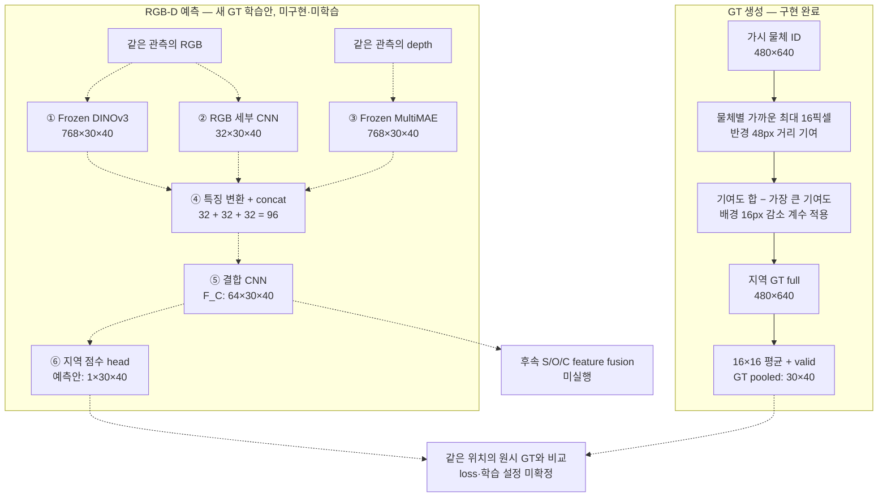

# Complexity Stream

<!-- navigation:start -->
[전체 개요](README.md) · [Similarity](similarity_stream.md) · [Occlusion](occlusion_stream.md) · **Complexity** · [Development Log](development_log.md) · [연구 문맥](agent.md)
<!-- navigation:end -->

> **현재 방법 — 2026-10-15:** 가까운 여러 물체의 거리 기여를 합친 **지역 Complexity GT**를 사용함. 반경 48px, 물체별 가까운 최대 16픽셀, 배경 감소 범위 16px로 기존 train 160장을 재생성하고 수치 검산을 완료함. **새 GT를 예측하는 모델의 구현·학습·평가는 아직 수행하지 않음.** 아래 GT 경로는 구현 완료이고, RGB-D 예측 경로는 후속 학습안임. 이전 count 모델의 구조·학습·성능 그림은 Development Log의 이력으로 분리함.

## 1. 목적과 입출력

Complexity는 **현재 영상에서 여러 물체가 가까이 모인 위치**에 높은 점수를 주려는 stream임. Similarity가 target과 관련된 외형을, Occlusion이 target의 가림 가능성을 다루는 데 더해, scene 자체의 지역적인 혼잡 정도를 제공함. Target 사진·이름을 조건으로 넣지 않음.

한 물체만 가까운 곳은 0이며, 여러 물체의 가시 부분이 함께 가까워지면 점수가 커지도록 정의함. 물체 윤곽에서 값이 갑자기 끊기지 않도록 물체 밖의 좁은 영역에도 부드럽게 감소하는 값을 허용함. 예를 들어 책 한 권의 넓은 표면보다 책·과일·상자의 가시 부분이 가까이 모인 위치를 높게 표현하려는 목적임. 어떤 장면에서도 사람의 판단과 일치한다고 확인한 것은 아님.

이 점수는 영상상의 밀집 정도임. 완전히 가려진 물체 수·실제 3D 접촉·제거 난이도·target 존재 확률까지 나타내지는 않음. 최종 탐색에 도움이 되는지는 다른 stream과 결합한 뒤 별도로 검증해야 함.

### 현재 저장한 GT

| 항목 | 규격 | 의미 |
|---|---|---|
| 원본 물체 ID | `480×640` | 시뮬레이터가 구분한 가시 물체. GT 생성에만 사용함 |
| 원시 지역 점수 `C` | `full: float32 [480,640]` | 각 픽셀의 주변 물체 거리에서 계산한 점수 |
| 평균 GT `C_pool` | `pooled: float32 [30,40]` | full의 각 16×16 영역 평균. 별개의 복잡도 종류가 아님 |
| 유효 영역 | `valid_full / valid` | 계산 반경이 영상 밖으로 나가는 위치를 학습·평가에서 제외하기 위한 표시 |
| 회색조 PNG | `uint8 [480,640]` | 원시 점수를 공통 0–6 범위로 표시한 그림 |

PNG는 640×480 각 픽셀에서 계산한 값의 표시임. 30×40 지도를 단순 확대해 만든 그림이 아니며, 학습용 원시 수치는 NPZ에 따로 보존함.

### RGB-D 예측 경로의 학습안

| 항목 | 계획 규격 | 역할 |
|---|---|---|
| Scene RGB | `B×3×480×640` | 한 camera 관측의 색·무늬·윤곽 |
| Scene depth | `B×1×480×640` | 같은 관측에 대응하는 표면 깊이 |
| 중간 표현 `F_C` | `B×64×30×40` 유지 검토 | 지역 점수 학습에 사용할 위치별 특징. 후속 fusion의 후보 입력 |
| 예측 지도 `Ĉ_pool` | `B×1×30×40` 학습안 | 같은 위치의 평균 지역 GT 하나를 회귀 |

`B`는 한 번에 처리하는 관측 수임. 각 관측의 외부 입력은 **단일 RGB-D**이며 여러 camera의 영상을 동시에 넣는 조건이 아님. 원본 ID·GT mask·pose·물체 수는 모델 입력으로 제공하지 않음.

새로운 1채널 head와 loss는 미구현·미학습 상태임. 위 규격은 기존 특징 추출 경로를 활용하는 출발안이며 최종 구조 확정이나 새 모델의 실행 결과가 아님. 마지막 학습 모델은 Phase 42로 유지하며, 그 checkpoint를 새 GT 예측 모델로 부르지 않음.

## 2. 전체 구조

GT는 시뮬레이터 ID로 미리 계산하고, 모델은 RGB-D에서 그 점수를 예측하도록 학습할 계획임. **GT를 만드는 경로와 추론 경로를 구분함.** 아래에서 실선의 GT 경로는 구현 완료이며, 점선의 예측·loss 경로는 새 GT에 대한 학습안임.



모델 쪽 크기는 `채널×세로×가로`이고 batch 축은 생략함. `64×30×40`은 각 위치에 숫자 64개가 남는 특징이며 물체 64개라는 뜻이 아님. `1×30×40`은 각 위치에서 지역 점수 하나를 출력한다는 계획임.

모델이 먼저 완전한 segmentation을 만들고 물체별 거리 계산을 반복하는 흐름은 아님. 원본 ID에서 수행하는 거리 집계는 offline GT 생성에만 사용함. 배포에서는 RGB-D 특징과 head를 고정된 순서로 한 번 처리하는 방향을 유지함. 세 stream의 실제 연산시간이 같다는 뜻은 아니며, 같은 관측의 결과가 준비되는 시간과 전체 지연은 통합 단계에서 측정해야 함.

## 3. 내부 모듈과 역할 — 후속 학습안

기존 RGB-D 특징 경로를 재사용하는 안임. 아래 선택 이유는 새 GT에서의 효과를 이미 검증했다는 뜻이 아님. 새 학습 후 RGB만 사용한 경우와 RGB-D를 사용한 경우를 같은 자료에서 비교해야 함.

### ① DINOv3: RGB의 외형과 문맥

Frozen DINOv3 ViT-B/16의 마지막 block에서 `768×30×40` 특징을 받는 경로를 유지하는 안임. 원본 `480×640` 영상의 patch 간격은 16px이므로 공간 격자는 30×40임. 각 위치의 특징에는 attention을 거친 주변 문맥도 포함되며, 특정 channel 하나를 물체 하나로 해석하지 않음.

책 표지·과일 표면·주변 배치처럼 RGB에 나타나는 정보를 지역 점수 head에 제공하려는 역할임. 원본 ID는 DINO에 주지 않으며 GT와 예측의 차이로 뒤쪽 학습 layer가 특징을 읽는 방법을 배우도록 할 계획임.

### ② RGB 세부 CNN: 원본 영상의 작은 변화

DINO 특징과 함께 원본 RGB를 작은 CNN으로 처리하여 `32×30×40` 특징을 얻는 안임. 기존 경로는 4×4 위치의 RGB 값을 48채널로 재배열하는 PixelUnshuffle 뒤에 convolution을 적용함. 이후 공간 크기를 줄이면서 색·무늬·윤곽의 세부 정보를 조합함.

이 경로는 물체별 mask를 만들지 않음. 지역 GT가 물체 경계 주변에서 달라지므로 세부 정보를 보완하려는 선택이며, 새 점수에 대한 실제 기여량은 후속 비교 대상임.

### ③ MultiMAE: 관측 depth의 공간 패턴

MultiMAE에는 **실제로 관측한 depth**를 넣음. RGB에서 depth를 새로 생성하는 경로가 아님. Depth를 영상별로 정규화한 뒤 frozen depth adapter·encoder로 `768×30×40` 공간 특징을 받는 안임.

Depth는 물체 표면의 높낮이와 경계에 관한 단서를 제공할 수 있음. 그러나 현재 GT는 영상상의 물체 ID와 2D 거리로 정의되어 있어 depth의 추가 효과를 자동으로 보장하지 않음. 기존 count 실험에서의 이득도 새 GT의 성능으로 옮겨 쓰지 않음.

### ④ 특징 변환과 concat

DINO와 MultiMAE의 각 위치에 있는 768개 숫자를 각각 학습 변환으로 32개로 줄이고, RGB CNN의 32개와 같은 위치에서 이어 붙이는 안임.

```text
위치 A의 DINO 특징     768 → 32
위치 A의 RGB 세부 특징        32
위치 A의 depth 특징    768 → 32
                          ↓ concat
                   [32 | 32 | 32] = 96
```

같은 channel끼리 단순 덧셈하는 것이 아니라 서로 다른 특징을 함께 보존하는 연산임. 후속 convolution이 어느 특징을 어떻게 사용할지 학습함. 차원을 맞췄다는 이유만으로 외형과 깊이의 의미가 정렬됐다고 가정하지 않음.

### ⑤ 결합 CNN과 중간 표현

96채널을 주변 위치와 함께 읽는 CNN으로 처리하고 `F_C:64×30×40`을 유지하는 안임. 한 픽셀의 지역 GT는 그 주변의 여러 물체에 영향을 받으므로 중심 위치의 특징만 읽는 것보다 주변 정보를 함께 조합할 필요가 있음.

64개 channel에 개수·높이·접촉 같은 이름을 직접 지정하지 않음. 새 지역 GT를 학습하면 그 목표를 예측하는 데 필요한 표현이 형성되도록 할 계획임. 현재 저장된 checkpoint의 특징이 이미 새 목표에 맞게 바뀐 것은 아님.

### ⑥ 한 종류의 지역 점수를 출력하는 head

각 위치의 64개 특징을 하나의 지역 점수로 읽는 head가 필요함. 현재 저장된 `pooled [30,40]`에 맞춘 **1채널 출력**을 출발안으로 두며, 음수가 아닌 원시 점수와 유효 영역을 다룰 activation·loss 설정은 구현 전에 명시해야 함.

예측값이 1.4라면 원시 지역 점수 1.4를 뜻하도록 학습하는 안이며, 물체 1.4개나 확률 140%라는 뜻이 아님. PNG 표시 상한 6을 모델의 최대 출력으로 제한하는 것은 별개의 설계이며 현재 확정하지 않음.

Fusion 후보는 최종 회색조 그림보다 head 이전의 `F_C`임. 다른 두 stream과 공간 격자가 맞아도 추가 효용이 확인되는 것은 아니므로, 새 GT의 stream 단위 학습·검증 후 통합을 진행해야 함.

## 4. GT 생성과 학습

### 구현한 지역 GT 계산

시뮬레이터가 제공하는 것은 물체 구분 정보이며, Complexity 자체는 아래 규칙으로 정의한 학습용 점수임. 입력은 원본 instance ID를 물체별로 정리한 `480×640` 지도임. 한 물체의 여러 mesh나 떨어진 가시 조각은 같은 ID로 묶고 서랍·바닥은 0으로 둠. 색상 PNG의 색 수를 세지 않으며, **이 GT 계산에는 RGB·depth·pose·DINO·MultiMAE 특징을 사용하지 않음.** 완전히 가려져 가시 픽셀이 없는 물체도 계산에 들어가지 않음.

```text
원본 물체 ID 지도
 → 각 위치에서 물체별 가까운 최대 16픽셀 선택
 → 거리로 가중한 물체별 기여도
 → 기여도 전체 합 − 가장 큰 기여도 하나
 → 배경에서 물체와 떨어진 거리에 따라 감소
 → 원시 GT 저장 / 고정 회색조 표시
```

이 절의 반복 집계는 시뮬레이터 자료로 정답을 미리 만드는 과정임. 추론 시 GT segmentation을 받거나 여러 crop을 재처리하는 네트워크 구조를 추가한 것이 아님. 추론 입력은 단일 scene RGB-D 조건을 유지함.

#### 1. 같은 물체의 픽셀 중 가까운 16개를 선택함

점수를 계산할 위치를 `P`라고 함. 물체 A의 가시 픽셀 중 P와 가까운 최대 16개를 고르고, 물체 B·C에도 같은 선택을 각각 적용함. **모든 물체에서 총 16개를 뽑거나 16×16 사각형을 자르는 연산이 아님.** 거리는 영상의 가로·세로 좌표 차이로 구한 직선거리이며 실제 미터 단위 거리가 아님. 48px 반경 밖의 픽셀은 기여도를 0으로 처리함.

다음은 선택 규칙을 설명하는 작은 가상 예임. `P=(100,100)`이고 물체 B는 `x=103..107, y=98..102`의 25픽셀이라고 가정함. `●`는 선택한 16개, `○`는 같은 물체지만 선택하지 않은 9개, `·`는 B가 아닌 위치임.

```text
                 x 좌표
          100 101 102 103 104 105 106 107
y =  98    ·   ·   ·   ●   ●   ●   ○   ○
y =  99    ·   ·   ·   ●   ●   ●   ○   ○
y = 100    P   ·   ·   ●   ●   ●   ●   ○
y = 101    ·   ·   ·   ●   ●   ●   ○   ○
y = 102    ·   ·   ·   ●   ●   ●   ○   ○
```

`(103,100)`은 P에서 3px, `(103,99)`는 `sqrt(3²+1²)≈3.16px` 떨어져 있음. 가까운 순서로 16번째인 `(106,100)`의 거리는 6px이고, 그다음 `(106,99)`의 약 6.08px부터 제외됨. P가 바뀌면 선택되는 픽셀도 바뀜. 같은 물체의 여러 가시 조각은 한 ID의 픽셀 집합에서 함께 검색함.

#### 2. 선택한 거리들을 물체 하나의 기여도로 바꿈

물체 `i`의 k번째 선택 픽셀까지 거리를 `d_ik(p)`라고 하면 다음과 같이 계산함. 16개보다 적으면 부족한 항은 0이며, 분모는 항상 16임.

$$
a_i(p)=\frac{1}{16}\sum_{k=1}^{16}\max\left(0,1-\frac{d_{ik}(p)}{48}\right)
$$

| 선택 픽셀까지 거리 | 픽셀 하나의 기여 |
|---|---:|
| 3px | 0.9375 |
| 6px | 0.875 |
| 24px | 0.5 |
| 48px 이상 | 0 |

앞의 25픽셀 예에서 선택된 16개 기여의 합은 약 14.548이고, B의 점수는 `14.548/16≈0.909`임. B의 전체 면적이 크더라도 한 물체의 기여는 최대 1임. 반경 안에 4픽셀만 있고 각 기여가 0.75라면 `4×0.75/16=0.1875`로 계산함. 작은 가시 조각의 영향을 줄이는 가정이며 작은 물체를 과소평가할 가능성도 남음. 16개라는 설정의 최적성은 검증하지 않았음.

#### 3. 여러 물체의 기여를 결합함

$$
C_0(p)=\sum_i a_i(p)-\max_i a_i(p)
$$

물체별 기여를 더하고 가장 큰 값 하나를 뺌. 한 물체만 가까운 곳은 0이고, 여러 물체가 함께 가까워야 양수가 되게 하는 규칙임. 물체가 없으면 0으로 둠. 예를 들어 A/B/C의 기여가 `0.950/0.909/0.500`이면 `C_0=1.409`임. 설명용 수치이며 물체가 1.409개 있다는 뜻은 아님.

**빼는 값은 항상 가장 큰 기여도이며 자기 물체의 기여도와 같다고 보장하지 않음.** 자기 물체가 얇게 보이고 이웃이 크게 보이는 경우 이웃의 값이 빠질 수 있음. 물체 픽셀인지 배경인지에 따라 ID 제외 규칙을 바꾸지 않으므로 물체 사이의 작은 틈에서도 같은 식으로 계산할 수 있음.

#### 4. 물체 밖에서는 16px에 걸쳐 값을 줄임

P에서 가장 가까운 가시 물체까지의 거리를 `b(p)`라고 함. 물체 위에서는 0임. 다음 계수 `g(p)`를 기본 점수에 곱함.

$$
t(p)=\min\left(1,\max\left(0,1-\frac{b(p)}{16}\right)\right),\quad
g(p)=t(p)^2(3-2t(p)),\quad C(p)=C_0(p)g(p)
$$

| 물체까지 거리 | 기본 점수를 남기는 비율 |
|---|---:|
| 물체 위 | 100% |
| 배경 4px | 84.375% |
| 배경 8px | 50% |
| 배경 12px | 15.625% |
| 배경 16px 이상 | 0% |

기본 점수가 1.409인 배경 위치가 물체에서 8px 떨어졌으면 최종 점수는 `1.409×0.5=0.7045`임. 경계에서 바로 0으로 끊지 않고 감소시키는 방식이며 작은 빈틈뿐 아니라 더미 바깥 16px 이내의 띠도 허용함. 한 물체만 가까워 `C_0=0`이면 이 주변 띠도 0임. **참고 픽셀 16개와 배경 감소 거리 16px는 별개의 설정**임.

#### 5. 원시 수치와 회색조 표시를 구분함

원시 `C`를 float32로 저장하고, PNG에는 `round(255×clip(C/6,0,1))`을 적용함. 점수 1/3/6은 밝기 약 43/128/255에 대응함. 모든 영상에서 같은 기준을 쓰며 영상마다 최대값에 맞춰 밝기를 늘리지 않음. 6은 표시용 상한으로 물체 수·확률·학습 목표의 최대값을 뜻하지 않음.

| 저장 항목 | 규격과 의미 |
|---|---|
| `full` | float32 `[480,640]`, 픽셀마다 계산한 원시 지역 점수 |
| `pooled` | float32 `[30,40]`, 같은 영상 안의 16×16픽셀 평균 |
| `valid_full` / `valid` | 각각 `[480,640]` / `[30,40]`의 유효 위치 |
| 대표 PNG | uint8 `[480,640]`, 고정 선형 0–6 표시 |

반경 48px가 영상 안에 온전히 들어오는 위치만 유효함. `valid`는 16×16 셀 전체가 유효할 때만 참이며 영상 가장자리의 무효 0을 정답 0으로 학습하지 않도록 구분함. DINO의 16×16 patch 간격, 물체별 참고 픽셀 16개, 배경 감소 거리 16px는 서로 다른 설정임.


각 쌍은 RGB와 새 GT이며 모델 예측이 아님. 서로 다른 6개 target 폴더의 지정 camera에서 목록상 첫 프레임을 골랐고, center/left/right/top/bottom의 다섯 camera를 포함함. 원본 PNG의 밝기를 그대로 사용한 예시이며 독립 test나 성능에 따른 사례 선택이 아님. Target 이름은 자료 폴더를 구분하며 Complexity 계산에 target ID를 조건으로 넣지 않음.

### 학습에서 사용할 값과 남은 구현

현재 준비한 것은 원시 GT와 유효 mask임. 30×40 출력안을 사용할 경우 같은 위치의 `pooled`와 예측을 비교하고, `valid=False`인 격자는 loss·평가에서 제외해야 함. 무효 위치에 저장된 0을 복잡도가 낮다는 정답으로 취급하지 않음. 유효한 먼 배경의 0은 실제 감독값임.

회색조 PNG의 밝기 대신 NPZ의 원시 점수를 학습에 사용하는 방향임. 같은 물리 배치의 다섯 view가 train과 test에 나뉘지 않도록 split을 구성해야 하며, 현재 160장은 기존 train 표본이므로 독립 test가 아님. 새 head·activation·loss·학습 비중·checkpoint 선택 규칙과 별도 평가 자료는 아직 확정·실행하지 않았음.

원본 full GT가 640×480이어도 30×40 head를 학습하면 예측은 그 격자 해상도임. 이를 화면 크기로 확대하는 것과 640×480의 세부 점수를 직접 예측하는 모델은 다름. 원본 픽셀 수준 예측이 필요하면 고해상도 decoder를 따로 설계·검증해야 함.

## 5. 설계 이유와 확인 결과

### 주요 설계 선택

| 선택 | 목적 | 남은 한계 |
|---|---|---|
| 가시 물체 ID와 2D 거리 | 영상에서 보이는 여러 물체의 밀집 정도를 정의함 | 숨은 형상·실제 3D 간격은 반영하지 않음 |
| 물체별 가까운 최대 16픽셀 | 큰 물체의 전체 면적이 그대로 점수를 지배하는 것을 줄임 | 작거나 조금만 보이는 물체의 기여도 줄어듦 |
| 거리 기여 합에서 최대값 하나 제외 | 물체 하나만 있는 영역을 0으로 만듦 | 가장 큰 값이 항상 자기 물체의 기여는 아님 |
| 배경 16px에서 부드럽게 감소 | 물체 경계의 급격한 단절을 줄임 | 작은 틈뿐 아니라 더미 바깥의 좁은 띠도 양수일 수 있음 |
| 공통 선형 0–6 회색조 | 장면마다 같은 점수를 같은 밝기로 보여 줌 | 표시 설정이며 GT 최적성이나 확률을 뜻하지 않음 |

반경 48px·참고 16픽셀·배경 감소 16px는 현재 적용한 설정임. 서로 역할이 다르며 최적값으로 검증하지 않았음. 영상의 해상도·카메라 거리·화각이 달라지면 같은 픽셀 거리가 의미하는 실제 범위도 달라짐.

### 기존 160장 재생성 결과

`261013_data`의 **16개 target 폴더 × 2배치 × 5뷰 =160장**에 같은 식을 적용함. 원본 PNG 160장·NPZ 160개를 갱신했으며, 전체 240,000장의 GT를 생성한 것은 아님. Fusion에서 재투영 검사를 통과하지 못한 한 배치의 5뷰는 계속 보류하므로 모든 stream의 공통 목록은 155장임.

| 확인 항목 | 결과와 범위 |
|---|---|
| 생성·교체 시간 | 약 39.80초. 모델 학습·추론 시간은 아님 |
| 배경 범위 | 160장 모두 물체에서 16px 이상 떨어진 배경 값이 0임 |
| 표시 범위 | 원시 최댓값 5.298194, 표시 상한 6에서 잘린 픽셀 0개 |
| 원시 점수 직접 검산 | 영상당 3좌표, 총 480점의 거리 재계산 최대 차이 약 1.51×10⁻⁷ |
| 평균 지도 검산 | 저장 full에서 pooled 192,000값을 재계산한 최대 차이 약 7.35×10⁻⁷ |
| 저장·이력 확인 | 전체 PNG·valid와 기존 4장 지역 후보의 배열·PNG 일치. 교체 전 PNG·NPZ 보존 |

이 결과는 계산과 저장이 정의대로 수행됐는지 확인한 것임. 전 픽셀의 거리 점수를 독립 재계산하거나, 사람이 판단한 혼잡도·모델 예측 정확도·최종 탐색 성능을 평가한 결과가 아님. 새 점수를 학습한 예측 결과는 아직 없음.

### 저장 경로와 다음 Step

현재 PNG는 `261013_data/complexity/<target>/<frame>.png`, 원시 NPZ는 `261013_data/_gt/feasibility_20261014/complexity_arrays/<target>/<frame>.npz`임. 생성·감사 기록은 같은 metadata 아래 `complexity_region_regeneration_20261015/`에 있으며 `complexity_layout.json`이 활성 규격을 설명함. 실행 코드·원시 배열·checkpoint는 공개 저장소에 배포하지 않음.

다음 Step은 현재 정의를 유지한 채 새 head의 출력·loss·분할 규칙을 명시하고, 별도 장면에서 지역 점수와 높은 영역의 선택 품질을 평가하는 것임. RGB-only와 RGB-D를 같은 조건에서 비교한 뒤 fusion으로 넘어가야 함. 이전 모델의 정확도를 새 정의의 성능 근거로 사용하지 않음.

이전 count 방식의 구조·GT·학습 설정·실패와 성능 그림은 [Development Log](development_log.md)의 Phase 39–42 및 「이전 count 모델 구현 상세 보존」에 둠. 이번 문서 개편은 새로운 실험·학습 결과가 아님.

## 6. 질문과 답변

### Q1. 정답 segmentation이 없는 실제 환경에서는 어떻게 계산하는가?

Segmentation에서 거리 기여를 계산하는 부분은 학습용 GT 제작 단계임. 실제 추론에서는 RGB-D만 입력받는 모델이 그 점수를 근사하도록 학습할 계획임. 새로운 사진마다 segmentation이 정확한지 확인하거나 GT ID를 받아 계산하는 방식은 아님. 학습하지 않은 장면의 GT와 예측을 비교해 어느 정도 맞는지 확인해야 하며, 현재는 그 새 학습을 실행하지 않았음.

### Q2. 빈 공간에 값이 생기는 이유는 무엇인가?

주변의 여러 물체가 함께 가까운 위치를 표현하므로 물체 사이의 작은 빈틈도 양수일 수 있음. 다만 가장 가까운 물체에서 멀어질수록 감소하고 16px 이상이면 정확히 0임. 더미 바깥도 16px 안에서는 값이 생길 수 있으며, 이 좁은 배경 영역을 허용한 정의임. 모든 배경을 0으로 하는 segmentation mask와는 목적이 다름.

### Q3. 큰 물체 하나가 0이어도 되는가?

현재 점수는 면적보다 여러 물체가 함께 가까운 정도를 다룸. 반경 안에 한 ID만 기여하면 합과 최대값이 같아 0임. 큰 책 하나의 내부보다 다른 물체와 맞닿거나 가까운 부분에서 점수가 커지도록 한 규칙임. 이것이 모든 종류의 탐색에 가장 좋은 정의인지는 아직 검증하지 않았음.

### Q4. 16픽셀·16px·16×16 patch는 같은 뜻인가?

서로 다른 설정임. 물체마다 고르는 **최대 16픽셀**은 가까운 거리 순으로 고른 표본 수임. **배경 16px**는 물체 밖에서 값이 사라지는 거리임. **16×16 영역**은 full GT를 30×40으로 평균내는 단위이자 현재 특징 경로의 patch 간격임. 첫 번째는 16×16 사각형을 고르는 연산이 아님.

### Q5. 640×480 그림과 30×40 지도는 어떤 관계인가?

640×480의 full은 모든 원본 픽셀 위치에서 계산한 GT임. 30×40의 pooled는 그 안의 16×16픽셀씩 평균한 같은 점수임. 같은 정의를 서로 다른 공간 해상도로 저장한 것이며 두 종류의 complexity를 계산한 것이 아님. 현재 비교 그림은 full을 표시하고, 아직 없는 모델 예측을 확대한 그림이 아님.

### Q6. 흰색은 복잡할 확률 100%인가?

아님. 흰색 255는 표시 범위에서 원시 점수가 6 이상임을 뜻함. 점수 3은 밝기 약 128이고 점수 1은 약 43임. 이 수치는 정수 물체 수나 확률이 아니며, 장면마다 최대값을 흰색으로 맞추지도 않음. 학습에는 밝기로 바꾸기 전 원시 점수를 사용할 계획임.

### Q7. Depth를 쓰는데 GT는 왜 2D 거리인가?

GT는 영상에서 보이는 혼잡 위치의 정의이고, depth는 그 위치를 RGB-D에서 예측할 때 사용할 관측 단서임. 감독값을 만드는 입력과 모델이 활용할 수 있는 입력이 반드시 같을 필요는 없음. 그러나 이 GT에 depth가 실제로 도움이 되는지는 새 RGB-only/RGB-D 비교로 확인해야 하며, MultiMAE를 붙였다는 사실만으로 개선을 주장하지 않음.

### Q8. 복잡한 부분을 crop해서 다시 보거나 GT를 매번 계산하는가?

현재 방향은 같은 RGB-D에서 특징과 점수 head를 한 번 처리하는 것임. 반복 crop·SAM 실행·GT ID 계산을 추론 경로에 추가하지 않음. 표본 생성 코드가 물체별·영상별로 반복하는 것은 offline 작업임. 세 stream을 결합할 때는 같은 관측의 특징을 사용하고 전체 지연을 따로 확인해야 함.

### Q9. 지금 어느 단계까지 완료됐는가?

현재 정의로 기존 160장의 GT 생성과 수치 검산을 완료함. 새 점수의 1채널 예측 head·loss·학습·독립 예측 평가·fusion은 미실행임. 따라서 현재 문서의 회색조 그림은 모두 GT이며, 새 방법의 accuracy나 탐색 성능으로 제시할 수 있는 결과는 아직 없음.

---

<!-- navigation:start -->
[전체 개요](README.md) · [Similarity](similarity_stream.md) · [Occlusion](occlusion_stream.md) · **Complexity** · [Development Log](development_log.md) · [연구 문맥](agent.md)
<!-- navigation:end -->
