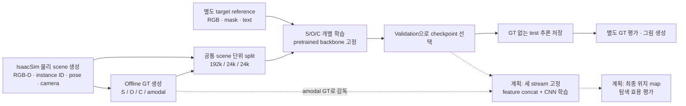

# 전체 Framework 작성 지침 — 2026-10-26

> [README](README.md) · [Similarity](similarity_stream.md) · [Occlusion](occlusion_stream.md) · [Complexity](complexity_stream.md) · [Development Log](development_log.md) · [다른 agent를 위한 문맥·상세 보고서](agent.md)

**목적:** 웹 GPT와 외부 독자가 이 저장소만 읽고 현재 세 stream의 구조, 실제 출력, 학습 과정과 계획 중인 fusion을 정확한 논문 그림으로 표현할 수 있도록 정리함. 아래 설명·좌표·공개 이미지를 함께 사용함. 그림을 새로 그리는 작업이며 추가 학습을 의미하지 않음.

## 1. 먼저 읽을 자료와 현재 상태

1. [README](README.md): 연구 목표, 전체 구조, feature와 map의 차이.
2. 이 문서: 그림의 노드·연결·배치·이미지 사용법.
3. [Similarity](similarity_stream.md), [Occlusion](occlusion_stream.md), [Complexity](complexity_stream.md): 현재 모델의 세부 구조, GT와 loss, 평가.
4. [agent.md의 최신 인계](agent.md#current-handoff-20261026): 전체 진행 맥락, 완료/미실행 구분, 로컬 근거 경로와 작업 규칙. 긴 과거 보고서는 최신 절을 읽은 뒤 필요한 부분만 확인함.
5. [학습·평가 요약 JSON](docs/stream_training_20261022_summary.json), [이미지 manifest](img/framework_assets_20261026.json), [그림 배치 JSON](framework_layout.json): 숫자·파일·좌표를 기계적으로 확인함.

| 구분 | 2026-10-26 기준 |
|---|---|
| 원본 관측 | 물리 시뮬레이션 후 정지 촬영한 240,000세트. 16 targets × 50 scenes × 60 envs × 5 cameras |
| GT | S/O/C/fusion 각각 240,000장. 보류 0장. 최종 fusion GT는 amodal target mask 한 종류 |
| 분할 | Train192,000 / validation24,000 / test24,000. 같은 `(target,scene)`의 env·camera는 같은 split |
| 개별 모델 | 새 seed0 학습 완료. S20/O12/C20 epochs, best S20/O12/C19. 완료 시각 2026-10-24 04:18 KST |
| 추론·평가 | 선택한 checkpoint로 test24,000장의 GT 없는 예측을 먼저 저장한 뒤 GT 평가 완료 |
| 통합 | Head 이전 feature concat+CNN이 첫 실험 구상. 통합 forward·fusion 학습은 미실행이며 Step4 미승인 |
| 일반화 | 현재 결과는 원래16종의 새 scene·clean 합성 관측. 새 물체·실센서·탐색 성공률은 현재 모델에서 미검증 |

이 연구의 zero-shot 탐색은 최종 목표임. 현재 세 모델의 test 결과만으로 통합 zero-shot 성능을 주장하지 않음. 이전 모델의 외부 target 실험과 현재 결과도 구분함.

## 2. 데이터에서 최종 학습까지의 흐름



원본 `261013_data`의 각 scene에는 RGB/depth/seg 및 물체 pose·camera 정보가 있음. 색상만으로 모든 scene의 물체를 통합 식별하지 않으며 원본 instance ID와 해당 scene의 metadata로 GT를 생성함. Target reference는 더미 속 target 위치를 알려 주는 정답이 아니라, 찾을 물체를 별도로 촬영한 자료임. 현재 stream 추론에는 scene segmentation·pose·mesh·amodal GT를 넣지 않음.

### GT 네 종류의 역할

| GT | 생성 의미 | 그림에서 들어갈 곳 |
|---|---|---|
| Similarity | 가시 물체 픽셀에 exact target1.0 / same-category0.8 / related0.5 / other0.2, 배경0의 관계 점수를 부여함. 경계 patch는 평균값임 | `P_S`의 감독 가지 옆. 최종 위치 mask로 표시하지 않음 |
| Occlusion | Target mesh 후보 pose들을 관측 depth와 비교함. 각 픽셀을 덮은 유효 후보 중 전체 footprint의70% 이상이 가려진 후보의 비율임 | `P_O`의 감독 가지 옆. 실제 target의 amodal segmentation과 구분 |
| Complexity | 가시 instance별 가까운 최대16픽셀의 거리 기여를 반경48px에서 계산함. 물체별 기여의 합에서 가장 큰 하나를 제외하고, 물체 밖에서는16px 이내에서 부드럽게 감소시킴 | `P_C`의 감독 가지 옆. 정수 count·확률이 아닌 연속 지역 점수 |
| Fusion | 저장된 실제 target pose와 asset으로 복원한 **전체 target 투영 mask**. 가려진 부분도 흰색이며 배경은 검정 | 계획된 최종 출력의 supervision 위치. 현재 예측으로 표시하지 않음 |

예를 들어 target의 절반만 보이면 최종 fusion GT에는 보이는 절반과 가려진 절반을 모두 흰색으로 표시함. 전부 가려져도 전체 투영 영역이 흰색임. Visible mask로 바꾸어 학습하는 분기는 없음. Visible은 복원·검사용 보조 정보임. 실제 보이는 target을 우선 찾는 행동까지 amodal mask만으로 검증됐다는 뜻은 아니며, 그 효용은 후속 fusion·탐색 평가 대상임.

Native GT는 모두640×480 grayscale임. S/C는 정밀 float GT의16×16 평균인30×40 배열로 학습하며, O는 PNG/255와 coverage를 읽어 patch 감독을 계산함. PNG의 표시 밝기와 원시 학습값을 혼동하지 않음. GT 생성과 모델 예측의 차이를 자세히 설명한 수식은 각 stream 본문을 따름.

처음 fusion420장은 별도 renderer의 재투영 문제로 보류했으나, 원래 pose를 그대로 IsaacSim에서 직접 복원하여 보완함. 새 physics·원본 재수집 없이420장과 정상 비교80장, 총500장이 복원 기준을 통과함. 전체 segmentation은442/500장 완전 일치, 나머지58장은 총70픽셀 차이였음. 이는500장 검사이며 전체24만장의 독립 픽셀 일치 검사가 아님.

### 지금까지 방법이 바뀐 이유

| 시기 | 확인·판단 | 현재 그림에 반영할 내용 |
|---|---|---|
| 기존 S/O 연구 | DINO+SigLIP matching과 RGB-D·target geometry FiLM을 개발함 | 구조를 유지하되 이번 새 전체 학습 checkpoint·결과를 표시 |
| Complexity Phase38 | RGB-D 접경 head의 개선이 일관되지 않아 미채택 | 현재 경로에 접경 head를 추가하지 않음 |
| Phase39–42 | 지역 count와 depth 표현을 비교하고 MultiMAE를 검토함. 감소·잡음 보완과 clean16 한계도 기록함 | Depth encoder 선택의 이력. 당시 count 지표는 현재 지역 점수 성능표에 합치지 않음 |
| 10-15 | 딱딱한 count 격자·물체 윤곽 중심 표시를 재검토하고 r48 지역 GT와16px 배경 감소를 채택함 | 현재 C는 softplus 한 채널의 연속 지역 점수 |
| 10-16 | 지역 GT 소규모 학습 검증, 전체 GT 생성과 fusion 보류420장 보완 완료 | S/O/C/fusion 공통24만장 사용 가능 |
| 10-22→24 | 데이터 연결→소량 실행 검사→승인된 전체 개별 학습·test 완료 | 세 stream은 학습 완료된 실선 경로 |
| 10-26 | 고정5장면의 GT·예측·논문 그림 제작. O의 workspace 밖 흰 반응은 기존 고정 mask로 표시 보정 | O raw와 workspace 적용 출력을 구분. 학습·GT·평가 수치는 그대로 |

전체 실패·가정·결과는 [Development Log](development_log.md)에 남김. GT 관계 회귀 공개 철회·평균 count 지도 공개 제외는 유지하며, SAM2 자동 영역 비교와 crop 반복 재분할은 현재 실행 경로에 없음.

## 3. 실제 모델 노드와 화살표

공간 크기는 `세로×가로`, tensor는 `채널×세로×가로`이며 batch를 생략함. RGB는 `3×480×640`, 관측 depth는 `1×480×640`임. 세 stream은 같은 단일 관측을 처리하지만 현재 실행은 각각 독립적임. 같은 DINO pretrained weight를 쓰는 것과 한 번의 DINO forward를 공유하는 구현은 구분함.

### Similarity: target과 관련된 가시 영역

```text
Scene RGB → frozen DINOv3 ViT-B/16 → layers 2,5,8,11: 각각 768×30×40
Target RGB + reference mask → crop224 → frozen DINO → masked pool: layer별768
Target center crop384 + text → frozen SigLIP image/text → normalize/mean/normalize1152
  → 학습 Linear1152→768 ×4 → appearance에 더함 → layer별 query768
각 layer: concat(scene768, broadcast query768, cosine1) =1537 → 학습 Matching CNN64
4개 결과 concat256 → 학습 fusion CNN → F_S:64×30×40
F_S → 학습1×1 Conv + sigmoid → P_S:1×30×40
```

DINOv3·SigLIP은 frozen임. Semantic projection·matching·feature fusion·map head는 map MSE로 학습함. 이름/category text는 의미 조건이며 scene의 정답 위치나 category별 공간 지도를 입력하지 않음. Train은 DINO target reference5뷰 중 하나를 선택함. Validation은5개 reference 각각의 loss를 평균하고 test는 center reference를 사용함. 화면에 넣을 단일 target 썸네일은 식별용 그림이며 실제 모든 전처리를 뜻하지 않음.

### Occlusion: 해당 target이 가려질 수 있는 영역

```text
Scene RGB → frozen DINO → layers 2,5,8,11: 각각768×30×40
Target center 전체 RGB → frozen DINO → 일반 공간 평균: layer별 appearance768
Target reference mask → 정해진 geometry68 계산 → 학습 MLP → FiLM gamma/beta
Observed depth + valid =2채널 → 학습 ResNet18(weights=None)
  → stage2/3/4를 각각256×30×40에 맞춤 → 네 경로에2/3/4/4로 대응
  → geometry의 global FiLM: gamma×depth_feature+beta
각 layer: concat(scene768, FiLM depth256, broadcast target768, cosine1)=1793
  → 학습 Matching CNN64 → 4개 concat256 → 학습 fusion CNN → F_O:64×30×40
F_O → 학습1×1 Conv + sigmoid → P_O:1×30×40
```

Geometry68은 면적·bbox·log aspect·8×8 silhouette임. Reference mask는 geometry를 만드는 별도 입력이며 scene target mask가 아님. 현재 target appearance는 Similarity와 달리 **전체 RGB의 일반 평균**임. DINO는 frozen, ResNet18·FiLM·matching·fusion·map head는 trainable임. Loss는 coverage 가중 BCE+SmoothL1과 safe-ring 보조항임. 현재 mode는 `raw_broadcast/global_film`이며 이전 local gate 실험을 현재 경로에 섞지 않음.

### Complexity: 여러 물체가 가까이 있는 정도

```text
Scene RGB → frozen DINO layer11 → L2 + 학습1×1 projection →32×30×40
Scene RGB → 학습 RGB CNN(PixelUnshuffle4 + stride2 Conv 두 번) →32×30×40
Observed depth → standardize → frozen MultiMAE depth adapter + encoder
  → L2 + 학습1×1 projection →32×30×40
32+32+32 concat96 → 학습3×3 CNN(dilation1/2/4) → F_C:64×30×40
F_C → 학습1×1 Conv + softplus → P_C:1×30×40
```

Target 입력은 없음. DINO는 RGB만 처리하고, MultiMAE는 **이미 관측한 depth를 표현으로 변환**함. RGB에서 depth를 추정하여 공급하는 경로가 아님. Depth adapter도 frozen이며 projection·RGB CNN·통합 CNN·head는 학습함. Valid 영역의 양수/0 GT 그룹을 균형 있게 반영한 Smooth L1을 사용함. 출력은 비음수 지역 점수이고 총합1의 확률이나 정수 물체 수가 아님.

### 세 feature의 fusion: 아직 계획

```text
F_S:64×30×40 ─┐
F_O:64×30×40 ─┼→ Concat192×30×40 → Fusion CNN → final target-location map
F_C:64×30×40 ─┘                         ↑
                           amodal target GT로 학습 예정
```

Fusion으로 들어갈 화살표는 **각 map head 이전의64채널 feature에서 분기**함. `P_S/P_O/P_C`의 작은 grayscale 그림은 개별 감독·평가 출력으로 따로 보여 줌. 세1채널 map을 concat하는3채널 모델로 그리지 않음. 첫 실험안은 pretrained backbone과 학습된 세 stream을 고정하고 fusion head만 학습하는 것임. Attention/Transformer 채택·구체 CNN층·fusion loss·최종 출력 해상도·DINO 공유 구현은 미확정임. 그림에 임의로 Transformer나 최종 성능값을 추가하지 않음.

## 4. 그림으로 사용할 독립 이미지

[전체 비교 PNG](img/stream_gt_prediction_comparison_20261026.png) · [PDF](img/stream_gt_prediction_comparison_20261026.pdf) · [SVG](img/stream_gt_prediction_comparison_20261026.svg) · [Framework와 비교 그림을 합친 PDF](img/paper_figures_20261026.pdf)

Stream별 비교: [Similarity](img/similarity/full_data_20261026_gt_prediction.png) · [Occlusion](img/occlusion/full_data_20261026_gt_prediction.png) · [Complexity](img/complexity/full_data_20261026_gt_prediction.png).

각 행은 **같은 scene을 세 stream에서 비교**하는 고정 test 표본임. 해당 target/camera의 첫 test 행이며 예측을 본 뒤 좋은 장면으로 교체하지 않음. 5개 camera를 예시로 보여 주지만 한 장씩의 예시가 camera별 성능을 대표하지는 않음. 정량 결과는24,000장 전체임.

| 예시 ID | Camera | RGB / depth | Target 참조 | Fusion amodal GT |
|---|---|---|---|---|
| `book_1_scene00001_env0000_center` | center | [RGB](img/scene_20261026_book_1_scene00001_env0000_center_rgb.png) · [depth](img/scene_20261026_book_1_scene00001_env0000_center_depth.png) | [book_1](img/target_20261026_book_1_reference.png) | [GT](img/fusion_20261026_book_1_scene00001_env0000_center_gt.png) |
| `fruit_1_scene00003_env0000_left` | left | [RGB](img/scene_20261026_fruit_1_scene00003_env0000_left_rgb.png) · [depth](img/scene_20261026_fruit_1_scene00003_env0000_left_depth.png) | [fruit_1](img/target_20261026_fruit_1_reference.png) | [GT](img/fusion_20261026_fruit_1_scene00003_env0000_left_gt.png) |
| `packaged_food_1_scene00017_env0000_right` | right | [RGB](img/scene_20261026_packaged_food_1_scene00017_env0000_right_rgb.png) · [depth](img/scene_20261026_packaged_food_1_scene00017_env0000_right_depth.png) | [packaged_food_1](img/target_20261026_packaged_food_1_reference.png) | [GT](img/fusion_20261026_packaged_food_1_scene00017_env0000_right_gt.png) |
| `toy_1_scene00001_env0000_top` | top | [RGB](img/scene_20261026_toy_1_scene00001_env0000_top_rgb.png) · [depth](img/scene_20261026_toy_1_scene00001_env0000_top_depth.png) | [toy_1](img/target_20261026_toy_1_reference.png) | [GT](img/fusion_20261026_toy_1_scene00001_env0000_top_gt.png) |
| `toy_4_scene00007_env0000_bottom` | bottom | [RGB](img/scene_20261026_toy_4_scene00007_env0000_bottom_rgb.png) · [depth](img/scene_20261026_toy_4_scene00007_env0000_bottom_depth.png) | [toy_4](img/target_20261026_toy_4_reference.png) | [GT](img/fusion_20261026_toy_4_scene00007_env0000_bottom_gt.png) |

| 예시 | Similarity GT / prediction | Occlusion GT / prediction | Complexity GT / prediction |
|---|---|---|---|
| book_1 / center | [GT](img/similarity/similarity_20261026_book_1_scene00001_env0000_center_gt.png) · [예측](img/similarity/similarity_20261026_book_1_scene00001_env0000_center_prediction.png) | [GT](img/occlusion/occlusion_20261026_book_1_scene00001_env0000_center_gt.png) · [예측](img/occlusion/occlusion_20261026_book_1_scene00001_env0000_center_prediction.png) | [GT](img/complexity/complexity_20261026_book_1_scene00001_env0000_center_gt.png) · [예측](img/complexity/complexity_20261026_book_1_scene00001_env0000_center_prediction.png) |
| fruit_1 / left | [GT](img/similarity/similarity_20261026_fruit_1_scene00003_env0000_left_gt.png) · [예측](img/similarity/similarity_20261026_fruit_1_scene00003_env0000_left_prediction.png) | [GT](img/occlusion/occlusion_20261026_fruit_1_scene00003_env0000_left_gt.png) · [예측](img/occlusion/occlusion_20261026_fruit_1_scene00003_env0000_left_prediction.png) | [GT](img/complexity/complexity_20261026_fruit_1_scene00003_env0000_left_gt.png) · [예측](img/complexity/complexity_20261026_fruit_1_scene00003_env0000_left_prediction.png) |
| packaged_food_1 / right | [GT](img/similarity/similarity_20261026_packaged_food_1_scene00017_env0000_right_gt.png) · [예측](img/similarity/similarity_20261026_packaged_food_1_scene00017_env0000_right_prediction.png) | [GT](img/occlusion/occlusion_20261026_packaged_food_1_scene00017_env0000_right_gt.png) · [예측](img/occlusion/occlusion_20261026_packaged_food_1_scene00017_env0000_right_prediction.png) | [GT](img/complexity/complexity_20261026_packaged_food_1_scene00017_env0000_right_gt.png) · [예측](img/complexity/complexity_20261026_packaged_food_1_scene00017_env0000_right_prediction.png) |
| toy_1 / top | [GT](img/similarity/similarity_20261026_toy_1_scene00001_env0000_top_gt.png) · [예측](img/similarity/similarity_20261026_toy_1_scene00001_env0000_top_prediction.png) | [GT](img/occlusion/occlusion_20261026_toy_1_scene00001_env0000_top_gt.png) · [예측](img/occlusion/occlusion_20261026_toy_1_scene00001_env0000_top_prediction.png) | [GT](img/complexity/complexity_20261026_toy_1_scene00001_env0000_top_gt.png) · [예측](img/complexity/complexity_20261026_toy_1_scene00001_env0000_top_prediction.png) |
| toy_4 / bottom | [GT](img/similarity/similarity_20261026_toy_4_scene00007_env0000_bottom_gt.png) · [예측](img/similarity/similarity_20261026_toy_4_scene00007_env0000_bottom_prediction.png) | [GT](img/occlusion/occlusion_20261026_toy_4_scene00007_env0000_bottom_gt.png) · [예측](img/occlusion/occlusion_20261026_toy_4_scene00007_env0000_bottom_prediction.png) | [GT](img/complexity/complexity_20261026_toy_4_scene00007_env0000_bottom_gt.png) · [예측](img/complexity/complexity_20261026_toy_4_scene00007_env0000_bottom_prediction.png) |

파일 경로의 규칙은 `img/<stream>/<stream>_20261026_<sample_id>_{gt,prediction}.png`임. O의 후처리 전 출력은 같은 위치의 `_prediction_raw.png`, workspace는 `img/occlusion/workspace_20261026_<camera>.png`임. 전체63개 PNG의 역할·shape·hash·모델 epoch·출처는 [manifest](img/framework_assets_20261026.json)에 있음. Manifest의 `path`는 **저장소 루트 기준**이며 JSON 파일의 `img/` 위치를 기준으로 다시 붙이지 않음.

### 표시 규칙

- GT PNG와 RGB는 원본 파일의 byte를 그대로 복사함. Stream map PNG는 모두640×480 단일 grayscale임. Target 참조 썸네일은320×320 식별용 crop으로, O가 이 crop을 입력받았다는 뜻이 아님.
- 예측은 저장된30×40 float를 bilinear로640×480까지 확대함. Native GT보다 흐릿하거나 격자가 보일 수 있으며 새로운 세부 정보가 생긴 것이 아님.
- S/O는0–1, C는0–6을 고정적으로0–255에 대응함. C의6은 **그림 표시 상한**이고 모델 출력 상한이 아님. 장면별 최댓값에 맞춰 밝기를 자동 보정하지 않음.
- Depth PNG는 **관측 depth의 표시용 변환**임. 모든 예시를2.5–3.5m 고정 범위로 그리며 가까울수록 흰색, 멀수록 검정임. 무효 depth는 검정임. 이 inversion은 모델 전처리와 구분함. 기존 전체 구조도 안의 depth 썸네일은 해당 영상의2–98백분위 대비 표시를 사용했으며, 새 그림 작성에는 공개 독립 depth PNG의 고정 범위를 사용함.
- O의 본문용 예측은 확대된 float에 기존 camera workspace를 곱해 서랍 밖을0으로 표시함. GT target mask나 GT coverage로 예측을 정답처럼 잘라내지 않음. Raw 파일도 공개하며 기존24,000장 평가 수치는 raw grid와 GT coverage에 대한 값으로 유지함.
- Framework 안에는 **한 sample_id의 RGB/depth/세 예측/amodal GT를 일관되게 사용**함. 다른 scene의 더 보기 좋은 예측을 섞지 않음. 기본은 `book_1_scene00001_env0000_center`임.
- Feature stack은64채널 tensor의 **개념도**임. 공개 grayscale map을 feature 활성화 시각화라고 부르지 않음. Fusion 예측 이미지는 아직 없음.

## 5. 논문 Framework의 배치 위치

기존 [PNG](img/overall_architecture.png) · [편집 가능한 SVG](img/overall_architecture.svg) · [벡터 PDF](img/overall_architecture.pdf)를 기본안으로 사용 가능함. 아래 좌표는 **1920×1080 논리 canvas의 좌상단 원점 `(x,y,width,height)`**이며 장면 픽셀 좌표가 아님. 인쇄 크기를 바꾸면 비율대로 확대/축소함. 배치 JSON은 그림 재작성용 권장안이며 렌더링된 모든 텍스트의 정확한 bounding box를 보장하는 파일은 아님.

| 영역 | x,y,w,h | 넣을 내용 |
|---|---|---|
| 입력 열 | 25,95,238,830 | Scene RGB / observed depth / target reference·mask·text |
| Similarity 패널 | 335,95,1110,270 | 분홍 계열 `#fff2f4` |
| Occlusion 패널 | 335,375,1110,270 | 파랑 계열 `#eef6fd` |
| Complexity 패널 | 335,655,1110,270 | 초록 계열 `#eff8f2` |
| Fusion 패널 | 1490,95,405,830 | 금색 점선, `Planned / not trained` 명시 |
| RGB 이미지 | 43,172,202,151.5 | 기본 sample RGB. RGB를 DINO와 C RGB CNN에 연결 |
| Depth 이미지 | 43,403,202,151.5 | 같은 sample depth. O ResNet18과 C MultiMAE에 연결 |
| Target 참조 묶음 | 34,606,221,306 | 별도 target RGB·reference mask·text를 구분. S/O만 연결 |
| S DINO / SigLIP | 355,153,205,72 / 355,255,205,72 | Frozen 표시. Appearance와 semantic query 경로 |
| S query / matching | 620,255,220,72 / 905,173,225,92 | Trainable projection / 4-layer matching+fusion |
| O DINO / depth encoder | 355,433,205,72 / 355,543,205,72 | DINO frozen / ResNet18 trainable |
| O FiLM / matching | 620,543,220,72 / 905,453,225,92 | Geometry→MLP→depth 조절 / 4-layer matching+fusion |
| C DINO / RGB CNN | 355,713,205,72 / 355,803,205,60 | Frozen DINO+trainable projection / trainable CNN |
| C MultiMAE / fusion CNN | 620,788,220,72 / 905,733,225,92 | Frozen depth encoder+trainable projection /96→64 |
| Feature stack S/O/C | x1190, y194/474/754, w88,h64 | 각각 `F_S/F_O/F_C:64×30×40`, 실제 활성화가 아닌 개념도 |
| S/O/C prediction 썸네일 | x1320, y265/545/825, w104,h78 | 해당 stream의 독립 `_prediction.png` |
| Concat 세로 블록 | 1535,195,70,605 | `64+64+64=192`, 세 F에서 직접 연결 |
| Fusion CNN | 1640,404,225,93 | Planned, 구체 층 수를 임의로 확정하지 않음 |
| 최종 출력 placeholder | 1640,554,225,96 | `Target-location map (not yet predicted)` 텍스트 또는 빈 schematic |
| Amodal GT | 1688,729,128,96 | 같은 sample `_gt.png`, `Amodal target GT / supervision only` |

Target reference mask의 의미와 크기68 계산은 노드로 표현해도 됨. 공개 target reference PNG는 RGB 식별 썸네일이며 binary reference mask asset을 제공한 것은 아님. Fusion GT를 reference mask 자리에 넣지 않음. 글자가 많으면 encoder·tensor·frozen/trainable·핵심연산만 본 그림에 두고 세부 수식과 GT 예시는 별도 패널로 옮김.

### 화살표와 범례

| 선/표시 | 의미 |
|---|---|
| 실선 데이터 화살표 | 완료된 개별 stream의 실제 계산 경로 |
| `F` 또는 자물쇠 | Frozen pretrained weights. Feature는 입력마다 계산함 |
| `T` | 이번 전체 데이터로 학습한 module. 추론할 때는 weight 고정 |
| Feature→map head의 짧은 가지 | 개별 stream 감독·test용 한 채널 출력 |
| Feature→concat의 점선 | 아직 통합하지 않은 feature 연결 계획 |
| GT→loss/출력의 점선 | 감독 관계. GT가 encoder나 추론 입력으로 들어간다는 뜻이 아님 |
| 금색 점선 경계 | 미학습 fusion/최종 위치 출력 |

초기 그림의 오른쪽 작은 흰 target mask를 최종 예측처럼 옮기지 않음. Amodal GT와 최종 출력 placeholder를 별도 위치에 놓고 caption에도 상태를 적음. 모든 map 자체는 grayscale로 유지하고 stream 구분 색상은 패널·화살표·제목에만 사용함.

## 6. 그림과 함께 보고할 현재 결과

| Stream | Test24,000장 결과 | 해석 |
|---|---|---|
| Similarity | MSE0.0000511075, 전체 MAE0.00135590, positive-GT MAE0.00764586 | Pooled 관계 점수 회귀. 배경 비중의 영향이 있음 |
| Occlusion | Coverage 가중 MAE0.00438191, IoU@0.5 0.90754181 | IoU는 nonempty-union21,612장 평균. Empty-union2,388장 제외 |
| Complexity | 전경 MAE0.10390411, 상위20% 선택 손실0.02159412, valid 전체 MAE0.02600665 | 지역 점수와 선택 평가. 정수 count 정확도가 아님 |

IoU90.75%를 accuracy90.75%로 바꾸지 않음. Complexity의 선택 손실은 GT 기준 상위20% 영역의 평균 점수와 모델이 고른 상위20% 영역의 실제 GT 평균 점수 차이임. 값이 작을수록 높은 GT 영역을 잘 골랐다는 의미임. 동일 seed·원래16개 target·5개 camera 조건이며 세 지표의 숫자 크기를 서로 비교해 stream 우열을 정하지 않음. Camera/target별 결과·epoch 기록은 [공개 요약 JSON](docs/stream_training_20261022_summary.json)에 있음.

이 공개에는 문서·요약 JSON·그림·이미지 출처를 포함함. 현재 전체 데이터 runner·지역 GT 모델 소스·checkpoint·원본240,000세트·원시 예측 배열은 LOCAL에 유지함. 저장소의 이전 trainer만으로 현재 결과를 그대로 재현할 수 있다고 주장하지 않음. LOCAL 식별자는 [agent.md](agent.md)에 설명함.

## 7. 웹 GPT에 전달할 작성 요청 예시

아래 요청과 이 문서 URL을 함께 전달하면 됨.

```text
이 저장소의 README, framework_guide.md, 각 stream 문서의 최신 절,
agent.md의 2026-10-26 인계, framework_layout.json 및 이미지 manifest를 읽고
논문용 전체 프레임워크를 그려줘. 과거 Phase 기록보다 최신 절을 우선해.

왼쪽에는 같은 한 장면의 RGB와 관측 depth, 별도 target reference를 배치해.
중앙은 Similarity/Occlusion/Complexity 3개 평행 패널로 구성하고,
각 pretrained encoder는 frozen, projection/CNN/matching/head는 trainable로 표시해.
DINO는 RGB만, MultiMAE는 관측 depth를 인코딩하고 C에는 target이 들어가지 않아.
S의 DINO+SigLIP query, O의 geometry68→FiLM→depth feature, C의32+32+32→64를 보여줘.

각 stream은64×30×40 feature에서 한 채널 map head로 분기해.
독립 공개 prediction PNG를 해당 head 옆에 넣되 모두 같은 sample_id를 사용해.
오른쪽에는 세 feature concat192→CNN→최종 target-location map을 금색 점선으로 그리고
'Planned / not trained'를 표시해. 3개의 grayscale map을 concat하는 것으로 그리지 마.
최종 예측은 아직 없으므로 placeholder를 쓰고, 공개 amodal mask는 별도의 GT 위치에
'Amodal target GT — supervision only'로 표시해. GT를 추론 encoder 입력으로 연결하지 마.

논문에 맞게 정렬·간격·가독성을 정리하고 map은 grayscale을 유지해.
원본 이미지를 다시 생성하거나 장면별 밝기를 바꾸지 말고 공개 PNG를 삽입해.
O는 workspace 적용 prediction을 본문에 쓰고 raw와의 차이는 caption에 밝혀줘.
좌표는 framework_layout.json을 참고하되 가독성에 맞게 조정할 수 있어.
SVG/PDF와 고해상도 PNG로 내보내고, 완료된 개별 모델과 미학습 fusion을 구분한 caption도 써줘.
```

**Caption 예시:** *Overview of the three-stream architecture and proposed feature fusion. Frozen DINOv3, SigLIP, and MultiMAE encoders supply visual, semantic, and observed-depth representations. Independently trained Similarity, Occlusion, and Complexity modules produce spatial features and task-specific maps. The proposed fusion concatenates the three 64-channel features and predicts an amodal target-location map; this fusion stage has not yet been trained. Map thumbnails are saved test predictions from the same scene. The amodal mask is a supervision example, not a fusion prediction. Occlusion visualization applies the fixed-camera workspace mask after interpolation.*

> [전체 개요](README.md) · [문맥·상세 보고서·작업 지침](agent.md) · [개발 이력](development_log.md)
