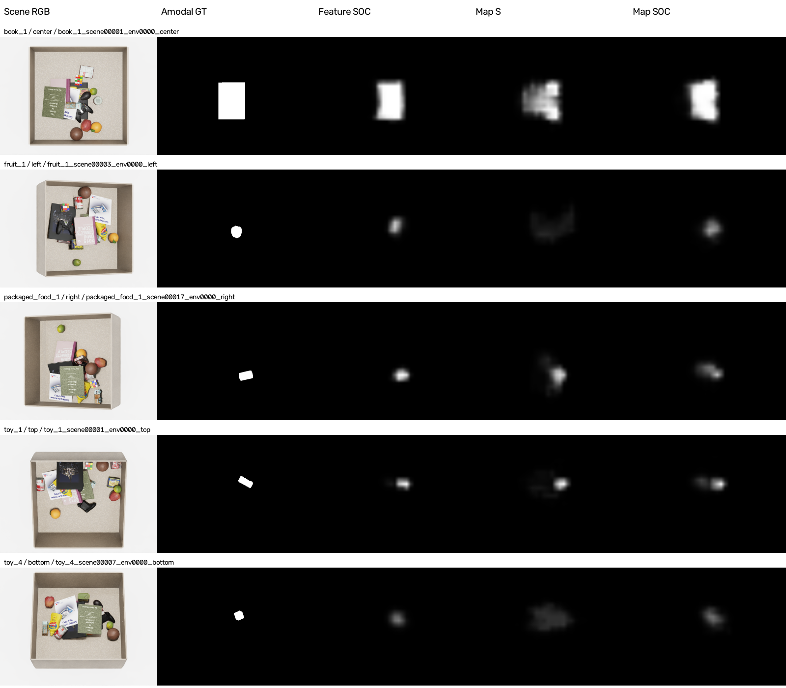

# 실제 점수 지도 기반 Fusion 비교 — 2026-11-06

<!-- navigation:start -->
[전체 개요](README.md) · [Fusion](fusion_stream.md) · [Development Log](development_log.md) · [연구 문맥](agent.md#current-handoff-20261106)
<!-- navigation:end -->

> 공개 갱신: 2026-11-06. 기존 실행을 설명하는 보고서이며 새 실험이 아님. 최신 상태는 연구 문맥의 같은 날짜 인계를 우선함. 제거 우선순위 head와 새 행동 GT는 미실행 제안임.

각 stream의 최종 점수 지도만 받는 CNN fusion 학습·test와 동일32장면·5camera·4모델의640회 제거 비교를 완료함. S 지도만 사용하는 head와 S/O/C 지도 세 개를 사용하는 head를 새로 학습하고, 기존 중간 특징 기반 S/SOC head와 비교함. 지도 SOC는 지도 S보다 개선되지만 기존 특징 SOC보다 전체 위치 적중이 낮고 평균 제거도 많았음. 따라서 이번 지도 CNN으로 기존 모델을 교체할 근거는 없음. 아래 정적 위치 적중과 실제 제거 횟수는 별도 지표임.

## 정적 위치 예측 결과

| Fusion 입력 | Best epoch | 전체 amodal 최고점 적중 | 완전 가림 amodal 최고점 적중 | 실제 visible 최고점 적중 | Amodal mIoU |
|---|---:|---:|---:|---:|---:|
| 기존 S 특징 64채널 | 18 | 70.883333% (17,012/24,000) | 40.239863% (3,523/8,755) | 44.502790% (6,780/15,235) | 40.165282% |
| 기존 SOC 특징 192채널 | 10 | 85.058333% (20,414/24,000) | 70.359794% (6,160/8,755) | 41.450607% (6,315/15,235) | 50.920985% |
| 새 S 점수 지도 1채널 | 15 | 57.525000% (13,806/24,000) | 26.453455% (2,316/8,755) | 48.290121% (7,357/15,235) | 27.944527% |
| 새 SOC 점수 지도 3채널 | 7 | 73.633333% (17,672/24,000) | 54.220445% (4,747/8,755) | 42.579586% (6,487/15,235) | 38.169565% |

기존16종·5camera의 원래 test split임. 전체24,000장은 일부 가시15,235장·완전 가림8,755장·amodal GT가 빈10장으로 구성됨. 최고점 적중은 원시30×40 예측을 bilinear640×480로 확대한 뒤 가장 높은 한 점이 해당 GT 영역에 들어가는 비율임. 동점이면 행 우선 첫 점을 사용하고 GT/작업영역 마스킹을 하지 않음. Pixel accuracy·zero-shot·파지 성공률이 아님.

mIoU는 같은 확률지도에서0.5 이상인 영역과 native amodal GT의 영상별 IoU 평균임. GT와 예측 영역이 모두 비어 union이0인 영상은 원래 evaluator 규칙대로 제외함. 따라서 mIoU 분모는 표 순서대로23,991/24,000/23,990/23,994장임. 해당 제외는 최고점 적중 분모24,000장을 바꾸지 않음. 서로 다른 분모를 숨겨 동일한24,000장 평균이라고 쓰지 않음.

지도 SOC는 지도 S보다 전체 최고점 적중이16.108333%p 높음. 반면 기존 특징 SOC보다11.425000%p 낮고, 실제 가시부 적중은1.128979%p 높음. 지도 S의 가시부 적중48.29%가 네 모델 중 가장 높음. 전체 target 위치를 찾는 성능과 실제 보이는 부분에 최고점을 놓는 성능 사이의 차이가 유지됨.

이번 결과는 점수 지도만 결합하면 기존 특징 방식보다 좋아진다는 가설을 지지하지 않음. 점수 하나로 줄이는 과정에서 최종 target 예측에 필요한 정보가 줄었을 가능성은 있지만, 정보 손실을 원인으로 분리 검증한 것은 아님. CNN 자체가 무효하거나 attention이면 해결된다는 결론도 내리지 않음. 모든 비교 모델은 CNN이며 amodal GT는 다음에 제거할 방해물을 직접 감독하지 않음.

## 입력과 학습 방법

S20/O12/C19 및 DINOv3·SigLIP·MultiMAE의 parameter와 buffer를 모두 고정함. 한 장면의 단일 RGB-D와 기존 target reference로 세 stream을 계산하고, 원래 최종 출력층의 실제 숫자를 fusion에 전달함.

| 입력 | 실제 전달 값 | 처리 |
|---|---|---|
| S | sigmoid 출력, 0–1 | 원래 값 그대로 |
| O | sigmoid 출력, 0–1 | 원래 값 그대로 |
| C | softplus 출력, 0 이상 | 1보다 큰 값도 그대로 |

C는 확률이 아니며 train 캐시 최대6.333889, val5.558356, test5.607697임. C를6으로 나누거나1로 자르지 않음. PNG 밝기값·RGB 변환·영상별 정규화·GT/작업영역 마스크를 입력하지 않음. 중간64채널 특징 또는 RGB-D가 fusion head로 우회 전달되는 연결도 없음. 원본 FP32 점수 지도를 S/O/C 순서로 저장함.

S head는1×30×40, SOC head는3×30×40 입력을 받음. 두 구조 모두 `1×1 Conv → 64채널/GN8/GELU → 3×3 Conv64/GN8/GELU 두 층 → 1×1 Conv1`이며 마지막 sigmoid로 target 지도를 얻음. 학습 parameter 수는 S74,433/SOC74,561개임. 기존 특징 S/SOC는78,465/86,657개로 입력 projection 크기가 다르며, 공통 body/output/GN 초기값은 동일함.

- 기존 train192,000/val24,000/test24,000, seed0·FP32·batch16을 유지함. AdamW lr0.001/wd0.01·gradient clip5, epoch별 shuffle seed20261026+epoch, 최대20epoch·최소3epoch 이후 validation3회 연속 미개선 종료임.
- 기존 native640×480 amodal GT를16×16 평균한30×40 값에 BCEWithLogits를 적용함. 이전 S 특징 대조의 검증된 train/val GT 캐시를 읽기 전용으로 재사용하고 GT를 새로 만들지 않음.
- 각 head가 독립 optimizer·validation best·조기종료를 가짐. 지도 S는18epoch/best15, 지도 SOC는10epoch/best7임. Test 결과로 모델을 고르거나 조정하지 않음.
- 고정 stream 예측을 한 번 FP32로 저장하고 지도와 train/val GT를 GPU에 올려 반복 I/O를 줄임. 학습 minibatch16·샘플 순서·값은 유지함. 기존 특징 S는 특징 캐시, 기존 SO/SOC는 매epoch 특징 추출을 사용했으므로 계산 방식 차이를 명시함.
- Stream과 fusion은 동일 train pool로 순차 학습함. Fusion용 train 지도는 해당 train pool에서 학습한 stream의 예측이며, out-of-fold 예측을 사용하는 실험은 아님. Val/test를 gradient 학습에 사용하지 않음.
- 새 두 head의 test24,000장 예측을 모두 저장한 뒤 기존 evaluator로 GT를 읽고 평가함. Test GT는 캐시에 포함하지 않음.

## 시간·검증

2026-11-06 15:03:02–16:32:03 KST에 학습 pipeline을 완료함. 사전검사부터 test 평가까지89.03분, 고정 지도 준비74.10분, 두 head 학습·validation 누적9.57분임. 학습 시작부터 test 평가 종료까지는13.76분이며 제거 탐색 시간은 포함하지 않음. 새 지도 캐시는3,456,000,384bytes(약3.22GiB)이며 기존 GT 캐시를 복제하지 않음. 이 시간은 전체 데이터 준비·학습 실행시간이며 한 장면의 배포 추론속도가 아님.

사전 train80장의 원래 독립 stream 경로 대비 지도 최대차는 S0/O3.4571e-6/C0으로 허용오차를 통과함. FP32 디스크 저장과 GPU 재로딩이 exact이고, 두 update의 미세 GPU 차이는 기존 atol1e-5/rtol1e-4 안에 있음. 고정 모델 parameter/buffer 전후 동일을 확인함.

독립 CPU 검산에서 네 모델의24,000개 고유ID·순서·GT 크기·가시성 분류와 전체/카메라/target/가시성별 CSV 평균·분모를 대조함. 기존 및 새68개 Python source, 고정 checkpoint와 비교 모델·예측 hash 보존 PASS임. 기존 visible/amodal GT의 일부 픽셀 차이는 유지하며 새 정답 보정으로 결과를 바꾸지 않음. 단일 seed·서로 다른 validation best·입력 크기 차이를 포함한 비교로, 통계적 유의성·다양한 미학습 물체·실센서 성능이나 각 stream 의미 활용의 인과 증명으로 확대하지 않음.

## 실제 저장 예측

왼쪽부터 RGB / amodal GT / 기존 특징 SOC / 새 지도 S / 새 지도 SOC임. 원래 정한 동일5개 target/camera의 첫 test 행을 사용해 결과를 보고 고르지 않음. 모든 예측은 저장된 실제 target 확률의 고정0–1 grayscale이며 bilinear로 확대함. 정규화·작업영역 보정·합성 예측을 넣지 않음. 입력 C의 원시 점수 범위와 최종 target 확률의 표시 범위를 구분함. 샘플·파일 hash는 아래 audit에 있음.

## 제거 탐색 비교 — 완료

기존에 고정한16targets×서로 다른2장면의32물리배치에서 각5camera를 독립 시험함. 네 모델을 모두 이번 실행에서 다시 추론·제거했으며, 과거 특징 SOC 결과를 대신 넣지 않음. 정책당160회, 총640회이고640개의 독립 물리장면을 뜻하지 않음. 표의 S 모델도 최종 amodal GT로 학습한 head이며 과거 standalone similarity 지도를 바로 사용한 정책과 다름.

| Fusion 입력 | 성공/전체 | 성공 조건의 평균 방해물 제거 | 중앙값 | 제거 없이 target 선택 |
|---|---:|---:|---:|---:|
| 기존 S 특징64채널 | 155/160 (96.875%) | 2.129032회 | 2 | 37/160 |
| 기존 SOC 특징192채널 | 155/160 (96.875%) | 2.096774회 | 2 | 36/160 |
| 새 S 점수 지도1채널 | 155/160 (96.875%) | 2.516129회 | 3 | 37/160 |
| 새 SOC 점수 지도3채널 | 155/160 (96.875%) | 2.232258회 | 2 | 37/160 |

네 모델 모두 성공한155조건이 정확히 같음. 지도 SOC는 지도 S보다43조건에서 적게,95조건에서 같게,17조건에서 많이 제거하여 평균0.283871회(11.2821%) 감소함. 기존 특징 SOC와 비교하면17조건에서 적게,112조건에서 같게,26조건에서 많이 제거하여 평균0.135484회(6.4615%) 증가함. 기존 특징 SOC와 특징 S의 차이는 각각20/114/21조건, 평균0.032258회 감소에 그침. 이32장면에서는 정적 위치 적중 개선 폭이 제거 횟수 개선 폭으로 이어지지 않았음.

실패는 모두 원본부터 책 전체가 서랍 바닥 아래에 있던 `book_3_scene00005_env0031`의5camera이며 다른 실패는 없음. 원본 target mesh 최고점6.271mm가 floor10mm보다 낮다는 기존 검사 근거를 유지함. 이 장면을 교체하거나 분모에서 제외하지 않았고 모델 실패로만 귀속하지 않음. 평균은 성공한155조건만의 값이며 target 회수1행동은 별도임. 처음 target을 선택하면0제거로 기록함.

네 모델은 같은 초기pose·zero velocity에서 시작함. 같은camera의 초기 RGB를 사전 지정한 특징 SOC 환경 관측으로 공유하고 개별 렌더도 보존했으며 depth/ID는 exact 일치함. 첫 제거 이후에는 각 정책의 별도 물리장면임. 매관측 단일camera RGB-D와 독립 target reference만 모델에 넣고, 가시물체별 최대 점수가 높은 순으로 현재 visible/단독투영 면적이50% 이상인 첫 물체를 선택함. 배경·제거 불가능한 후보는 건너뛰고 예측 점수 threshold는 없음. Target이 선택되고 조건을 만족해야 성공이며, 방해물 제거 후 고정600 actual physics steps(5초)를 적용함. Simulator ID·가시율은 행동 연결과 제거 조건용으로 사용하며 실제 robot grasp 성공률은 아님.

실제 실행1028.51초(17.14분),2327관측·3187가시율 검사·1687방해물 제거를 기록함. 원시 점수 순위·마스크 면적·50% 조건·선택·종료·물리step·초기 공통입력 검산 PASS, PhysX 오류0임. 기존68개 Python source와 새 탐색5개 source, checkpoint 및 모든 고정 parameter/buffer 보존을 확인함. 별도 CPU 감사가640원본 episode와 CSV/전체·camera·target·동일조건 집계, 정확한 실패목록, 원래32선정 보존을 재검산해 PASS임. 모든step의 RGB-D/ID/pose/raw지도/선택·제거 로그,2327개 비교그림과640개 trajectory를 보존함.

코드는 제거 비교 실행 안내 (LOCAL: `<DEV_ROOT>/experiments/fusion_map_search_20261106/README.md`), 완료 근거는 [completion](docs/fusion_map_search_20261106.json), [행동 검산](docs/fusion_map_search_20261106.json), [독립 집계 검산](docs/fusion_map_search_20261106.json), [최종 수치](docs/fusion_map_search_20261106.json)임. 장면별 결과 색인 (LOCAL: `<DEV_ROOT>/outputs/fusion_map_search_20261106/full/report/index.html`)에서 각 trajectory·관측에 접근함.

## 판단과 다음 논의

현재는 기존 특징 SOC를 비교 기준으로 유지함. 원시 점수 지도만 결합하는 CNN으로 바꿔도 사용자가 기대한 제거 효율 개선은 확인되지 않았음. 다만 지도 SOC가 지도 S보다 개선되므로 O/C 입력을 추가하는 이득 자체가 없다는 주장도 맞지 않음. 두 입력을 함께 추가한 실험이므로 O와 C 각각의 기여를 분리한 결과는 아님.

다음 설계를 논의할 때는 최종 target의 위치를 잘 예측하는 목표와 다음에 제거할 물체를 잘 고르는 목표를 구분해야 함. 현재 amodal GT는 가려진 target 위치를 감독하며 어떤 방해물을 먼저 제거할지는 직접 알려주지 않음. 이번 비교는 이 목표 차이가 원인임을 입증하지는 않지만, 구조만 바꾸면 제거 효율이 좋아질 것이라고 가정할 근거도 주지 않음. 단일 seed·32배치·서로 연관된5뷰 결과이며 attention/gating의 우월성이나 각 stream의 의미를 활용했다는 인과 증명을 주장하지 않음. 추가 학습이나 GT 변경은 이번 작업에 포함하지 않음.

## 코드·근거

- 학습 실행 안내 (LOCAL: `<DEV_ROOT>/experiments/fusion_map_control_20261106/README.md`), [고정 protocol](docs/fusion_map_control_20261106.json), [사전검사](docs/fusion_map_control_20261106.json), [지도 캐시 완료](docs/fusion_map_control_20261106.json).
- [학습·test 완료](docs/fusion_map_control_20261106.json), [기존 특징 모델과 수치 비교](docs/fusion_map_control_20261106.json), [독립 CPU 검산·그림 manifest](docs/fusion_map_control_20261106.json).
- [S 지도 평가](docs/fusion_map_control_20261106.json), [SOC 지도 평가](docs/fusion_map_control_20261106.json). 각 평가 폴더의 `per_image.csv`가 영상별 수치이며 상위 run 폴더에 `best.pt`, `test_predictions.npy`, validation/test 예시가 있음.
- Protocol SHA256: `45e38136f13b878c039d33241754fa3b076a018b35523be920efa70479f77ad8`. 소스 snapshot·전체 history·재개 checkpoint는 같은 output에 보존함.

사용자 요청으로 보고서·수치·선택 그림을 공개함. 기존 GT·모델은 유지하고 실행 소스·checkpoint·전체 원시 배열은 LOCAL에 보존함.

<!-- navigation:start -->
[전체 개요](README.md) · [Fusion](fusion_stream.md) · [Development Log](development_log.md) · [연구 문맥](agent.md#current-handoff-20261106)
<!-- navigation:end -->
