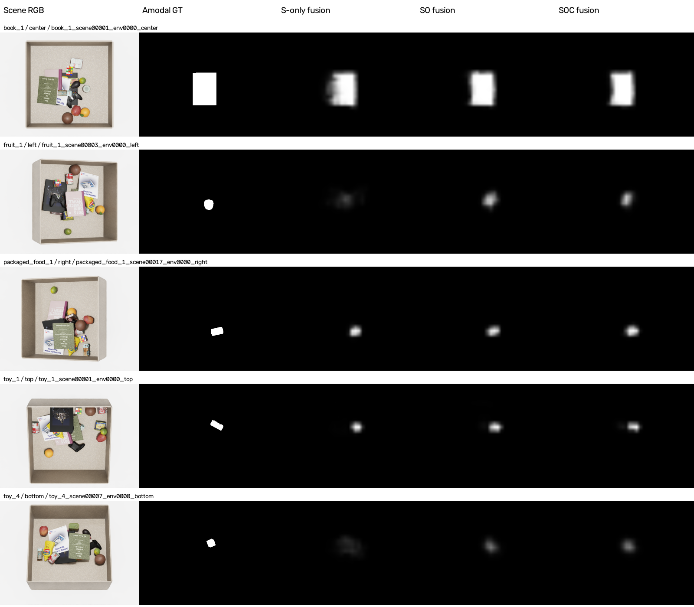

# S 단독 최종 target 감독 대조 결과 — 2026-11-06

<!-- navigation:start -->
[전체 개요](README.md) · [Fusion](fusion_stream.md) · [Development Log](development_log.md) · [연구 문맥](agent.md#current-handoff-20261106)
<!-- navigation:end -->

> 공개 갱신: 2026-11-06. 기존 실행을 설명하는 보고서이며 새 실험이 아님. 최신 상태는 연구 문맥의 같은 날짜 인계를 우선함. 제거 우선순위 head와 새 행동 GT는 미실행 제안임.

사용자가 승인한 첫 비교를 완료함. S20 특징만 받는 새 CNN head를 기존 SO/SOC와 동일한 amodal GT·split·학습 조건으로 학습함. 새 S head는20epoch 학습 후 validation BCE로 best18을 선택함. 완료 시각 2026-11-06T14:00:49.906861+09:00, 사전검사 재개부터 최종 완료까지 51.96분임. 최초 GPU roundoff 사전검사 실패는 제외하고 별도 보존함.

| 모델 | Best epoch | 전체 amodal 최고점 적중 | Amodal mIoU | 실제 visible 최고점 적중 | 완전 가림 amodal 최고점 적중 |
|---|---:|---:|---:|---:|---:|
| S 특징 + 최종 GT | 18 | 70.883333% (17012/24,000) | 40.165282% | 44.502790% | 40.239863% |
| S+O 특징 + 최종 GT | 20 | 82.758333% (19862/24,000) | 52.103077% | 39.789957% | 66.042262% |
| S+O+C 특징 + 최종 GT | 10 | 85.058333% (20414/24,000) | 50.920985% | 41.450607% | 70.359794% |

전체24,000장은 기존16종·5camera의 별도 test임. Visible 적중은 일부라도 보이는15,235장, 완전 가림 적중은8,755장 기준임. Amodal GT가 빈10장도 전체 분모에 포함함. 최고점은 원시30×40 확률을 bilinear640×480로 확대한 최고점 한 점이며, mIoU는 같은 확률>=.5와 원래 native amodal mask의 영상별 IoU 평균임. Pixel accuracy·zero-shot·새 제거 성공률이 아님.

## 해석

S-only에 최종 target GT를 학습해도 SOC의 전체 위치 적중을 재현하지 못함. SO는 S보다11.875%p, SOC는 S보다14.175%p 높음. 특히 완전 가림에서 S40.239863%→SO66.042262%→SOC70.359794%로 차이가 큼. 이번 조건에서는 추가 stream 특징을 제공한 head가 더 좋은 가려진 target 위치 예측을 보였으며, 최종 GT로 학습한 효과만으로 전체 성능을 설명할 수 없음.

반면 실제 보이는 target 부분 최고점은 S44.502790%로 SOC41.450607%보다3.052182%p 높음. Amodal GT는 target 전체영역을 감독하며 실제 가시부를 우선 선택하도록 강제하지 않음. 이 목적 차이와 관찰을 구분하고 구체적인 실패 원인은 확정하지 않음.

C를 추가한 SOC−SO는 최고점+2.30%p, mIoU−1.182092%p, visible 최고점+1.660650%p임. 세 stream의 의미를 모두 활용했다는 증명은 아니며, 단일 seed·서로 다른 validation best와 입력 projection parameter 수 차이가 있음. S/SO/SOC는78465/82561/86657 parameters, 나머지 공통 body/output 초기값·optimizer·batch순서·GT/evaluator는 동일함. 현재 CNN을 폐기하거나 균등 혼합 GT·attention을 채택할 근거로 확대하지 않음.

기존 네정책 제거 실험의 S는 원래 Similarity 지도 정책임. 이번 새 S-only fusion head가 아니므로 이전 S 평균3.9355회나 SOC2.1290회의 차이를 이번 head 비교 결과로 쓰지 않음. 이 정적 평가 완료 시점에는 새 S-only/SO 제거 실험 전이었음. 이후 소규모3head 및 전체32배치4head 비교를 완료했으며 최신 결과는 fusion_map_control_20261106.md를 따름. 현재 S/SO/SOC의4장면 비교와 특징 S/SOC·지도 S/SOC의32장면 비교는 완료됐음. SO까지 포함한 전체32장면 비교는 미실행임. 이 정적 S 대조 실행 자체에는 지도 fusion·gating·reference 교란·새GT 생성·외부물체평가를 포함하지 않았음. 이후 지도 fusion 비교 완료와 나머지 미실행 항목을 구분함.

## 조건·검증·근거

- Train192000/val24000/test24000, seed0·FP32·batch16, AdamW lr.001/wd.01·clip5, 원래 epoch shuffle seed20261026, 최대20·최소3 이후 validation3회 미개선 종료를 유지함.
- DINO/SigLIP/S20은 고정. 속도 절약을 위해 FP32 특징을 한 번 저장함. Cache preparation1888.4초, 실제 train+validation20epochs 약17.24분임. 캐시+train/val GT 약69.6GiB, 원본은 수정하지 않음.
- 사전80train영상의 기존 runtime 특징 최대차0, 배치 순서 변경 최대차2.8610e-6, 디스크/GPU입력 exact, 두 update는기존 atol1e-5/rtol1e-4 내 일치함. GPU 동일입력에서도 gradient 미세차이가 발생한 최초 실패는 history에 보존했으며 학습조건은 유지함.
- Test GT는 캐시하지 않았고24,000예측을 모두 저장한 뒤 기존 evaluator로 평가함. CSV24,000개고유ID·순서·GT/visibility와 지표 재계산이 SO/SOC와 대응함. 원래40개+새8개 Python source hash 유지 확인. Frozen parameter/buffer는 캐시 전후 동일함.
- 결과: `outputs/fusion_similarity_control_20261106/{completion,comparison,audit}.json`; 선택 모델: `runs/s/best.pt`; 모든 test 결과: `runs/s/evaluation/{evaluation.json,per_image.csv}`.
- 코드/재개: `experiments/fusion_similarity_control_20261106/README.md`; 규약·출처: output `protocol.json`, `source_snapshot/`; 실패 보존: `outputs/fusion_similarity_control_20261106_history/preflight_01_gpu_roundoff/`.

## 같은 test 장면의 실제 예측

원래 정한 동일5개 target/camera의 첫 test 행을 사용하며 성능으로 고른 사례가 아님. 모든 지도는 실제 저장 예측의 고정0–1 grayscale이고 GT/작업영역 마스킹이나 영상별 최대값 정규화를 하지 않음. S-only 열은 이번 최종 target GT로 학습한 새 head이며 기존 Similarity scalar 지도와 다름. Figure source/sample/hash는 `audit.json`에 보존함.

사용자 요청으로 이 보고서·수치·선택 그림을 공개함. 실행 소스·모델·전체 원시 배열은 LOCAL에 유지함.

현재 분모 주의: 기존 evaluator는 빈 union의 IoU를 제외하므로 S mIoU 유효23,991장, SO/SOC는24,000장임. 최고점 적중은 세 모델 모두24,000장임.

<!-- navigation:start -->
[전체 개요](README.md) · [Fusion](fusion_stream.md) · [Development Log](development_log.md) · [연구 문맥](agent.md#current-handoff-20261106)
<!-- navigation:end -->
