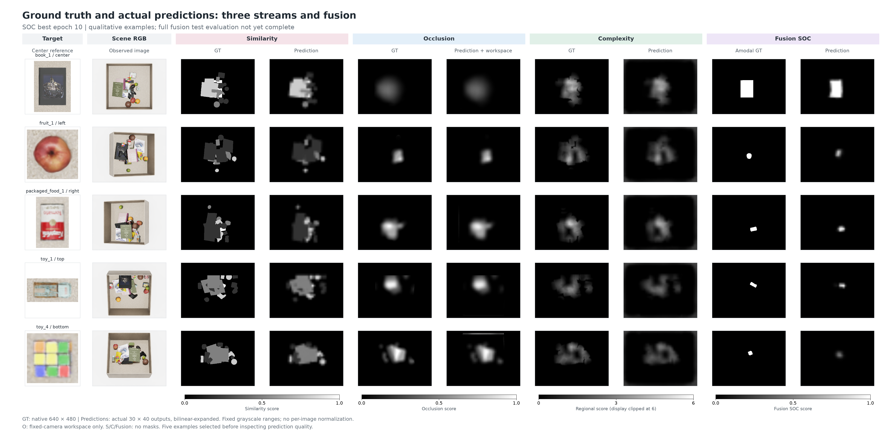

# Fusion — 고정 S/O/C 특징으로 amodal target 위치 예측

<!-- navigation:start -->
[전체 개요](README.md) · [Similarity](similarity_stream.md) · [Occlusion](occlusion_stream.md) · [Complexity](complexity_stream.md) · **Fusion** · [Framework Guide](framework_guide.md) · [Development Log](development_log.md) · [연구 문맥](agent.md#current-handoff-20261027)
<!-- navigation:end -->

> 2026-10-27 공개 snapshot: Step4 승인 후 fusion 구현·학습을 진행함. SOC는13epoch에서 조기 종료, best10의 실제 test 예시5장을 생성함. SO는epoch17 학습 중임. **전체24,000장 fusion test 평가·최종 성능%·SOC/SO 우열은 아직 확정되지 않음.** 최신 수치 근거는 [Fusion 학습 요약](docs/fusion_training_20261027_summary.json)임.

## 목적과 현재 확인 범위

Similarity는 찾는 target과 관련된 가시 영역, Occlusion은 해당 target의 가림 가능성, Complexity는 물체들이 가까이 모인 지역 점수를 다룸. Fusion은 이 세 모듈의 **마지막 지도 head 이전 특징**을 이용하여 실제 target의 전체 투영 영역을 예측하도록 학습함. 목표 정답은 보이는 부분과 가려진 부분을 모두 포함하는 amodal mask 한 종류임.

세 출력 지도 자체를 곱하거나 합산하지 않음. 각 특징의64채널을 연결한192채널을 작은 CNN으로 처리함. Attention/Transformer와 명시적인 GT/coverage gate는 사용하지 않음. 개별 점수 지도와 최종 위치 지도는 목표가 다르므로 stream의 높은 점수 영역 일치율을 fusion 위치 정확도로 읽지 않음.


[구조도 SVG](img/overall_architecture.svg) · [PDF](img/overall_architecture.pdf) · [재작성 지침](framework_guide.md) · [배치 JSON](framework_layout.json)

## 입력과 실제 계산 경로

추론 입력은 단일 scene RGB-D와 별도 target reference임. Scene segmentation·물체 pose·amodal GT·O coverage는 추론 입력이 아님. Target reference의 RGB·mask·text는 기존 S/O 전처리를 유지하고, Complexity에는 target 입력이 없음.

| 경로 | 현재 사용 모델 | Fusion 단계 상태 |
|---|---|---|
| Scene DINOv3 | 동일 RGB의 layer2/5/8/11을 한 번의 forward에서 공유 | Frozen |
| Similarity | 선택epoch20; target crop/mask pooling와 SigLIP image+text 조건 | Backbone·projection·matching·전체 파라미터 고정 |
| Occlusion | 선택epoch12; target 전체RGB 평균·reference geometry68·global FiLM | Depth CNN·FiLM·matching·BatchNorm 통계까지 고정 |
| Complexity | 선택epoch19; DINO RGB + RGB CNN + MultiMAE 관측depth | Encoder·projection·CNN·전체 파라미터 고정 |
| Fusion CNN | Seed0 새 초기화, 아래 구조 | 이 head만 학습 |

현재 공유 scene DINO는 실제 구현임. 단순히 같은 pretrained weight를 각 stream에서 따로 실행하는 설명과 구분함. Reference 특징은 scene과 별개로 기존 stream별 전처리로 준비함. 모든 고정 모듈은 eval/no_grad이며 파라미터뿐 아니라 buffer도 유지함.

```text
F_S [64,30,40] ─┐
F_O [64,30,40] ─┼→ concat [192,30,40]
F_C [64,30,40] ─┘
 → Conv1×1 192→64 + GroupNorm(8 groups) + GELU
 → Conv3×3 64→64 + GroupNorm(8 groups) + GELU
 → Conv3×3 64→64 + GroupNorm(8 groups) + GELU
 → Conv1×1 64→1 → logits [1,30,40]
 → sigmoid → target occupancy probability [1,30,40]
```

SO 비교 head는 C를 제외한128채널을 같은64채널 크기로 projection한 뒤 같은 구조를 사용함. SO/SOC의 공통 크기 body·output 초기값은 같은 seed로 맞추지만 입력 projection의 크기는 다름. 두 head의 optimizer·validation 선택·조기 종료는 독립적임. 현재 SO/SOC 비교는 학습 중이며 C의 추가효과를 확정한 결과가 아님.

## GT와 loss

기존240,000장의 native640×480 binary amodal GT를 그대로 사용함. 저장 pose와 target asset으로 얻은 전체 투영 mask이며 visible mask를 대체 정답으로 사용하지 않음. GT 파일·원본 데이터·공통 split은 이번 fusion 학습에서 변경하지 않음.

학습 정답은16×16 block 평균으로 계산한30×40의 점유율임. 예를 들어 한 셀의256픽셀 중64픽셀이 target이면 정답은0.25임. 경계 셀을 임의의 binary label로 바꾸지 않으며, 단순 공간 평균을 추가 label smoothing과 혼동하지 않음.

학습 loss는 모든 pooled 셀의 **동일 가중 BCEWithLogits 평균**임. Head는 logit을 반환하고 loss 안에서 안정적인 BCE를 계산함. 저장·표시할 때만 sigmoid를 적용함. Dice loss·전경 가중치·GT mask를 통한 예측 자르기는 사용하지 않음. Native640×480 비교 그림은 실제30×40 확률을 bilinear로 확대한 것이며 고해상도 decoder 출력이 아님.

## 학습 규약과 현재 상태

고정 split은 train192,000 / validation24,000 / test24,000임. 같은 target·scene의60환경·5뷰가 같은 split에 있어 뷰를 분리한 누설을 피함. 원래16개 물체가 split 전반에 존재하므로 unseen-target 학습 검증은 아님.

| 설정 | 값 |
|---|---|
| Fusion 초기화 | Seed0 새 head; 기존 S20/O12/C19 checkpoint 고정 |
| Batch / precision | 16 / FP32 |
| Optimizer | AdamW, learning rate0.001, weight decay0.01 |
| Schedule / gradient clip | 고정 learning rate / norm5 |
| 최대 epoch / 조기 종료 | 20 / 최소3epoch 이후 validation3회 연속 미개선 |
| 모델 선택 | 각 head의 전체 validation BCE 최저 |
| SOC 상태 | 13epoch·156,000updates 후 조기 종료 |
| SOC 선택 모델 | Epoch10, validation BCE **0.012314409569526712** |
| SO 상태 | Epoch17 학습 중인 snapshot |
| 전체 fusion test | 미완료; 최종 mIoU·위치 적중률%·비교 우열 미확정 |

Validation BCE는 모델 선택 손실이며 “정확도98.77%”처럼 변환할 수 없음. 선택epoch10이 실행epoch13보다 이른 이유는 마지막epoch가 아니라 validation 최저 checkpoint를 쓰기 때문임. 실행 중 상태는 계속 바뀌므로 이 표는 위 날짜의 기록이며 [요약 JSON](docs/fusion_training_20261027_summary.json)의 상태와 함께 읽음.

정식 평가는 두 head를 validation으로 선택한 뒤 모든 test 예측을 GT 없이 저장하고 별도 CPU evaluator가 GT를 읽도록 분리함. Native amodal IoU@0.5와 최고점의 amodal/visible 내부 적중률, camera·target·visibility별 결과 및 빈 집합 분모를 기록하도록 구현함. **평가 코드의 존재는 전체 평가 완료를 뜻하지 않음.**

## 실제 GT·예측 비교 — 같은 고정 test 5장

아래는10-26 S/O/C 그림에서 미리 선택한 동일 다섯 장면임. 좋은 fusion 결과를 골라 교체하지 않았으며, SOC best10으로 GT 없는 추론을 한 뒤 정답과 함께 표시함. 원래16종의 새 test scene에 대한 **정성 예시5장**이고, 외부 `packaged_food_5/World1` 80장 평가와 다른 자료임.



[비교 PDF](img/stream_fusion_gt_prediction_comparison_20261027.pdf) · [공개 asset manifest](img/framework_assets_20261027.json)

| Sample / camera | 전체 비교 | Amodal GT | 실제 SOC best10 예측 |
|---|---|---|---|
| book_1 / center | [비교](img/fusion_20261027_book_1_scene00001_env0000_center_comparison.png) | [GT](img/fusion_20261026_book_1_scene00001_env0000_center_gt.png) | [예측](img/fusion_20261027_book_1_scene00001_env0000_center_prediction.png) |
| fruit_1 / left | [비교](img/fusion_20261027_fruit_1_scene00003_env0000_left_comparison.png) | [GT](img/fusion_20261026_fruit_1_scene00003_env0000_left_gt.png) | [예측](img/fusion_20261027_fruit_1_scene00003_env0000_left_prediction.png) |
| packaged_food_1 / right | [비교](img/fusion_20261027_packaged_food_1_scene00017_env0000_right_comparison.png) | [GT](img/fusion_20261026_packaged_food_1_scene00017_env0000_right_gt.png) | [예측](img/fusion_20261027_packaged_food_1_scene00017_env0000_right_prediction.png) |
| toy_1 / top | [비교](img/fusion_20261027_toy_1_scene00001_env0000_top_comparison.png) | [GT](img/fusion_20261026_toy_1_scene00001_env0000_top_gt.png) | [예측](img/fusion_20261027_toy_1_scene00001_env0000_top_prediction.png) |
| toy_4 / bottom | [비교](img/fusion_20261027_toy_4_scene00007_env0000_bottom_comparison.png) | [GT](img/fusion_20261026_toy_4_scene00007_env0000_bottom_gt.png) | [예측](img/fusion_20261027_toy_4_scene00007_env0000_bottom_prediction.png) |

Fusion 예측은 공통0–1 범위의 grayscale이며 장면별 밝기 정규화를 하지 않음. GT는 native640×480이고 예측은30×40 확대임. O 그림에는 기존 camera workspace 표시 마스크를 적용하지만, fusion 추론 입력 feature나 최종 fusion 예측을 그 마스크로 자르지 않음. Amodal GT와 예측은 서로 다른 파일이며 정답을 예측으로 표시하지 않음.

## % 결과와 한계

[외부80장 개별 stream 평가](docs/stream_external_evaluation_20261027.json)의 같은 ROI 상위20% 영역 일치율은 S90.16% / O95.25% / C90.85%임. 각 stream의 서로 다른 GT에서 높은 영역을 선택하는 평가이고 fusion 위치 성능%가 아님. 특히 S의 visible query 최고점 적중률은2.5%이므로 관계 점수 일치율을 정확한 target 위치 발견률로 바꿀 수 없음. Fusion 전체 test 성능%는 아직 없음.

완전히 가려진 물체는 동일 RGB-D에서도 여러 숨은 배치가 가능하므로 단일 관측만으로 실제 pose가 유일하게 결정되지 않을 수 있음. Amodal 감독은 숨은 부분을 포함한 위치 학습 목표이지만 가림 아래의 정확한 위치를 항상 식별한다는 보장은 아님. 또한 amodal 최고점이 보이는 부분 또는 집기 가능한 점이라는 보장도 없음. Visible 적중률은 그 차이를 보는 진단이며 실제 집기·가림물 제거·DRL 탐색 성공률은 별도 미검증임.

현재 실제 fusion 예시는 원래16종·고정camera·합성관측 범위임. 새 물체에 대한 fusion 일반화·실센서·정책 효용을 확인하지 않았으며, SO/SOC test 비교 전에 “Complexity 때문에 성능이 좋아졌다”고 결론내리지 않음.

## 재작성·근거 안내

외부 독자는 [최신 인계](agent.md#current-handoff-20261027) → [학습 요약](docs/fusion_training_20261027_summary.json) → [Framework Guide](framework_guide.md) → [asset manifest](img/framework_assets_20261027.json) 순서로 읽음. 현재 그림은 한 장면의 RGB/depth/S/O/C/fusion 예측과 amodal GT를 함께 쓰며, feature64×3 연결과 실제 예측·GT를 구분함. 구조도에서 fusion을 미학습 점선 계획으로 되돌리지 않음.

LOCAL 근거는 개발 폴더의 `experiments/fusion_training_20261026/`, `outputs/fusion_training_20261026/{protocol,status,history}.json`, `runs/soc/best.pt`, `outputs/fusion_examples_20261027/{selection,prediction_complete,comparison_provenance}.json`임. 이들은 공개 clone에 전체 포함된 실행 패키지를 뜻하지 않음. 공개 내용은 설명·상태 요약·그림과 출처이며 원시 데이터·전체 trainer·weights를 모두 재현 릴리스한 것은 아님.

[전체 개요](README.md) · [Framework Guide](framework_guide.md) · [연구 문맥](agent.md#current-handoff-20261027)
