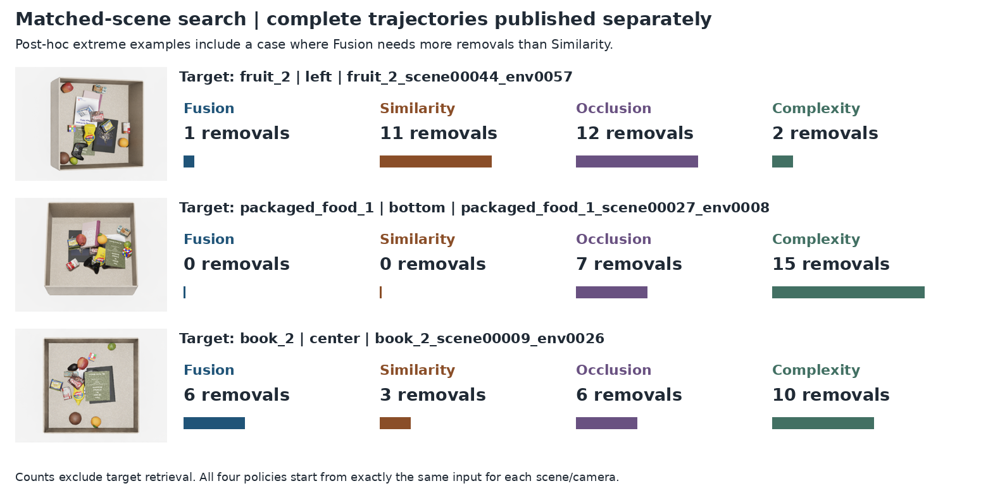

# Fusion — 고정 S/O/C 특징으로 amodal target 위치 예측

<!-- navigation:start -->
[전체 개요](README.md) · [Similarity](similarity_stream.md) · [Occlusion](occlusion_stream.md) · [Complexity](complexity_stream.md) · **Fusion** · [Framework Guide](framework_guide.md) · [Development Log](development_log.md) · [연구 문맥](agent.md#current-handoff-20261027)
<!-- navigation:end -->

> 2026-10-27 최신 결과: SOC는13epoch에서 종료됐고 validation으로 선택한 best10의 **기존16종 test24,000장 평가를 완료함. Amodal 최고점 적중률85.06%, 마스크 mIoU50.92%이며 실제 보이는 부분 최고점 적중률은41.45%임.** 서로 다른 지표이며 일반적인 pixel accuracy나 zero-shot 정확도가 아님. 이후SOC/SO공동학습·각test24,000장완료기록을확인함. 아래표의17:56:50상태는이전snapshot이며SOC–SO추가효과해석은이번네정책제거비교와구분함. [학습·진행 요약](docs/fusion_training_20261027_summary.json) · [SOC test 결과](docs/fusion_test_evaluation_20261027.json)

<a id="closed-loop-search-20261027"></a>
## 동일 scene의 반복 제거 평가 완료

기존 16개 물체의 별도 test 32장면을 5개 고정 camera에서 각각 독립적으로 평가하여 정책당 160회·총 640회 제거 탐색을 완료함. 한 episode의 입력은 해당 camera의 단일 RGB-D이며, 5뷰를 합친 입력이 아님. 네 정책 모두 155/160=96.875% 성공했고, 성공한 155조건의 집합도 정확히 동일함.

| 정책 | 성공/160 | 성공률 | 평균 제거 | 중앙값 | 초기 선택 성공 |
|---|---:|---:|---:|---:|---:|
| Fusion | 155 | 96.875% | **2.1290** | 2 | 36 |
| Similarity | 155 | 96.875% | **3.9355** | 3 | 36 |
| Occlusion | 155 | 96.875% | **7.7226** | 8 | 5 |
| Complexity | 155 | 96.875% | **6.0516** | 6 | 9 |

성공한 동일 155조건의 평균 제거 횟수는 Fusion 2.1290회로 Similarity 3.9355회보다 45.90% 적음. Fusion 평균은 5/5 camera에서 세 단독 stream보다 작음. S보다 적게/같게/많게 제거한 조건은 84/58/13임. 이 평균은 target 회수 동작을 제외하며 실패 회차를 성공으로 바꾸지 않음.

기존 16종·고정 5camera·한 seed·clean 합성 조건의 비교이며 zero-shot/실제 robot 파지 성공률이 아님. Simulator 물체 ID·가시율을 행동 연결과 가능 조건에 사용하므로 배포 segmentation 오류를 포함한 검증이 아님. SOC와 각 단독 stream의 비교만으로 Complexity의 추가 효과를 분리할 수 없으며, SOC–SO 비교 해석이 별도로 필요함.



전체단계그림·행동순서·카메라별수치·원본매몰scene의실패근거는 [제거탐색](closed_loop_search.md)에정리함. 각step은단일RGB-D→현재지도→물체별최대점수→가시율50%검사→제거→물리5초→새관측순서임. Target회수는평균에서제외함. 실패5회씩을포함한분모160을유지했으며정답물체ID/가시율은시뮬레이터행동판정에만사용함.

## 목적과 현재 확인 범위

Similarity는 찾는 target과 관련된 가시 영역, Occlusion은 해당 target의 가림 가능성, Complexity는 물체들이 가까이 모인 지역 점수를 다룸. Fusion은 이 세 모듈의 **마지막 지도 head 이전 특징**을 이용하여 실제 target의 전체 투영 영역을 예측하도록 학습함. 목표 정답은 보이는 부분과 가려진 부분을 모두 포함하는 amodal mask 한 종류임.

세 출력 지도 자체를 곱하거나 합산하지 않음. 각 특징의64채널을 연결한192채널을 작은 CNN으로 처리함. Attention/Transformer와 명시적인 GT/coverage gate는 사용하지 않음. 개별 점수 지도와 최종 위치 지도는 목표가 다르므로 stream의 높은 점수 영역 일치율을 fusion 위치 정확도로 읽지 않음.


[구조도 SVG](img/overall_architecture.svg) · [PDF](img/overall_architecture.pdf) · [재작성 지침](framework_guide.md) · [배치 JSON](framework_layout.json)

## 입력과 실제 계산 경로

추론 입력은 단일 scene RGB-D와 별도 target reference임. Scene segmentation·물체 pose·amodal GT·O coverage는 추론 입력이 아님. Target reference의 RGB·mask·text는 기존 S/O 전처리를 유지하고, Complexity에는 target 입력이 없음.

| 경로 | 현재 사용 모델 | Fusion 단계 상태 |
|---|---|---|
| Scene DINOv3 | 동일 RGB의 layer2/5/8/11을 한 번의 forward에서 공유 | Frozen |
| Similarity | 선택epoch20; target crop/mask pooling와 SigLIP image+text 조건 | Backbone·projection·matching·전체 파라미터 고정 |
| Occlusion | 선택epoch12; target 전체RGB 평균·reference geometry68·global FiLM | Depth CNN·FiLM·matching·BatchNorm 통계까지 고정 |
| Complexity | 선택epoch19; DINO RGB + RGB CNN + MultiMAE 관측depth | Encoder·projection·CNN·전체 파라미터 고정 |
| Fusion CNN | Seed0 새 초기화, 아래 구조 | 이 head만 학습 |

현재 공유 scene DINO는 실제 구현임. 단순히 같은 pretrained weight를 각 stream에서 따로 실행하는 설명과 구분함. Reference 특징은 scene과 별개로 기존 stream별 전처리로 준비함. 모든 고정 모듈은 eval/no_grad이며 파라미터뿐 아니라 buffer도 유지함.

```text
F_S [64,30,40] ─┐
F_O [64,30,40] ─┼→ concat [192,30,40]
F_C [64,30,40] ─┘
 → Conv1×1 192→64 + GroupNorm(8 groups) + GELU
 → Conv3×3 64→64 + GroupNorm(8 groups) + GELU
 → Conv3×3 64→64 + GroupNorm(8 groups) + GELU
 → Conv1×1 64→1 → logits [1,30,40]
 → sigmoid → target occupancy probability [1,30,40]
```

SO 비교 head는 C를 제외한128채널을 같은64채널 크기로 projection한 뒤 같은 구조를 사용함. SO/SOC의 공통 크기 body·output 초기값은 같은 seed로 맞추지만 입력 projection의 크기는 다름. 두 head의 optimizer·validation 선택·조기 종료는 독립적임. 두head의공동학습·test완료기록은확인했으며C의추가효과해석은별도로구분함. 이번제거탐색은SOC와단독S/O/C의네정책비교임.

## GT와 loss

기존240,000장의 native640×480 binary amodal GT를 그대로 사용함. 저장 pose와 target asset으로 얻은 전체 투영 mask이며 visible mask를 대체 정답으로 사용하지 않음. GT 파일·원본 데이터·공통 split은 이번 fusion 학습에서 변경하지 않음.

학습 정답은16×16 block 평균으로 계산한30×40의 점유율임. 예를 들어 한 셀의256픽셀 중64픽셀이 target이면 정답은0.25임. 경계 셀을 임의의 binary label로 바꾸지 않으며, 단순 공간 평균을 추가 label smoothing과 혼동하지 않음.

학습 loss는 모든 pooled 셀의 **동일 가중 BCEWithLogits 평균**임. Head는 logit을 반환하고 loss 안에서 안정적인 BCE를 계산함. 저장·표시할 때만 sigmoid를 적용함. Dice loss·전경 가중치·GT mask를 통한 예측 자르기는 사용하지 않음. Native640×480 비교 그림은 실제30×40 확률을 bilinear로 확대한 것이며 고해상도 decoder 출력이 아님.

## 학습 규약과 현재 상태

고정 split은 train192,000 / validation24,000 / test24,000임. 같은 target·scene의60환경·5뷰가 같은 split에 있어 뷰를 분리한 누설을 피함. 원래16개 물체가 split 전반에 존재하므로 unseen-target 학습 검증은 아님.

| 설정 | 값 |
|---|---|
| Fusion 초기화 | Seed0 새 head; 기존 S20/O12/C19 checkpoint 고정 |
| Batch / precision | 16 / FP32 |
| Optimizer | AdamW, learning rate0.001, weight decay0.01 |
| Schedule / gradient clip | 고정 learning rate / norm5 |
| 최대 epoch / 조기 종료 | 20 / 최소3epoch 이후 validation3회 연속 미개선 |
| 모델 선택 | 각 head의 전체 validation BCE 최저 |
| SOC 상태 | 13epoch·156,000updates 후 조기 종료 |
| SOC 선택 모델 | Epoch10, validation BCE **0.012314409569526712** |
| SO 상태 | 이후공동완료기록:20epoch·best20, test24,000장완료. 17:56:50의epoch18은과거snapshot |
| SOC 전체 test | Best10 고정, 24,000장 예측·평가 완료 |
| SOC/SO 공동 비교 | 공동학습·각test완료기록확인. 이번제거실험에는SO미포함, C추가효과해석별도 |

Validation BCE는 모델 선택 손실이며 “정확도98.77%”처럼 변환할 수 없음. 선택epoch10이 실행epoch13보다 이른 이유는 마지막epoch가 아니라 validation 최저 checkpoint를 쓰기 때문임. 실행 중 상태는 계속 바뀌므로 이 표는 위 날짜의 기록이며 [요약 JSON](docs/fusion_training_20261027_summary.json)의 상태와 함께 읽음.

원래 공동 실행은 두 head를 validation으로 선택한 뒤 두 모델의 모든 test 예측을 GT 없이 저장하고 CPU evaluator로 평가하는 순서임. 사용자의 SOC test 결과 요청에 따라 **이미 선택·종료된 SOC best10만 먼저 별도 평가**했으며, 이 시점 예외를 별도 protocol에 기록함. SOC24,000장 예측 저장 후 기존 evaluator가 GT를 읽었고 모델·threshold·GT·split을 바꾸지 않았음. 원래 공동 protocol과 학습source40개를 유지했으며 이 결과로 SOC/SO 모델을 선택하거나 튜닝하지 않음. SOC 단독 평가 완료와 원래 공동 실행 완료를 구분함.

## 실제 GT·예측 비교 — 같은 고정 test 5장

아래는10-26 S/O/C 그림에서 미리 선택한 동일 다섯 장면임. 좋은 fusion 결과를 골라 교체하지 않았으며, SOC best10으로 GT 없는 추론을 한 뒤 정답과 함께 표시함. 원래16종의 새 test scene에 대한 **정성 예시5장**이고, 외부 `packaged_food_5/World1` 80장 평가와 다른 자료임.


[비교 PDF](img/stream_fusion_gt_prediction_comparison_20261027.pdf) · [공개 asset manifest](img/framework_assets_20261027.json)

| Sample / camera | 전체 비교 | Amodal GT | 실제 SOC best10 예측 |
|---|---|---|---|
| book_1 / center | [비교](img/fusion_20261027_book_1_scene00001_env0000_center_comparison.png) | [GT](img/fusion_20261026_book_1_scene00001_env0000_center_gt.png) | [예측](img/fusion_20261027_book_1_scene00001_env0000_center_prediction.png) |
| fruit_1 / left | [비교](img/fusion_20261027_fruit_1_scene00003_env0000_left_comparison.png) | [GT](img/fusion_20261026_fruit_1_scene00003_env0000_left_gt.png) | [예측](img/fusion_20261027_fruit_1_scene00003_env0000_left_prediction.png) |
| packaged_food_1 / right | [비교](img/fusion_20261027_packaged_food_1_scene00017_env0000_right_comparison.png) | [GT](img/fusion_20261026_packaged_food_1_scene00017_env0000_right_gt.png) | [예측](img/fusion_20261027_packaged_food_1_scene00017_env0000_right_prediction.png) |
| toy_1 / top | [비교](img/fusion_20261027_toy_1_scene00001_env0000_top_comparison.png) | [GT](img/fusion_20261026_toy_1_scene00001_env0000_top_gt.png) | [예측](img/fusion_20261027_toy_1_scene00001_env0000_top_prediction.png) |
| toy_4 / bottom | [비교](img/fusion_20261027_toy_4_scene00007_env0000_bottom_comparison.png) | [GT](img/fusion_20261026_toy_4_scene00007_env0000_bottom_gt.png) | [예측](img/fusion_20261027_toy_4_scene00007_env0000_bottom_prediction.png) |

Fusion 예측은 공통0–1 범위의 grayscale이며 장면별 밝기 정규화를 하지 않음. GT는 native640×480이고 예측은30×40 확대임. O 그림에는 기존 camera workspace 표시 마스크를 적용하지만, fusion 추론 입력 feature나 최종 fusion 예측을 그 마스크로 자르지 않음. Amodal GT와 예측은 서로 다른 파일이며 정답을 예측으로 표시하지 않음.

## % 결과와 한계

### 기존16종의 별도 test24,000장

모든 카메라의 원시30×40 확률 지도를 bilinear로640×480에 확대하고 GT/workspace mask로 자르지 않은 상태에서 평가함. **최고점 적중률**은 영상마다 가장 밝은 한 점이 target GT 안에 들어간 영상 수의 비율임. 동점이면 행 우선 첫 위치를 사용함. **Amodal**은 가려진 부분을 포함한 target 전체 영역이며, **visible**은 현재 관측에서 실제로 보이는 부분임. **mIoU**는 확률0.5 이상인 예측 영역과 amodal GT의 교집합/합집합을 영상별로 계산한 평균임.

| 평가 조건 | 영상 수 | Amodal mIoU | Amodal 최고점 적중률 |
|---|---:|---:|---:|
| 전체 | 24,000 | **50.92%** | **85.06% (20,414/24,000)** |
| Target이 일부라도 보임 | 15,235 | 65.30% | 93.56% (14,254/15,235) |
| Target이 완전히 가려짐 | 8,755 | 25.96% | 70.36% (6,160/8,755) |
| 화면에 amodal 영역이 없음 | 10 | 0.00% | 0.00% (0/10) |

별도로, target이 보이는15,235장에서 최고점이 **실제 보이는 부분**에 들어간 비율은 **41.45% (6,315/15,235)**임. 보이는 장면의 amodal 적중93.56%는 가려진 부분에 최고점이 있어도 맞은 것으로 세므로41.45%와 다른 조건임. 따라서85.06%는 **전체 위치 최고점 적중률**로 표기하고 마스크 전체 정확도·보이는 표면 선택 성공률·집기 성공률로 확대하지 않음.

전체 mIoU의 유효 분모는24,000장이고 빈 합집합 제외는0장임. Camera별 amodal 적중은84.52–85.42%이지만 target별 편차가 있음. 예를 들어 book_1의 mIoU는89.57%, toy_4는14.89%임. 세부 camera·target·visibility 결과와 반올림 전 수치는 [전체 test JSON](docs/fusion_test_evaluation_20261027.json)을 따름. 이는 학습에 사용한16개 asset의 별도 장면 test이며 새 target의 zero-shot 결과가 아님.

기존 visible mask 중 amodal 밖에 있는 차이는4,321장 총8,566픽셀, 장당 최대107픽셀로 전체 visible 픽셀의0.040587%임. 원본 GT를 유지한 평가이며, 이 작은 전체 비율만으로 각 영상의 IoU 영향이 없다고 단정하지 않음. 앞선500장 GT 복원 검사가 전체 test의 픽셀 일치를 보장한다는 뜻도 아님.

### 외부 물체1종80장의 별도 진단

같은 SOC best10을 추가 학습 없이 packaged_food_5/World1에 적용했을 때 **보이는 target 최고점 적중은0/80=0.00%**임. 학습에서 본 category의 새 instance1개와 기존15개 물체가 섞인16layout×5뷰이며80장 모두 target이 일부 보임. 최고점은 book54/fruit2/packaged_food18/toy6의 가시 표면 위에 있었음. **외부80장의 amodal GT는 평가하지 않았으므로 amodal 적중0%나 IoU0%로 읽지 않음.** 가림 아래 target 영역에 최고점이 들어갔는지는 이 진단으로 판정할 수 없음. [외부 진단 JSON](docs/fusion_external_diagnostic_20261027.json)에 분모·camera/layout별 결과·checkpoint를 보존함.

[개별 stream의 외부80장 평가](docs/stream_external_evaluation_20261027.json)에서 공통 영역의 상위20% 선택 일치율은 S90.16% / O95.25% / C90.85%, S의 실제 target visible 최고점 적중은2.50%임. 이는 fusion 위치 적중률과 다른 지표임. 20%는 기존 평가에서 고정한 비율이며 최적값으로 검증한 것은 아님. 전체 유효 영역으로 재집계한 **GT 총량 대비 절대오차율**은 S9.59% / O12.39% / C9.34%이며 낮을수록 좋음. 이는80장 전체의 가중 절대오차 합/가중 GT 합×100으로, 100에서 빼서 정확도나 일치율로 쓰지 않음. 평가 영역·집계식은 [전체 영역 오차 JSON](docs/stream_full_map_error_20261027.json)을 따름.

완전히 가려진 물체는 동일 RGB-D에서도 여러 숨은 배치가 가능하므로 단일 관측만으로 실제 pose가 유일하게 결정되지 않을 수 있음. Amodal 감독은 숨은 부분을 포함한 위치 학습 목표이지만 가림 아래의 정확한 위치를 항상 식별한다는 보장은 아님. 또한 amodal 최고점이 보이는 부분 또는 집기 가능한 점이라는 보장도 없음. Visible 적중률은 그 차이를 보는 진단이며 실제집기·DRL성공률은미검증임. 고정규칙으로가림물을제거하는기존16종시뮬레이션비교는별도제거탐색절에제시함.

기존16종 test의 위치 적중과 외부1종의 visible 실패를 함께 유지함. 여러 새 물체·새 category·완전 가림 외부 target·실센서의 탐색 효용은 미검증임. 기존 16종의 SOC·단독 stream 제거 비교는 완료했으나, Complexity의 추가 효과는 SOC–SO 차이를 별도로 검토해야 함.

## 재작성·근거 안내

외부 독자는 [최신 인계](agent.md#current-handoff-20261027) → [학습 요약](docs/fusion_training_20261027_summary.json) → [Framework Guide](framework_guide.md) → [asset manifest](img/framework_assets_20261027.json) 순서로 읽음. 현재 그림은 한 장면의 RGB/depth/S/O/C/fusion 예측과 amodal GT를 함께 쓰며, feature64×3 연결과 실제 예측·GT를 구분함. 구조도에서 fusion을 미학습 점선 계획으로 되돌리지 않음.

LOCAL 근거는 개발 폴더의 `experiments/fusion_training_20261026/`, `outputs/fusion_training_20261026/{protocol,status,history}.json`, `runs/soc/best.pt`, `outputs/fusion_examples_20261027/{selection,prediction_complete,comparison_provenance}.json`임. 새 test와 외부 진단은 `outputs/fusion_soc_test_20261027/`, `outputs/fusion_external_check_20261027/`, stream 전체 오차는 `outputs/streams_full_map_error_20261027/`를 따름. 공개 JSON은 각 원본의 경로·hash와 수치·정의를 제공하며, 공개 clone에 원시 데이터·전체 trainer·weights를 모두 포함한 재현 릴리스는 아님.

[전체 개요](README.md) · [Framework Guide](framework_guide.md) · [연구 문맥](agent.md#current-handoff-20261027)
